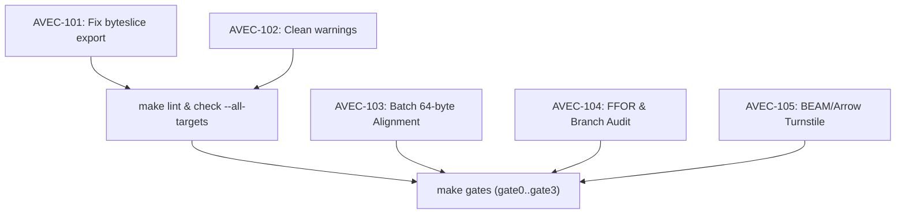

# AVEC Sprint v26.10.29 Jira Index

Master tracking index for issues discovered during the workspace-wide scan on release v26.10.29.
Derived from real repository state, compiler output, and gate verification ladders.

| Key | Summary | Component | Priority | Status |
|---|---|---|---|---|
| [AVEC-101](AVEC-101-byteslice-bench-export.md) | Export `byteslice` in `avec-parquet` to unbreak bench target | `avec-parquet`, `bench` | Blocker | OPEN |
| [AVEC-102](AVEC-102-workspace-lint-warning-hygiene.md) | Eliminate unused imports and compiler warnings across workspace | Workspace | Normal | OPEN |
| [AVEC-103](AVEC-103-batch-rectangular-alignment.md) | Steam Power: Multi-column RecordBatch with 64-byte alignment check | `avec-arrow` | High | IN PROGRESS |
| [AVEC-104](AVEC-104-ffor-fused-unpack-audit.md) | Transistor: Fused Frame-of-Reference (FFOR) kernel & branch audit | `avec-parquet`, `audit` | High | IN PROGRESS |
| [AVEC-105](AVEC-105-beam-arrow-dual-turnstile.md) | Alternating Current: Atomic dual-ownership turnstile for BEAM/C-ABI | `avec-beam`, `avec-ffi` | High | IN PROGRESS |

## Invariant Dependency Graph

