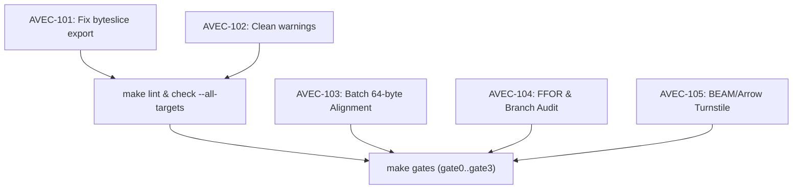

# AVEC Sprint v26.10.29 Jira Index

Master tracking index for issues discovered during the workspace-wide scan on release v26.10.29.
Derived from real repository state, compiler output, and gate verification ladders.

| Key | Summary | Component | Priority | Status |
|---|---|---|---|---|
| [AVEC-101](AVEC-101-byteslice-bench-export.md) | Export `byteslice` in `avec-parquet` to unbreak bench target | `avec-parquet`, `bench` | Blocker | RESOLVED |
| [AVEC-102](AVEC-102-workspace-lint-warning-hygiene.md) | Eliminate unused imports and compiler warnings across workspace | Workspace | Normal | RESOLVED |
| [AVEC-103](AVEC-103-batch-rectangular-alignment.md) | Steam Power: Multi-column RecordBatch with 64-byte alignment check | `avec-arrow` | High | RESOLVED |
| [AVEC-104](AVEC-104-ffor-fused-unpack-audit.md) | Transistor: Fused Frame-of-Reference (FFOR) kernel & branch audit | `avec-parquet`, `audit` | High | RESOLVED |
| [AVEC-105](AVEC-105-beam-arrow-dual-turnstile.md) | Alternating Current: Atomic dual-ownership turnstile for BEAM/C-ABI | `avec-beam`, `avec-ffi` | High | RESOLVED |
| [AVEC-106](AVEC-106-shm-oblivious-resbin.md) | High-Yield 80/20: POSIX SHM SPSC Ring, Oblivious Kernels & ResBin | `avec-beam`, `avec-parquet` | High | RESOLVED |
| [AVEC-107](AVEC-107-branchless-primitives-topology.md) | Canonical Branchless Execution Topology & Zero-Stall Primitives | Workspace | High | RESOLVED |
| [AVEC-108](AVEC-108-in-loop-branch-elimination.md) | In-Loop Conditional Branch Elimination & Invariant Verification | `avec-arrow`, `avec-parquet` | High | RESOLVED |
| [AVEC-109](AVEC-109-benchmark-parity-check.md) | Benchmark Parity & Performance Audit Post-Innovations | Workspace | High | RESOLVED |
| [AVEC-110](AVEC-110-phase-change-benchmarks.md) | Dedicated Release Benchmark Suite for Civilizational Phase Changes | `bench`, Workspace | High | RESOLVED |
| [AVEC-111](AVEC-111-metal-gpu-and-blake3.md) | Freestanding Apple Silicon Metal Unified Memory & Sovereign BLAKE3 Core | `avec-gpu`, `avec-arrow` | High | RESOLVED |

## Invariant Dependency Graph

