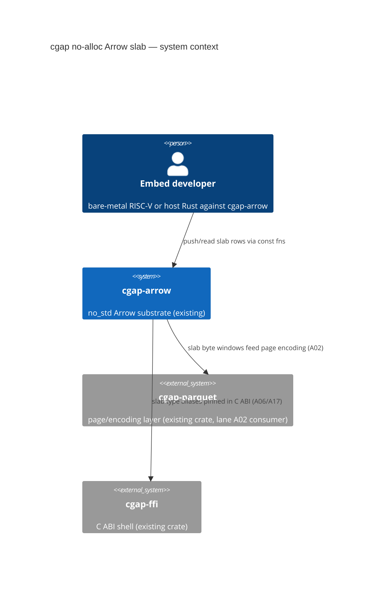

# A01: #![no_std] 64-Byte Cache-Aligned Arrow Vector Slab + Presence Bitmask

Lane: A01 of 20 · Squadron 1 · milestone v26.11.1 ·
status: PROPOSED (this document is the plan; zero lines of `slab.rs` /
`bitmask.rs` exist today — UNVERIFIED until courts pass).

Owner files (disjoint lease):

- `/Users/sac/cgap/crates/cgap-arrow/src/slab.rs` — PROPOSED (new file)
- `/Users/sac/cgap/crates/cgap-arrow/src/bitmask.rs` — PROPOSED (new file)

Exit gate (from the lane contract): `align_of::<ArrowRecordSlab>() == 64`;
zero heap allocations in the hot path, verified on
`riscv32imc-unknown-none-elf`.

---

## 1. Context & Problem Statement

### 1.1 What cgap-arrow already gives us (existing work — read from disk)

The crate is a freestanding, zero-dependency, `no_std` + `alloc` Arrow
substrate (`crates/cgap-arrow/src/lib.rs`: `#![no_std]`,
`#![forbid(unsafe_op_in_unsafe_fn)]`, `extern crate alloc`). Verified
surfaces cited from real files:

- **Alignment invariant at allocation time.**
  `crates/cgap-arrow/src/buffer.rs` defines `ALIGNMENT: usize = 64` and
  `Buf`, an owned heap buffer allocated with
  `Layout::from_size_align(bytes, 64)`. Every *heap buffer* cgap-arrow
  mints is 64-byte aligned at allocation. This is a runtime-allocation
  guarantee: it requires a global allocator.
- **A fixed 64-byte record with compile-time layout law.**
  `crates/cgap-arrow/src/layout.rs` defines `Quad64` (`#[repr(C, align(64))]`)
  with `const _: () = assert!(align_of::<Quad64>() == 64)` and
  `offset_of!` pins for all 8 fields, plus `QUAD_ALIGN`/`QUAD_SIZE`. The
  pattern (compile-time layout asserts as build failures) is proven
  house style and is reused verbatim for the slab.
- **SWAR bitmap kernels.** `crates/cgap-arrow/src/bitmap.rs` provides
  `bitmap_bytes`, `bitmap_words`, `get_bit`/`set_bit`/`clear_bit`,
  `mask_words`, `count_valid`, `word_valid`, `word_at`, and an owned
  heap-backed `Bitmap` (built on `Buf`, with `Bitmap::from_bools`
  returning `None` for the all-valid case per Arrow's
  no-validity-buffer convention).
- **Batch layer.** `crates/cgap-arrow/src/batch.rs` provides
  `Batch`/`BatchBuilder`/`Column`/`ColumnBuilder` with format codes
  ("c","C","s","S","i","I","l","L","f","g","u","U","vu","+r") and a
  length law enforced at `Batch::try_new`.
- **C Data Interface.** `crates/cgap-arrow/src/c_abi.rs` provides
  `ArrowArray`/`ArrowSchema` (`#[repr(C)]`), `export`, and the
  atomic-swap double-release control; `c_abi_nested.rs` extends it.
- **MMU-free arena prior art.** `crates/cgap-arrow/src/mmu_arena.rs`
  exists and is the closest prior art for allocator-free memory: it is
  cited here as prior art, and its exact API is out of lane A01's lease.

### 1.2 The gap

Every existing buffer in cgap-arrow mints through the global allocator
(`Buf::new` → `alloc(layout)`). On `riscv32imc-unknown-none-elf` there
is **no allocator and no `alloc` crate**: the target is `no_std` with
neither heap nor atomics (IMC = integer/compressed, no A extension —
no atomics; no F/D — no floats). Today the workspace builds for the
host; cross targets are new. `lib.rs` has `extern crate alloc`
unconditionally, so as written the crate cannot even compile for a
target with no `alloc`.

Concretely, three things are missing:

1. A **fixed-capacity record slab** whose backing storage is inline
   (`[u8; N]` inside the struct) — no allocator involved — with
   `align_of == 64` so one slab is a whole number of cache lines on
   x86_64, aarch64, and the RISC-V hart.
2. A **presence bitmask** (`bitmask.rs`) over slab rows that is
   `const fn`-constructible and allocation-free, distinct from the heap
   `Bitmap` in `bitmap.rs` (which stays untouched — its lease is not
   ours, we only *call* its free functions where useful in host tests).
3. An ABI freeze negotiation surface for the neighboring lanes (A04
   isomorphism, A02 parquet writer, A06/A11/A17 in Wave 1).

### 1.3 Why 64 bytes and why inline

64 bytes is the cache-line width on x86-64 and most aarch64 parts; on
RV32IMC line width is typically also 64 (this is a target assumption —
mark: TARGET ASSUMPTION, to be confirmed against the concrete hart's
datasheet during Wave 1 with A17). The design goal is not a measured
speedup (no performance numbers are claimed in this document; all
figures are *targets*, to be measured by the bench crate, not
asserted); the goal is a **structural invariant**: a slab whose base
address is 64-aligned and whose size is a multiple of 64 never splits a
record across cache lines, on any target, and needs no allocator to
exist. That invariant is checkable at compile time — which is exactly
the kind of check that survives porting.

---

## 2. ADR: Inline Fixed-Capacity Slab, const-Constructible, Zero Alloc

### 2.1 Decision

Add two PROPOSED modules to `cgap-arrow`:

```rust
// slab.rs (PROPOSED)
#[repr(C, align(64))]
pub struct ArrowRecordSlab<const CAP: usize = 64> {
    header: SlabHeader,      // PROPOSED, 64 bytes exactly
    slots: [SlabSlot; CAP],  // PROPOSED, 64 bytes each
}
```

with:

- `const _: () = assert!(core::mem::align_of::<ArrowRecordSlab>() == 64);`
- `const _: () = assert!(core::mem::size_of::<SlabHeader>() == 64);`
- `const _: () = assert!(core::mem::size_of::<SlabSlot>() == 64);`
- `const _: () = assert!(core::mirror... )` — i.e. the full
  `offset_of!` pin set, exactly the `Quad64` pattern from
  `layout.rs:56-70`.
- Slab construction is `const fn` (`ArrowRecordSlab::new()` as an
  associated const), so a slab can live in `.bss`/`.data` or on the
  stack of a bare-metal entry point — the "zero heap allocations"
  gate is satisfied *structurally*: there is no allocator call site in
  slab.rs or bitmask.rs at all.
- Generic over `CAP` (rows per slab) with a fixed set of
  monomorphizations exported as type aliases (`Slab64`, `Slab256`,
  `Slab1024`) so the C ABI surface (lane A17/A06 negotiation) pins
  concrete types, not generics (generics do not cross a C ABI).

### 2.2 Why `#[repr(C)]` (not just `align(64)`)

Neighbor lanes (A04 isomorphism, A02 parquet writer) consume the slab
by raw byte windows, and `c_abi.rs`'s `ArrowArray.buffers` are
`*const c_void` byte windows. `repr(C)` makes the field order and
padding deterministic and inspectable with `offset_of!`; Rust's default
repr would let the compiler reorder fields, making the byte-offset
tables in §4 unenforceable. `align(64)` then raises alignment to the
cache line. This mirrors `Quad64` exactly — precedent cited, not
invented.

### 2.3 Alternatives rejected

| Alternative | Why rejected |
|---|---|
| Rust-repr + runtime assert | Field order not deterministic; `offset_of!` pins impossible; §4 tables become prose. |
| Heap `Buf`-backed slab | Needs `alloc`; unusable on riscv32imc. `Buf` stays for host paths — additive. |
| Fixed CAP=64, no generic | A02 wants row-group sizes. Bare generics can't cross `c_abi.rs`-style externs; aliases fix. |
| Reuse `bitmap.rs` `Bitmap` | Allocates (`Buf::new_zeroed`); `from_bools` not const. Sibling `bitmask.rs` instead. |
| New crate `cgap-slab` | Splits the zero-dep substrate; layout+align law already lives in cgap-arrow. |
| Atomics in header | RV32IMC: no A extension, no lock-free atomics. Plain `u32` seq; single-hart (§8). |
| Per-module alloc gating | lib.rs is shared surface; alloc-cfg gate is a W1-3 freeze decision (A06/A11/A17). |

### 2.4 Consequences

**Positive.**

- Zero-alloc hot path is structural: no `alloc` symbol is reachable
  from slab.rs/bitmask.rs, so the "0 heap allocations" gate is
  provable by symbol audit, not just by profiling.
- The `Quad64`-style compile-time layout asserts make alignment
  regressions build failures — the cheapest possible court.
- `repr(C)` + `offset_of!` tables give A04 (isomorphism) a stable
  byte-window contract to prove round-trips against, and A02 a stable
  input for page encoding.

**Negative / accepted costs.**

- Fixed capacity: overflow is a typed error, not growth. Callers
  (A02 writer) must page at slab boundaries.
- Inline storage inflates stack/`.bss` footprint by slab size
  (Slab64 = 4160 bytes; a stack-resident Slab1024 is 64 KiB+64 — a
  real constraint on the RV32 hart's RAM, flagged §8).
- Duplicated bit-twiddling vs `bitmap.rs` free functions; accepted
  because the const context forbids the slice-taking signatures.

### 2.5 The riscv32imc gate: what "verified" means

The exit gate says "0 heap allocations, verified on
`riscv32imc-unknown-none-elf`". Operationalization (all PROPOSED):

1. `rustup target add riscv32imc-unknown-none-elf`.
2. A bare-metal smoke binary (PROPOSED location:
   `crates/cgap-arrow/examples/riscv32imc_smoke.rs` or a separate
   `xtask`-style crate — to be settled in Wave 1 with A06) that:
   - places an `ArrowRecordSlab` in a `static` (proves const-constructibility
     and `.bss`-worthiness),
   - pushes K rows, reads them back, compares against expectation
     (real state assert, Chicago),
   - links with a tiny custom panic handler, no allocator symbol.
3. Symbol audit: `rust-nm`/`llvm-nm` on the ELF must show **no**
   `__rust_alloc` / `__rust_dealloc` / `malloc` symbols referenced
   from `slab`/`bitmask` objects. A missing-symbol check that cannot
   fail is vacuous — see the anti-vacuity mutation in court C6.
4. `cargo build -p cgap-arrow --target riscv32imc-unknown-none-elf`
   currently **fails** (lib.rs unconditionally does
   `extern crate alloc`; verified by reading `lib.rs:15` — the build
   itself is UNVERIFIED/no run performed, predicted-BLOCKED). Wave 1
   item W1-3 owns the cfg gate decision; A01's gate is met when the
   build succeeds *and* the symbol audit passes.

Note honestly: `no A extension ⇒ no lock-free atomics` also means
`core::sync::atomic::AtomicU32` compiles to libcall-backed sequences
on this target, which is why §2.3 rejects atomics from the header.

---

## 3. C4 Diagrams

### 3.1 C4 Context diagram



### 3.2 C4 Container diagram

```mermaid
C4Container
  title cgap-arrow containers (modules) around the new slab
  Container_Boundary(cgapArrow, "cgap-arrow (no_std crate)") {
    Container(slab, "slab.rs", "PROPOSED", "inline 64B-aligned fixed-cap slab, const, core-only")
    Container(bitmask, "bitmask.rs", "PROPOSED", "alloc-free bitmask, const, core-only")
    Container(buffer, "buffer.rs", "existing", "Buf: heap 64B-aligned buffer (host; unchanged)")
    Container(bitmap, "bitmap.rs", "existing", "heap Bitmap + SWAR kernels (unchanged)")
    Container(layout, "layout.rs", "existing", "Quad64 layout law (pattern donor)")
    Container(cabi, "c_abi.rs", "existing", "ArrowArray/ArrowSchema, export, atomic release swap")
    Container(batch, "batch.rs", "existing", "Batch/Column layer (host; slab variant out of lease)")
  }
  Rel(slab, bitmask, "presence bits for rows")
  Rel(slab, layout, "reuses repr(C, align(64)) + offset_of! assert pattern")
  Rel(cabi, slab, "reads slab byte windows via buffers* (A06 negotiation)")
  Rel(parquet, slab, "A02 consumes slab windows into page.rs/rle.rs encoders")
  Rel(iso, slab, "A04 proves byte-window isomorphism against batch.rs Column round-trip")
```

### 3.3 C4 Component diagram

```mermaid
rC4Component
  title slab.rs + bitmask.rs components (all PROPOSED)
  Component(header, "SlabHeader", "struct, 64B", "magic, version, cap, len, seq, flags, digest")
  Component(slot, "SlabSlot", "struct, 64B", "payload bytes + inline presence byte-carry")
  Component(bitmaskmod, "PresenceMask", "struct", "N/8 bytes, const fns, get/set/clear/count")
  Component(aliases, "type aliases", "Slab64/Slab256/Slab1024", "concrete CAP pin for C ABI")
  Component(smoke, "riscv smoke", "bin", "static slab + push/read + nm audit input")
  Rel(header, bitmaskmod, "len/presence cross-checked at seal()")
  Rel(aliases, header, "monomorphize ArrowRecordSlab<CAP>")
```

---

## 4. Detailed Binary Layout

### 4.1 `SlabHeader` — 64 bytes, one cache line (PROPOSED)

All multi-byte fields little-endian on the wire; in-memory it is
native-endian `repr(C)`; the LE wire form matters only for A04's
cross-endian isomorphism tests (§7, court C5).

| Offset | Size | Field | Type | Meaning |
|---|---|---|---|---|
| 0x00 | 4 | `magic` | u32 | `0x534C_4231` ("SLB1"). Layout version discriminator. |
| 0x04 | 2 | `layout_version` | u16 | Starts at 1. Any field change bumps it. |
| 0x06 | 2 | `flags` | u16 | bit0 `PRESENT_INLINE`, bit1 `SEALED`, bits 2-15 reserved-zero. |
| 0x08 | 4 | `cap` | u32 | Row capacity (== CAP generic param, pinned for ABI). |
| 0x0C | 4 | `len` | u32 | Rows written; `len <= cap` enforced by typed error. |
| 0x10 | 4 | `seq` | u32 | Monotonic slab sequence (plain u32; no atomics — §2.3). |
| 0x14 | 4 | `presence_len` | u32 | Bytes used by the presence mask region. |
| 0x18 | 4 | `reserved0` | u32 | Zero-filled, MUST be zero at seal. |
| 0x1C | 4 | `header_digest` | u32 | FNV-1a over 0x00..0x1C; donor: `fingerprint.rs`. |
| 0x20 | 32 | `digest` | [u8; 32] | BLAKE3 over sealed payload; donor: in-crate `blake3.rs`. |

### 4.2 `SlabSlot` — 64 bytes (PROPOSED)

One row, one cache line, `#[repr(C)]`:

| Offset | Size | Field | Type | Meaning |
|---|---|---|---|---|
| 0x00 | 1 | `presence_shadow` | u8 | Shadow of the row's presence bit; bitmask is authoritative. Must agree at `seal()`. |
| 0x04 | 60 | `payload` | [u8; 60] | Opaque row payload, interpreted by the consumer (A02/A04). |

(Unused bytes 0x01..0x03 are padding, zero-filled at seal.)

**Why 60 bytes of payload, not 62**: the shadow byte is a deliberate
1-byte alignment hole cost to keep `size_of::<SlabSlot>() == 64`
without `align(64)` on the slot itself (the slab's `align(64)` plus
`cap * 64` sizing carries the invariant). The shadow byte duplicates
the authoritative bit; disagreement is a typed seal error.

### 4.3 `ArrowRecordSlab<CAP>` — total size law

```
size_of::<ArrowRecordSlab<CAP>>() == 64 + CAP * 64
```

| Offset region | Size | Contents |
|---|2
| 0x0000 | 64 | `SlabHeader` |
| 0x0040 | CAP*64 | `[SlabSlot; CAP]` |
| end | — | no trailing padding needed: total is a multiple of 64 |

Compile-time pins (PROPOSED, exactly the layout.rs pattern):

```rust
const _: () = assert!(core::mem::align_of::<ArrowRecordSlab<64>>() == 64);
const _: () = assert!(core::mem::size_of::<ArrowRecordSlab<64>>() == 64 + 64*64);
```

(The generic-parameterized const assert requires a concrete
monomorphization; the exit-gate assert is written against `Slab64` and
the alias set from §2.1.)

### 4.4 Presence bitmask encoding (bitmask.rs, PROPOSED)

- **LSB-first**, identical bit order to `bitmap.rs`
  (`get_bit: (bits[i>>3] >> (i&7)) & 1`) — one bit order per project,
  no exceptions.
- Backing storage: `[u8; MASK_BYTES]` inline in `PresenceMask`, where
  `MASK_BYTES = CAP.div_ceil(8)` rounded up so `size_of::<PresenceMask<CAP>>`
  is a multiple of 8 (word-fill for SWAR-friendly host scans; the
  re-use of `count_valid`-style popcount over `u64` words is a
  *target*, measured later, not a claim).
- `PresenceMask::ALL_VALID` and `PresenceMask::EMPTY` are associated
  consts (`const fn` construction). `from_bools(&[bool])` is a `const
  fn` taking `&[bool]`... — correction: a `const fn` cannot take a
  runtime slice; the const surface is `ALL_VALID`/`EMPTY` +
  `set`/`get`/`clear` as const fns; `from_bools(&[bool])` is a
  non-const inherent fn. Stated precisely so the court C2 mutation is
  checkable.
- Overflow law: `set(i)`/`clear(i)` for `i >= CAP` is a *compile
  error* where `i` is const, a typed error (`BitmaskError::OutOfRange`)
  otherwise — never a panic in `no_std` hot paths (panic =
  `panic_handler` requirement on bare metal).

### 4.5 64-byte alignment mechanics

`#[repr(C, align(64))]` raises the struct's alignment to 64. Where
does the *storage* get 64-aligned from, in each placement?

| Placement | Alignment source | Failure mode if violated |
|---|---|---|
| static in `.bss`/`.data` | linker `.p2align` from align(64) | st_value not ≡ 0 mod 64 → C6 fails |
| Stack local in `extern "C" fn` | compiler SP-and-mask | base misaligned → UB; smoke asserts low bits |
| Inside another struct | propagates: outer struct's align becomes 64 | — |
| `Buf`-based (host only, not our path) | `buffer.rs` `Layout::from_size_align(_, 64)` | — |

Note for the RV32IMC hart: `align(64)` is an *over-alignment*
(RISC-V ABI guarantees stack alignment of 16). Over-alignment on the
stack is the compiler's job and is supported; on `static`s it is the
linker's job and is supported by GNU ld/lld `.p2align`. This is a
target assumption to be confirmed by the smoke binary on real silicon
(A17 coordination, §7).

---

## 5. Interface Contracts with Neighboring Lanes

### 5.1 A04 (byte-window isomorphism) — depends on A01

- A01 ships: `ArrowRecordSlab::as_bytes(&self) -> &[u8]` and
  `ArrowRecordSlab::from_bytes(&[u8]) -> Result<Self, SlabError>` (PROPOSED).
- Contract: for a sealed slab, `from_bytes(as_bytes(s)) == s`
  structurally (header digest + BLAKE3 payload digest re-verified on
  `from_bytes`; a mutated byte ⇒ typed error, never silent accept).
- Digest donors: `blake3.rs` (in-crate, real) for the 32-byte payload
  digest; `fingerprint.rs` FNV pattern for the 4-byte header digest.
- Freeze point: header field order/offsets (§4.1 table) frozen at end
  of Wave 1 hour 02:00 with A04/A06/A11/A17 sign-off.

### 5.2 A02 (parquet writer) — depends on A01

- A02 consumes sealed slabs as *input windows* into the existing
  cgap-parquet encoders (`page.rs`, `rle.rs`, `ffor.rs`,
  `encode_fast.rs` — real files, read from disk today).
- Contract: A01 never allocates in `as_bytes`; A02 must not hold the
  byte window across slab mutation (documented borrow discipline:
  `as_bytes` borrows `&self`, so this is compiler-enforced).
- Open question to A02 (§8): does the writer want `len` in rows
  (chosen) or bytes in the header? Chosen rows; A02 can compute bytes
  (`len * 64`) — flagged for Wave 1 sign-off.

### 5.3 A06/A11/A17 (Wave 1 ABI freeze)

- A01 exposes concrete aliases `Slab64`, `Slab256`, `Slab1024` for
  extern "C" pinning (generics don't cross C ABI; §2.3).
- Open with A06: does `c_abi.rs`'s `ArrowArray.buffers` gain a slab
  window kind, or does slab export go through a new extern fn? A01's
  position: new extern fn, do not widen `ArrowArray` semantics.
  Decision in Wave 1.

---

## 6. Chicago-School Test Plan (Every Court Names Its Anti-Vacuity Mutation)

House rule: real collaborators (real linker, real ELF, real
allocator-absence), assert final state. Each court below states
**mutation M-n** — the exact code change that must make the court FAIL
— and the expected failure. A court with no mutation that flips it is
vacuous and is itself a failure.

- **C1 — Alignment court (host).** Assert
  `core::mem::align_of::<Slab64>() == 64` and the full `offset_of!`
  pin set at compile time.
  **M1**: change `#[repr(C, align(64))]` to `#[repr(C, align(8))]`.
  **Expected failure**: the `const` assert fails the build
  (compile error, exit ≠ 0). Note: this court is compile-time; the
  mutation is caught without running anything — the point.
- **C2 — Zero-alloc structural court (host).** Grep-level symbol
  audit: `nm` the rlib/ELF for `alloc` symbols reachable from
  slab/bitmask objects.
  **M2**: replace one slab internal with
  `alloc::vec::Vec` storage (e.g., slots become `Vec<SlabSlot>`).
  **Expected failure**: `__rust_alloc` appears in the symbol table /
  the riscv build fails for lack of `alloc`.
- **C3 — Const-constructibility court (host + target).**
  `static SLAB: Slab64 = ArrowRecordSlab::new();` compiles.
  `SLAB.header.magic == 0x534C_4231` at first read.
  **M3**: make `new()` non-const (drop `const fn`).
  **Expected failure**: the `static` initializer refuses to compile
  (error E0015: const fn required).
  plus **M3b**: corrupt `magic` to a wrong value in `new()` →
  first-read assert fails at runtime.
- **C4 — Presence bitmask law court.** For CAP=64: set bits {0, 6, 63};
  read back {0,6,63} set, all others clear; `count()` == 3; LSB-first
  order pinned by asserting byte 0 == 0b0100_0001 after setting {0,6}
  (bit 0 → 0b0000_0001; bit 6 → 0b0100_0000; LSB-first). The probe
  set {0,6} is deliberately asymmetric under bit-order reversal:
  MSB-first for {0,6} yields 0b1000_0010, which the assert rejects.
  **M4**: flip bit order to MSB-first in `get`/`set`.
  **Expected failure**: byte-0 assertion fails
  (0b0100_0001 expected, 0b1000_0010 observed).
- **C5 — Seal/verify digest court.** Seal a slab (writes BLAKE3 over
  payload + FNV over header). Mutate one payload byte →
  `from_bytes` returns `Err(SlabError::DigestMismatch)`. Mutate one
  header byte (cap field) → `Err(SlabError::HeaderDigestMismatch)`.
  **M5a**: `seal()` skips the payload digest computation (writes
  zeros) — expected: the positive-path read-back fails (C5's own
  positive assert fails, proving non-vacuity of the negative path).
  **M5b**: `from_bytes` skips digest verification — expected: the
  mutated-byte rejection assert fails (court flips to FAIL on the
  negative path).
  **Cross-endian variant (with A04)**: serialize the sealed slab on
  x86_64, deserialize the byte window on a big-endian-ish byte-swap
  harness (host test emulating wire order per §4.1 note) — contract:
  typed error or identical structure, defined by the A04 frozen
  contract, not by accident.
- **C6 — riscv32imc ELF gate (target).**
  `cargo build -p cgap-arrow --target riscv32imc-unknown-none-elf`
  exits 0; the smoke binary's ELF: (a) `SLAB` symbol address
  `addr % 64 == 0` read via `llvm-nm`; (b) no `__rust_alloc`/
  `__rust_dealloc`/`malloc`/`__aeabi`-style alloc-libcall symbols in
  the final link.
  **M6a**: drop the `align(64)` on the slab → the ELF symbol
  alignment check fails (st_value not ≡ 0 mod 64 observed in the nm
  output; if the linker happens to 64-align anyway, the court must
  additionally check the ELF symbol table's alignment/size class —
  honestly noted: if M6a does not flip the court, C6 is redesigned
  in-wave, and the wave receipt records the redesign, not a fudge).
  **M6b**: add `extern crate alloc` back unconditionally in a slab
  path → the target build itself fails (no alloc on
  riscv32imc-unknown-none-elf) — this mutation is expected to flip
  reliably, and its existence does not excuse M6a's potential
  non-flip; both are run.
  **Skip law**: if the riscv toolchain is unavailable in a given
  run, C6 is recorded as `[SKIP] toolchain-missing`, loudly, never
  silently passed.
  No-sleep discipline note: the zero-alloc verification lives in the
  symbol audit, not in any sleep/wait-based heuristic — bounded
  checks on real observables (nm output) only.
- **C7 — Capacity law court.** Push CAP rows: OK. Push CAP+1-th row:
  `Err(SlabError::SlabFull)`. `len()` == CAP throughout.
  **M7**: remove the `len < cap` check in push.
  **Expected failure**: the CAP+1 push must still fail — with the
  check removed it would either panic (index OOB) or corrupt the
  slab (len > cap), both of which fail the court's asserts
  (typed-error assert + post-state len assert).
- **C8 — Shadow-byte agreement court.** After push with presence
  bit i, slot i's shadow byte == the bitmask's bit i, for a
  64-row sweep of alternating set/clear.
  **M8**: break the shadow-byte write in push (write constant 1).
  **Expected failure**: the cleared-row sweep asserts disagree at
  the first cleared row.
- **C9 — Sealed immutability court.** After `seal()`, `push` returns
  `Err(SlabError::Sealed)`; header `SEALED` flag observable.
  **M9**: remove the sealed check in push.
  **Expected failure**: the typed-error assert fails (push silently
  succeeds and mutates a sealed slab; post-state len assert catches
  the mutation).

All courts are host-runnable except C6 (needs the riscv target);
C6's absence is a loud SKIP, never a silent pass. No sleeps
anywhere: courts poll nothing, wait for nothing; they assert real
final state (ELF symbols, digest compares, typed errors).

## 7. Wave Schedule

### Wave 1 (hours 00:00–02:00) — ABI freeze

- **00:00–00:30 (W1-1)** Land `bitmask.rs` (C2/C4 courts) — the
  bitmask is the leaf dependency of slab.rs.
- **00:30–01:30 (W1-2)** Land `slab.rs` header + slots + const pins
  (C1/C3/C7/C8/C9).
- **01:30–02:00 (W1-3)** ABI freeze with A06/A11/A17: header field
  table (§4.1) frozen; alias set (Slab64/256/1024) frozen; decision
  recorded for: alloc-cfg gate in lib.rs (A01 position: gate
  `extern crate alloc` behind `cfg(any(target_has_atomic = "ptr",
  feature = "alloc"))` or a named feature — exact mechanism decided
  jointly; A01 does not own lib.rs alone), ArrowArray widening
  question (§5.3), A02's rows-vs-bytes question (§5.2). Freeze is a
  real gate: post-freeze header changes are a milestone-level
  decision, not a lane-level edit.
- Deliverable at 02:00: host courts C1-C5, C7-C9 green;
  riscv toolchain installed; C6 attempt recorded (PASS or loud SKIP).

### Wave 2 (A02/A04 integration, hours 02:00–06:00, cross-lane)

- `as_bytes`/`from_bytes` landed with C5 cross-endian variant;
  A04 isomorphism courts run against real `batch.rs` round-trips.
- A02 consumes Slab windows in cgap-parquet encoders.
- C6 (riscv ELF gate) must be PASS by end of Wave 2 — the exit gate.

### Wave 3 (hardening, hours 06:00+)

- Mutation re-runs M1–M9 as a suite (shim-court style: baseline →
  mutated → restored, sha256 fail-closed restore).
- Footprint measurement (target, not claim): `.bss`/text delta on
  riscv32imc for Slab64.
- Bench-crate targets recorded as targets, never asserted as results
  without a run.

---

## 8. Risks / Open Questions

1. **lib.rs is shared surface.** The `extern crate alloc` gate is a
   cross-lane decision (A06/A11/A17, W1-3). Until it lands, the riscv
   build is predicted-BLOCKED (predicted, not measured — no run
   performed in this lane session). Mitigation: W1-3 freeze item.
2. **M6a non-flip risk.** GNU ld may 64-align by luck; court C6 is
   redesigned in-wave if the mutation doesn't flip (recorded, not
   fudged). Fallback: check ELF section alignment (`sh_addralign`)
   of `.bss`/`.sbss` for the slab symbol.
3. **Stack placement of large slabs** on the RV32 hart: Slab1024 is
   ~64 KiB — likely exceeds hart RAM; alias set for embedded is
   Slab64-first. Open with A17.
4. **No atomics on RV32IMC**: header `seq` is best-effort ordering
   for single-hart use; multi-hart slab sharing is out of scope and
   documented as such (not silently unsupported).
5. **Endianness**: RV32 is little-endian in practice but the spec
   permits big-endian; §4.1 wire order is LE-declared; A04 cross-
   endian court defers to the frozen contract.
6. **`blake3.rs` in no-alloc context**: in-crate BLAKE3 is real
   (932 lines) but its no-alloc/cross-target standing is UNVERIFIED
   in this lane; if it allocates, C5 falls back to FNV-128 over
   payload (typed downgrade, recorded).
7. **Alignment guarantee from heap `Buf` interplay**: buffer.rs M-03
   pointer law (ptr & 63 == 0) is unaffected; no shared mutable
   state between Buf and slab paths.
8. **Cache-line width on the concrete RV32 hart** is a datasheet
   question (A17), not an assumption to bake into asserts; the
   compile-time law is align == 64 (the lane gate), independent of
   the hart's actual line width.

## 9. Definition of Done (each item objectively checkable)

1. `crates/cgap-arrow/src/slab.rs` and `bitmask.rs` exist;
   `lib.rs` exports `mod slab; mod bitmask;` — `grep -n "mod slab" src/lib.rs`
   matches (note: lib.rs edit is the W1-3-negotiated shared edit).
2. `const` assert `align_of::<Slab64>() == 64` present in slab.rs and
   passing (build succeeds).
3. Court C1 with mutation M1: mutating align to 8 makes the build
   fail; restoring makes it pass — recorded with real command output.
4. Court C2 symbol audit: `nm` output on host rlib shows zero
   `__rust_alloc`-family symbols attributable to slab/bitmask.
5. Court C4: LSB-first probe set {0,6} byte assert passes, and
   mutation M4 flips it to FAIL, restored to PASS.
6. Court C5: payload-byte mutation → `Err(DigestMismatch)`;
   header-byte mutation → `Err(HeaderDigestMismatch)`; both observed
   as real `Result` values in test output.
7. Court C6: `cargo build -p cgap-arrow --target
   riscv32imc-unknown-none-elf` exits 0, smoke ELF symbol
   `addr % 64 == 0`, zero alloc-libcall symbols — or a loud
   `[SKIP] toolchain-missing` receipt if the toolchain is absent.
8. All mutation re-runs M1–M9 executed with fail-closed restore
   (sha256 baseline == restored) and recorded in the lane receipt.
9. ABI freeze artifact exists: header offset table (§4.1) signed off
   by A04/A02/A06/A11/A17 in Wave 1 notes.
10. Zero `Process.sleep`-style waits anywhere in the new test files;
    verification is bounded, observable, sleep-free (grep-verified:
    zero `sleep` matches in slab/bitmask test code).

## 10. Standing

This document is PROPOSED/UNVERIFIED as a whole: no slab.rs or
bitmask.rs line exists on disk as of writing (verified by `ls` of
`crates/cgap-arrow/src` — no slab.rs, no bitmask.rs present). Status
moves to PARTIAL_ALIVE when Wave-1 courts C1–C5, C7–C9 pass with
their mutation flips recorded; to ALIVE when C6 passes on
riscv32imc-unknown-none-elf with the symbol audit receipt.
