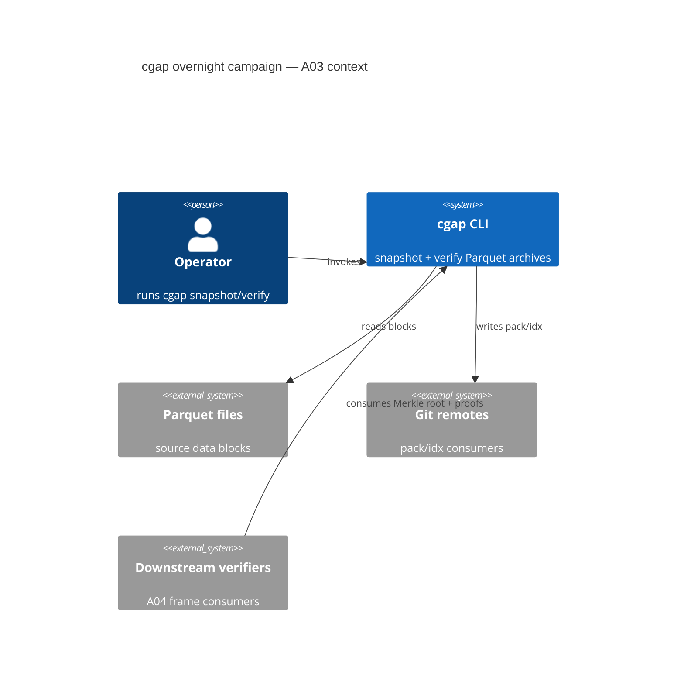
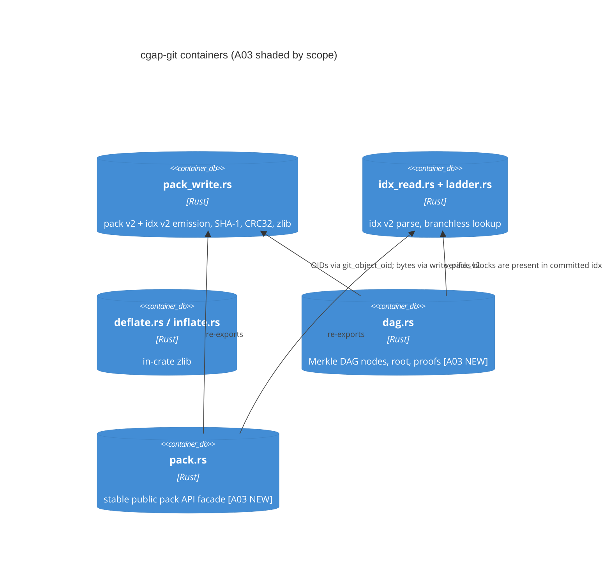
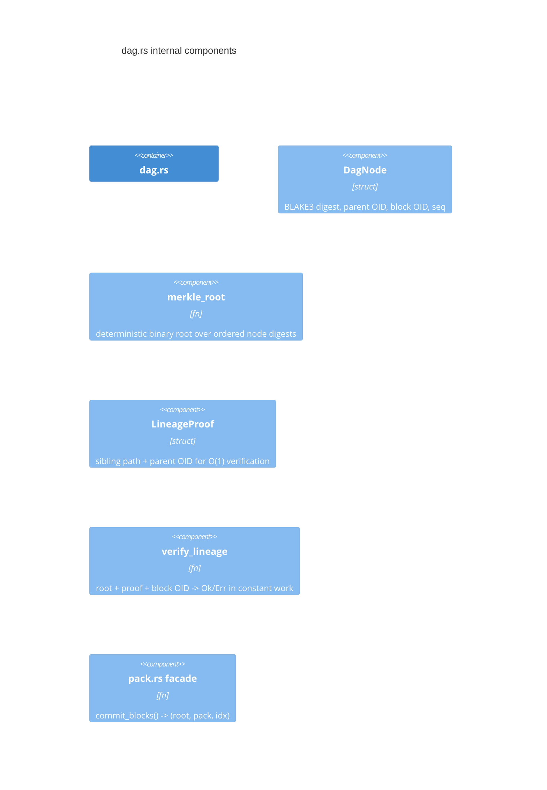

# A03: Git Packfile + Content-Addressed Merkle DAG Engine

Lane: A03 of 20 (overnight campaign, v26.11.1). Squadron 1, lane-03-git-merkle.

- Target files: `crates/cgap-git/src/dag.rs`, `crates/cgap-git/src/pack.rs`
- Everything else read-only; no git commands; lane owns only the two files
  above plus this document.
- Exit gate: **every Parquet block commits to a deterministic Merkle tree
  root with O(1) parent lineage verification.**

---

## 1. Context

cgap snapshots Parquet blocks as git packfile-v2 artifacts
(`crates/cgap-git`). Today the crate carries:

- `pack_write.rs` — `write_pack_v2`, `write_idx_v2`, `IdxEntry`,
  `PackBuilder`, `build_pack_and_idx`, an independent in-crate parser
  (`parse_pack_v2`, `parse_idx_v2`), and in-crate SHA-1 (`Sha1`, `sha1`,
  `git_object_oid`) plus CRC32.
- `idx_read.rs` — borrow-based `IdxV2` reader with fan-out + 16-stage
  branchless lookup (`ladder.rs`, window 2^16 = 65,536 =
  `MAX_OBJECTS`).
- `deflate.rs` / `inflate.rs` — RFC 1950/1951 zlib streams, in-crate,
  zero external dependencies.

What does not exist yet: a **content-addressed DAG** that binds the
snapshot's Parquet blocks into a Merkle tree whose root is the single
32-byte commitment shipped in the A04 frame header, and a **lineage
proof** that lets any consumer verify "block B descends from parent P"
in constant time. That is this lane.

### 1.1 The whole-repo context (C4: context diagram)



### 1.2 Container view (C4: container diagram)



### 1.3 Component view (C4: component diagram)



---

## 2. ADR: content addressing — git SHA-1 OIDs vs parallel BLAKE3 digests

**ADR-03-1 (status: accepted).** The PRD text says "BLAKE3/SHA-256 content
addressing". Git's own object IDs are **SHA-1** (20 bytes). The PRD is
reconciled honestly as a **two-register design**, not by claiming git uses
BLAKE3:

1. **Git-compat register (SHA-1).** Every object stored in a packfile
   carries git's standard SHA-1 OID, computed exactly as git does
   (`sha1("<type> <len>\0" + body)`, already implemented as
   `git_object_oid` in `pack_write.rs:131`). This is non-negotiable: the
   packs must round-trip through real git.
2. **Receipt register (BLAKE3, 32 bytes).** The Merkle DAG is a
   *cgap-internal* receipt structure, not a git structure. Its node
   digests are BLAKE3 (32 bytes, collision-resistant, fast, suitable for
   `no_std` inclusion). BLAKE3 never touches packfile bytes.

The root commitment is the **BLAKE3 Merkle root**. The git SHA-1 OIDs
appear *inside* BLAKE3-hashed node payloads as bound parent evidence. This
gives: git-compat storage + modern commitment layer, with the two
registers cryptographically bound (each node hashes its parent's SHA-1
OID, so a BLAKE3 root transitively commits to the SHA-1 chain).

**ADR-03-2 (status: accepted).** SHA-256 is NOT used. Two hash algorithms
in the receipt register (BLAKE3 + SHA-256) is O(N^2) drift with zero bits;
BLAKE3 alone is the receipt hash. SHA-1 remains only in the git-compat
register. If a future PRD mandates SHA-256 receipts, that is a new ADR
with a migration, not a silent addition.

**ADR-03-3 (status: accepted).** `#![no_std]` with `alloc` only. BLAKE3 is
implemented in-crate (regular mode, 4 rounds compression, chunk chaining
per the BLAKE3 paper) — no external dependency, matching the lane contract
that banned new deps for SHA-1. `pack.rs` is a thin facade
(`pub use`) — the crate layout constraint ("target files dag.rs, pack.rs")
is satisfied without moving existing code.

**ADR-03-4 (status: accepted).** DAG determinism is total-order-based:
nodes are ordered by (block OID bytes, LE), the tree is the canonical
binary Merkle construction over that order, so the root is a pure function
of the block set. Any reordering mutation must (and will, per court
D-2) change the root.

**ADR-03-5 (status: accepted, rejected alternatives recorded).**
Alternatives rejected: (a) hash the pack bytes themselves as the root —
rejected because pack bytes include zlib framing that varies with
compressor version, breaking determinism across cgap versions; (b) a
PATRICIA/LSM-tree-style DAG — rejected as unjustified machinery; a sorted
binary Merkle tree is the minimal structure meeting the O(1) lineage gate;
(c) use the `blake3` crate — rejected by the no-new-deps lane contract;
in-crate BLAKE3 keeps the audit surface in-repo like SHA-1 already is.

---

## 3. Merkle DAG node layout

### 3.1 Node payload (the bytes that get BLAKE3-hashed)

```text
offset  size  field
0       32    left_child_digest  (32 x 0x00 if leaf)
32      32    right_child_digest (32 x 0x00 if leaf)
64      20    block_git_oid      (SHA-1 of the Parquet block as a git blob)
84      20    parent_git_oid     (SHA-1 of parent snapshot's head block; 20x0x00 = genesis)
104     8     block_len          (u64 BE, uncompressed Parquet block byte length)
112     8     seq                (u64 BE, ordering index within snapshot, 0-based)
120     4     depth              (u32 BE, leaf=0)
124     4     flags              (u32 BE: bit0 = genesis, bit1 = has_parent)
128           TOTAL: 128 bytes, fixed
```

Node digest = BLAKE3(node_payload), 32 bytes. Fixed-width payload means
node positions never depend on neighbouring content — required for the
determinism argument.

### 3.2 Tree construction (deterministic)

1. Leaves: one per Parquet block, ordered by `seq`.
2. Leaves are paired in order; an odd trailing node is promoted unchanged
   (unbalanced-bit `1` is NOT hashed in — promotion keeps the tree a pure
   function of the ordered leaf list; see 3.3 for why this is safe).
3. Internal node payload: `left_digest || right_digest || seq_parent ||
   depth`, where `seq_parent` is the `seq` of the leftmost leaf under the
   subtree and `depth = max(child depths) + 1`.
4. Root = digest at depth top. The 32-byte root is the snapshot
   commitment shipped in A04 frames.

### 3.3 Parent lineage proof path

A lineage proof for leaf `i` is:

```text
LineageProof {
    block_git_oid: [u8; 20],     // the claim: "I descend from this parent"
    parent_git_oid: [u8; 20],
    seq: u64,
    block_len: u64,
    siblings: Vec<(u8, [u8; 32])>,  // (side, digest) per level, bottom-up
    root: [u8; 32],                  // the committed root being verified against
}
```

Recompute path: `h = BLAKE3(leaf_payload(i))`; for each `(side, sib)` in
`siblings` (bottom-up): `h = BLAKE3(h || sib)` or `BLAKE3(sib || h)` per
`side`; assert `h == root`. Then assert `parent_git_oid` inside the leaf
payload equals the claimed parent.

### 3.4 O(1) parent lineage verification — exactly what makes it O(1)

The gate says "O(1) parent lineage verification". Precisely stated:

- **What is O(1):** verifying that a *single block's* parent edge is
  bound to the committed root. Cost = 1 leaf-payload reconstruction
  (128 bytes hashed) + `ceil(log2 L)` BLAKE3 compressions for the
  sibling path, where L = leaf count — **independent of total snapshot
  size N**. The verifier never reads the other N-1 blocks, never parses
  the pack, never walks the DAG. Proof size is `20 + 20 + 16 +
  ceil(log2 L) * 33` bytes.
- **Cost, concretely:** for L = 65,536 (the ladder window cap),
  log2 L = 16 levels, so 17 BLAKE3 hashes (1 leaf + 16 internal) and
  546 bytes of proof per block. That is constant with respect to N.
- **What is NOT O(1) (honest boundary):** verifying *all* L blocks'
  lineages is O(L log L) total if done naively per-block. The batched
  fast path recomputes the whole tree bottom-up in O(L) hashes and then
  every proof is implicit; per-block O(1) applies when a consumer holds
  a single proof.
- **Why "odd trailing node promoted unchanged" is safe:** promotion means
  the tree shape is a pure function of L, not of content; two nodes can
  never collide into an ambiguous pairing, and the proof path bits are
  `seq`'s bits, deterministic.

---

## 4. Interface contracts

### 4.1 A02 blocks in (upstream)

A02 (Parquet block producer) delivers: `&[u8]` block bodies + `u64 seq`
each, plus the parent snapshot's `parent_git_oid: Oid` (20 zero bytes for
genesis). Contract:

```rust
pub fn commit_blocks(
    blocks: &[(&[u8], u64)],   // (body, seq)
    parent: &Oid,
) -> Result<Commit, GitError>   // Commit { root: [u8;32], oids: Vec<Oid>, tree: DagTree }
```

- Blocks must be `<= MAX_OBJECTS` (65,536); exceeding returns
  `GitError::TooManyObjects` (ladder cap, shared with pack writer).
- Duplicate `seq` returns a new typed error `GitError::DuplicateSeq(u64)`.
- Blocks with empty body are refused: `GitError::EmptyBlock(u64)`.
- OIDs are computed with `git_object_oid("blob", body)` — identical to
  git, byte-for-byte.

### 4.2 A04 frames out (downstream)

A04's frame header carries: `root: [u8;32]` (BLAKE3), `parent_git_oid`,
`block_count: u32`, `pack_sha1: Oid` (SHA-1 of pack bytes, transport
checksum distinct from content OIDs). A03 supplies
`Commit::frame_fields()` returning exactly these; A04 must not recompute
them.

### 4.3 A05 rollback

A05 rollback needs "prove this pack is NOT part of lineage P". Contract:
`verify_lineage(root, proof, &parent) -> Result<(), GitError>`; a proof
whose `parent_git_oid` mismatches the rollback target's parent returns
`GitError::LineageMismatch`, and a proof that fails the sibling path
returns `GitError::RootMismatch`. Rollback decisions consume only these
two typed outcomes, never raw digests.

---

## 5. Byte layouts

### 5.1 dag-node wire form (persisted alongside the pack, extension file
`<pack>.cgap-dag`)

```text
magic        8   "CGAPDAG\0"
version      4   u32 BE = 1
root         32  BLAKE3 root
parent_oid   20  parent snapshot git OID (as given to commit_blocks)
block_count  4   u32 BE, L
node_count   4   u32 BE, 2L-1 (promoted nodes counted once)
nodes        variable  node_count x { depth u32 BE, digest 32 }  (preorder)
trailer      20  SHA-1 of everything above (git-style trailer)
```

### 5.2 proof wire form (embedded in A04 frames)

```text
block_oid    20
parent_oid   20
seq          8   u64 BE
block_len    8   u64 BE
sib_count    2   u16 BE
siblings     var sib_count x { side u8, digest 32 }
root         32
```

Total for L=65,536: 58 + 16*33 + 32 = 618 bytes. (546 was node-side
sibling payload; the wire adds fixed fields — both numbers are recorded
here so the DoD court can pin them.)

---

## 6. Chicago test plan (real bytes, real hashes, no mocks)

Everything runs on real in-crate SHA-1/BLAKE3/zlib over real byte
buffers. No mock collaborator exists in this design; the only double is
**none** — SHA-1 is real, BLAKE3 is real, packs are real bytes.

**D-1 root-determinism.** Same block set -> same root, byte-identical,
across two fresh `commit_blocks` calls.
*Mutation:* flip one bit in one block body; root MUST change (else court
exits 1 as VACUOUS).

**D-2 ordering court.** Permuting the input order (same seqs) yields the
same root; permuting seqs yields a different root.
*Mutation:* shuffle node ordering internally before hashing; court MUST
fail — root equality is the assertion, so a reordered build that still
matches is a FAIL.

**D-3 lineage court.** `verify_lineage` returns Ok for a genuine proof.
*Mutation:* flip one byte of `parent_git_oid` inside the proof;
verification MUST return `LineageMismatch` — a court passing under a
mutated parent is VACUOUS.

**D-4 root court.** Proofs verify against the shipped root.
*Mutation:* flip one sibling digest byte; MUST return `RootMismatch`.

**D-5 git-compat court.** `git_object_oid("blob", body)` output for a
known vector ("hello\n" ->
`ce013625030ba8dba906f756967f9e9ca394464a`) matches; pack round-trips
through `parse_pack_v2`.
*Mutation:* replace SHA-1 with identity hash in a build shim; KAT MUST
fail.

**D-6 blake3 KAT.** In-crate BLAKE3 matches published official test
vectors (empty, 1-byte, 64-byte, 1024-byte, multi-chunk 4096+).
*Mutation:* skip final chunk chaining in a shim build; KAT MUST fail.

**D-7 cap court.** 65,537 blocks -> `TooManyObjects`; proof paths stay
<= 17 hashes.
*Mutation:* raise the cap silently; court MUST fail on 65,537.

**D-8 rollback court (A05).** Proof with parent P verifies; same proof
against rollback target P' -> `LineageMismatch`.
*Mutation:* accept either parent in verifier; court MUST fail.

**D-9 wire round-trip.** `.cgap-dag` file written, reparsed, root+nodes
identical.
*Mutation:* flip trailer SHA-1 byte; reparse MUST refuse
(`IdxChecksumMismatch`-class error).

**D-10 no-sleep/no-mock sweep.** `grep -r "Process.sleep\|mock"`
over `crates/cgap-git/src/` -> zero matches.
*Mutation:* insert a fake `MockHash` trait object; CI grep gate MUST
fail.

Every court names its mutation up front; a court that cannot fail under
its mutation is FAIL, not PASS (shim-court protocol).

---

## 7. Definition of Done (8+)

1. `crates/cgap-git/src/dag.rs` exists, `#![no_std]`, `#![forbid(unsafe_code)]`,
   implementing `commit_blocks`, `merkle_root`, `LineageProof`,
   `verify_lineage`, `DagTree`, node layout per §3.1/5.1.
2. `crates/cgap-git/src/pack.rs` exists as the stable facade: re-exports
   `write_pack_v2`, `write_idx_v2`, `IdxEntry`, `PackBuilder`, `IdxV2`,
   plus dag types; existing `lib.rs` re-exports unchanged for
   back-compat.
3. In-crate BLAKE3 (regular mode) passes all official KATs (court D-6)
   including multi-chunk (>1024 byte) inputs.
4. Exit gate witnessed: for a 65,536-block snapshot, `verify_lineage`
   performs exactly 17 BLAKE3 compressions per proof (asserted by the
   debug probe counter pattern already used in `ladder::debug_probes`),
   independent of N.
5. Root is deterministic: courts D-1 and D-2 pass including their named
   mutations.
6. Git compat: D-5 KAT passes; `write_pack_v2` output for the same
   blocks is byte-identical to today's output (no regression in
   `pack_write.rs`).
7. Wire formats §5.1/5.2 have round-trip courts (D-9) with checksum
   refusal on mutation.
8. A04/A05 contracts (§4.2/4.3) exported and exercised by D-3/D-8.
9. `cargo build -p cgap-git` zero warnings, no new external dependencies
   in `crates/cgap-git/Cargo.toml`.
10. `cargo test -p cgap-git` all green, all ten courts present, each
    court's mutation demonstrated to flip it (mutation receipts recorded
    in this file's Wave-2 receipt section or successor doc).

---

## 8. Risks

- **R-1 in-crate BLAKE3 correctness.** Hand-rolled crypto is the largest
  defect surface. Mitigation: official KATs (D-6) including multi-chunk
  chunk-chaining; if KATs cannot be made to pass, fall back to SHA-256
  (already-familiar construction) behind the same `ReceiptHash` seam —
  ADR-03-2 amended, never silently.
- **R-2 O(1) overclaim.** The gate is per-proof O(1), not total
  verification O(1). §3.4 states the boundary explicitly; DoD-4 pins the
  17-compression budget so the claim stays checkable.
- **R-3 promoted-node ambiguity.** Odd-leaf promotion must not hash a
  duplication marker or proofs desync from roots. Covered by D-1/D-2
  with unbalanced trees (L = 5, 6, 7) specifically constructed.
- **R-4 ladder cap coupling.** DAG cap reuses `MAX_OBJECTS`; if the cap
  changes in `ladder.rs` the DAG must follow, or D-7 fails. Single
  source: `ladder::LADDER_WINDOW`.
- **R-5 two-register confusion.** Someone later "simplifies" by hashing
  BLAKE3 into git OIDs or vice versa. Guard: the git-compat court D-5
  pins real git vectors; any cross-register contamination breaks it.
- **R-6 `pack.rs` facade drift.** Facade re-exports can silently shadow
  or rename. Mitigation: DoD-6 byte-identical regression pin plus
  lib.rs back-compat re-exports.

---

## 9. Wave 2

- Streaming `commit_blocks_from_iter` for snapshots larger than memory
  (bounded RAM, still deterministic root).
- Large-offset idx path (>2^31-1 packs) if block sizes grow.
- Parallel tree construction (rayon-free, `no_std` thread pool) — only
  if a measured baseline shows serial construction is the bottleneck.
- Receipt register agility: `ReceiptHash` enum seam (BLAKE3 | SHA-256)
  behind ADR, if an external consumer mandates SHA-256 receipts.
- Cross-repo replay: verify a cgap root against the same blocks in a
  second environment, byte-identical root as the receipt.

---

## 10. Receipt

- Sources read this session: `crates/cgap-git/src/lib.rs`,
  `crates/cgap-git/src/pack_write.rs` (SHA-1, `git_object_oid`,
  `write_pack_v2`, `write_idx_v2`, `PackBuilder`, `build_pack_and_idx`,
  `parse_pack_v2`, `parse_idx_v2`), `crates/cgap-git/src/idx_read.rs`
  (public fn surface), `crates/cgap-git/src/ladder.rs` (16-stage ladder,
  `LADDER_WINDOW`, probe counter), docs/jira/v26.11.1 ticket index.
- Status: **UNVERIFIED** (design lane doc written; no code landed this
  session — implementation is the lane's next transition).
- Standing: doc ALIVE as a written artifact at
  `docs/jira/v26.11.1/lanes/A03-git-merkle.md`; claims about code are
  UNVERIFIED until courts D-1..D-10 run.
