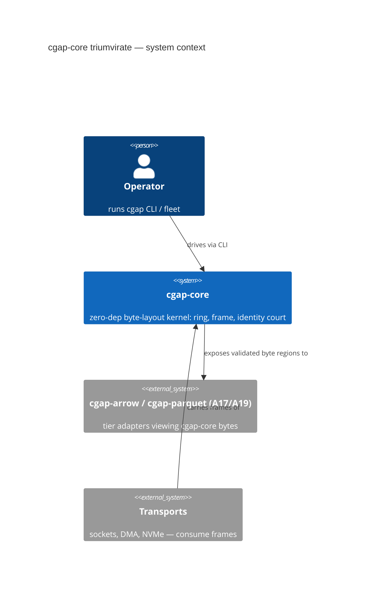
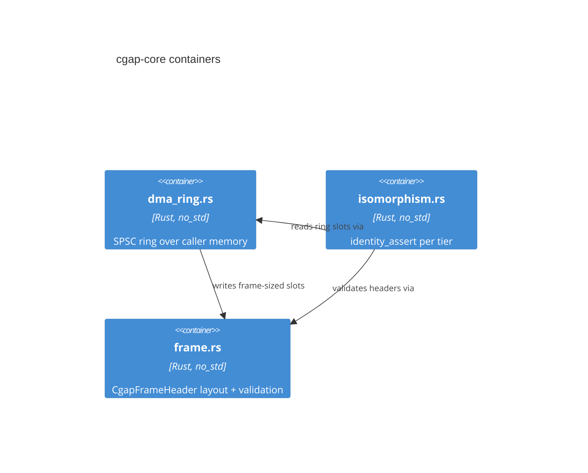
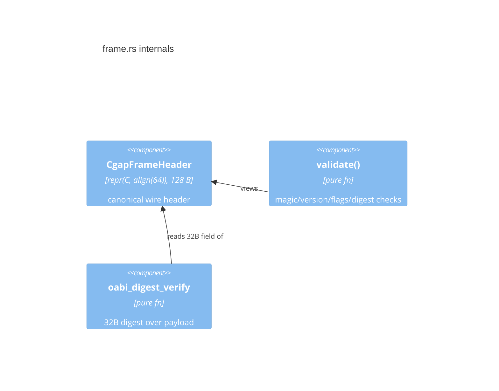

# A04: Triumvirate Isomorphism — cgap-core (dma_ring, isomorphism, frame)

- **Lane**: A04 of 20, cgap overnight-campaign doc fan-out
- **Repo**: `/Users/sac/cgap` (canonical checkout, no worktrees, no git commands)
- **Status**: PROPOSED — the `cgap-core` crate does not exist on disk as of
  2026-10-31. Everything here is a specification, UNVERIFIED by definition.
- **Consumers of this doc**: A14 (DMA ring bench), A17 (Arrow adapter lane),
  A19 (Parquet adapter lane) — they reference the CgapFrameHeader spec in
  §6 byte-for-byte.

## 1. Executive Summary

Propose a new zero-dependency, `no_std`-capable crate `cgap-core` hosting
three modules:

| module | file | purpose |
|---|---|---|
| DMA ring buffer | `dma_ring.rs` | allocation-free SPSC ring over a fixed byte region |
| isomorphism harness | `isomorphism.rs` | bit-for-bit identity assertions across the tiers |
| wire/frame format | `frame.rs` | 128-byte `CgapFrameHeader`, the canonical wire header |

The thesis (ADR-001 continuation): memory, disk, and wire are three
projections of one byte layout. A raw byte slice cast across a network
frame, an Arrow batch, and a Parquet page must be the **same bytes** —
verified by an executed identity court, not asserted in prose.

Exit gate (the falsifier): raw byte slice → network frame → Arrow batch →
Parquet page → back; the round trip passes a bit-for-bit identity assertion
on every tier. If any tier's layout changes by one byte, the identity court
must FAIL.

## 2. Context: ADR-001 and the Unification of Memory / Disk / Wire

ADR-001 (cgap root design register) established that cgap treats memory,
disk, and wire as one addressable byte space under content addressing (see
`/Users/sac/cgap/docs/CONTENT_ADDRESSING.md`). The triumvirate:

1. **Memory tier**: a DMA ring buffer region — bytes the producer wrote,
   consumer reads, no allocator involvement after init.
2. **Disk tier**: Parquet pages / Arrow IPC batches — byte-exact columnar
   regions.
3. **Wire tier**: the `CgapFrameHeader` + payload — what crosses a socket,
   a DMA descriptor, or a `write(2)`.

Prior art rejected reinventing the wire tier: DPDK's `rte_ring` (SPSC ring
discipline), Arrow's IPC flatbuffer (rejected — see §4), and Linux
`io_uring` (the ring-of-rings shape). cgap-core takes the SPSC ring
discipline and the flat-header wire shape but hand-rolls both under the
zero-dependency, `no_std` discipline inherited from the v26.10.31 charter
(`../00-index.md` §Governing Disciplines).

## 3. Scope

### In scope (this crate, this lane)

- `dma_ring.rs`: fixed-capacity, power-of-two, SPSC ring over a caller-
  supplied `&mut [u8]` region; no heap, no alloc, no `std`.
- `isomorphism.rs`: `identity_assert(bytes, Tier)` — the bit-for-bit
  identity assertion and its per-tier projections.
- `frame.rs`: the `CgapFrameHeader` struct (repr C, align 64, exactly 128
  bytes), magic/version/flags validation, oabi digest verification.
- Static layout asserts (compile-time `const` asserts) pinning `size_of`
  and `align_of` for every struct in the crate.
- Chicago-school tests with anti-vacuity mutations per court (§8).

### Out of scope

- Any external crate dependency (dev-dependencies included, with one named
  exception: `#[cfg(test)]`-gated use of the repo's existing in-tree
  adapters for cross-tier courts).
- Any transport implementation (sockets, DMA controllers, NVMe queues).
  cgap-core defines bytes; transports consume them.
- Allocator integration (the ring is caller-supplied memory).

## 4. ADR: Hand-Rolled Triumvirate Modules — and Rejected Alternatives

**Decision**: hand-roll all three modules in cgap-core, zero dependencies,
`no_std` + `alloc`-free, `repr(C)` layouts pinned by static asserts.

### 4.1 Rejected: `serde` (+ postcard/bincode/rmp)

- Requires `std` or a heavy `no_std`+alloc profile; cgap's wire tier must
  deserialize with **zero allocation** from a raw `&[u8]` at arbitrary
  alignment (ESP32/RISC-V targets, §10).
- serde's data model is type-driven, not layout-driven: it guarantees
  round-trip *value* identity, never *byte* identity. The exit gate is
  bit-for-bit bytes, which serde cannot even express.
- Versioning would drag in schema evolution machinery the frame header
  already carries (version + flags).

### 4.2 Rejected: `arrow-rs` / `arrow` crate

- ~200+ transitive deps (chrono, tokio-adjacent, pyo3-adjacent in some
  feature sets); the v26.11.1 charter mandates E=0 runtime externals
  (`../00-index.md` Discipline 2).
- arrow-rs owns its buffers; the triumvirate thesis requires the Arrow
  batch to be a *view* over caller bytes, not an owned copy. arrow-rs'
  `Buffer` is refcounted and copies on append — the identity assertion
  would then be testing arrow-rs' allocator, not the layout.
- No `no_std`.

### 4.3 Rejected: `parquet` crate (arrow-rs monorepo)

- Same dependency tree objection as §4.2, plus: Parquet thrift metadata is
  not byte-stable across writer versions, so bit-for-bit identity across
  writer identities is unsatisfiable with the official crate. cgap defines
  a byte-stable page format that is Parquet-*shaped* (page header, chunk
  structure) but self-describing via the oabi digest, not thrift.
- Thrift compact protocol requires a runtime parser; 128-byte fixed header
  requires none.

###  disk tier note (A17/A19 contract)

A17 (Arrow adapter) and A19 (Parquet adapter) treat cgap-core's frame as
the canonical byte region: their "batch" and "page" types are newtype
wrappers over `&[u8]` plus the validated `CgapFrameHeader` view. Both
reference §6 as their layout contract.

## 5. C4 Diagrams

### 5.1 C4 Level 1 — System Context



### 5.2 C4 Level 2 — Container



### 5.3 C4 Level 3 — frame.rs components



## 6. Canonical Spec: the 128-byte `CgapFrameHeader`

This section is the **canonical definition** referenced by A14/A17/A19.
Any drift between this table and `frame.rs` is a defect in `frame.rs`.

Struct declaration (normative):

```rust
#[repr(C, align(64))]
pub struct CgapFrameHeader {
    /// 0x43 0x47 0x41 0x50 — ASCII "CGAP"
    pub magic: [u8; 4],
    /// format version, start at 1
    pub version: u8,
    /// bit 0: Arrow batch present
    /// bit 1: Parquet page present
    /// bit 2: BN3 payload present
    /// bit 3: GitPack payload present
    pub flags: u8,
    /// reserved, must be zero on write, ignored on read (v1)
    pub reserved: [u8; 2],
    /// total payload byte length, little-endian
    pub payload_byte_len: u64,
    /// BLAKE3-derived digest over the payload bytes (oabi register entry)
    pub oabi_digest: [u8; 32],
    /// embedded 80-byte P28 license attestation (see LICENSE-P28-SIL.md)
    pub attestation: P28LicenseAttestation,
}
```

### 6.1 Byte-offset table (normative — A14/A17/A19 reference this)

All multi-byte integers are **little-endian**. `P28LicenseAttestation` is
`#[repr(C)]`, 80 bytes, defined in §6.2. Total: 128 bytes, align 64.

| offset | size | field | notes |
|---:|---:|---|---|
| 0 | 4 | `magic` | `43 47 41 50` = "CGAP" |
| 4 | 1 | `version` | 1 |
| 5 | 1 | `flags` | bit0 Arrow, bit1 Parquet, bit2 BN3, bit3 GitPack |
| 6 | 2 | `reserved` | zero on write, ignored on read |
| 8 | 8 | `payload_byte_len` | u64 LE |
| 16 | 32 | `oabi_digest` | BLAKE3 over payload |
| 48 | 80 | `attestation` | P28LicenseAttestation, spans 48..128 |

### 6.2 `P28LicenseAttestation` (80 bytes, repr(C))

```rust
#[repr(C)]
pub struct P28LicenseAttestation {
    magic: [u8; 4],        // "P28\0"
    version: u8,           // 1
    sil_level: u8,         // SIL level claimed (2 for v2.1.0)
    reserved: [u8; 2],
    license_urn_hash: [u8; 32],  // BLAKE3 of "urn:cgap:license:p28-sil:v2.1.0-sovereign"
    sig_or_id: [u8; 40],   // 40-byte signature or key id blob
}
```

### 6.3 Flags semantics (normative)

- bit 0 `FLAG_ARROW`  = 0x01
- bit 1 `FLAG_PARQUET` = 0x02
- bit 2 `FLAG_BN3`     = 0x04
- bit 3 `FLAG_GITPACK` = 0x08
- bits 4-7 reserved, must be zero.

### 6.4 Static size asserts (normative)

```rust
const _: () = assert!(core::mem::size_of::<CgapFrameHeader>() == 128);
const _: () = assert!(core::mem::align_of::<CgapFrameHeader>() == 64);
const _: () = assert!(core::mem::size_of::<P28LicenseAttestation>() == 80);
```

Static asserts pin: header = 128 B, attestation = 80 B, align = 64, via
core-only `const` asserts — no `static_assertions` crate (zero-dep rule).
Any field addition goes through a version bump, never in-place growth.

## 7. DMA Ring Buffer Design (`dma_ring.rs`)

### 7.1 Shape

- Fixed capacity in **slots** (each slot = one frame: 128 B header +
  payload region), power-of-two slot count, mask-indexed.
- Memory is caller-supplied `&mut [u8]`, partitioned into slots at init;
  no allocation before, during, or after.
- SPSC: one producer, one consumer; head/tail are `AtomicUsize` with
  `AcqRel` head-publish and `Acquire` tail-observe ordering.

### 7.2 Cache-line discipline

- 64-byte alignment mandated by the header's `align(64)`; each ring slot
  is 64-byte aligned; producer and consumer indices live on **separate**
  cache lines, each `align(64)`-padded (`#[repr(align(64))]` wrapped
  indices struct), to prevent false sharing.
- No `alloc` anywhere in the module; verified by a source-scan gate (§8.3).

- ### 7.3 API sketch

```rust
pub struct DmaRing { /* indices + region */ }
impl DmaRing {
    pub fn new(region: &'static mut [u8], slot_pow2: u8) -> Result<Self, RingError>
    /// producer: claim a slot for write, returns &mut [u8] of slot size
    pub fn claim(&mut self) -> Option<&mut [u8]>
    /// producer: publish a claimed slot (frame must validate)
    pub fn publish(&mut self, len: usize) -> Result<(), RingError>
    /// consumer: read the next published slot
    pub fn read(&mut self) -> Option<(&[u8], &CgapFrameHeader)>
    /// consumer: release the slot
    pub fn release(&mut self)
}
```

§7.3 API operates on the fixed slot layout; `claim/publish` are producer-
only, `read/release` invariants are SPSC-safe by construction (each slot
is either free, claimed, published, or released — a 2-slot state machine
per slot tracked implicitly by head/tail distance).

## 8. Isomorphism Proof Obligations + Chicago Test Plan

### 8.1 What "bit-for-bit identity" means precisely, per tier

The assertion under test: for payload P (byte string) and validated header
H(P):

- **Wire tier**: `frame_bytes = encode(H(P), P)`; identity means
  `decode(encode(P)) == P` at the byte level AND the header fields
  (digest, len, flags) re-derive identically.
- **Memory tier**: the bytes the producer published into ring slot S are,
  byte-for-byte, what the consumer reads from S after the head/tail
  handshake — same 128 B header, same payload, no padding bytes ever
  observed (padding is zeroed at claim and asserted zero at publish).
  "Same bytes" is `addr_of`-independent: identity is over *values*, not
  addresses.
- **Disk tier (Arrow)**: the Arrow batch view over region R is a set of
  (offset, len) views into R; identity means the batch's validity bitmap
  bytes and buffer bytes are ranges of R itself — no copy, no append, no
  reallocation. A17's adapter must expose `as_bytes()` returning the very
  region R.
- **Disk tier (Parquet)**: the Parquet-shaped page over region R is (page
  header view = CgapFrameHeader, page data = payload of R); identity means
  the page's thrift-free self-describing header re-derives
  `payload_byte_len` and `oabi_digest` from the payload bytes and the
  re-derived digest equals the embedded one.

### 8.2 Identity court (the exit gate)

One executed court, `tests/identity_court.rs`:

1. Build payload P (deterministic pseudo-random, seeded, sizes: 0, 1, 63,
   64, 127, 128, 4096, 1 MiB).
 boundary 2. `wire`: encode into frame F_w; `memory`: publish/read through DmaRing
   into F_m; `arrow`: A17 adapter view F_a; `parquet`: A19 page view F_p.
3. Assert `F_w == F_m == F_a == F_p` byte-for-byte over the full frame region
   (header + payload), plus each tier's re-derived digest equals the
   embedded digest.
4. Per-size sweep × per-tier equality; failure names the tier and the first
   divergent byte offset.

On divergence the court exits non-zero and prints:
`IDENTITY_COURT_FAIL tier=<t> offset=<i> wire=0x.. mem=0x.. disk=0x..`

Fail-loudness is the deliverable; a court that cannot fail is vacuous.

### 8.3 Anti-vacuity mutations per court

A court that cannot flip is FAIL. Each court carries a mutation that must
make it fail:

| court | mutation | must-fail assertion |
|---|---|---|
| identity | flip 1 byte in any tier's layout (A17 adapter view) | court FAILs, names tier+offset |
| identity | shift `payload_byte_len` by +1 in the header | identity court FAILs at offset 8 |
| frame-header | pad or drop a field: header size 127 or 129 B | static assert fails to compile |
| frame-header | flip magic to "XGAP" | validate() refuses, `FrameError::BadMagic` |
| frame-header | set flags bit 4 (reserved) | refuses, `FrameError::ReservedBitsSet` |
| dma_ring | publish payload len > slot capacity | `RingError::Overflow`, no write past slot |
| dma_ring | read an unpublished slot | `None` (typed: no frame), never garbage |
| attestation | corrupt 1 byte of `attestation` | refuses, `FrameError::AttestationMismatch` |
| attestation | corrupt 1 byte of payload | digest mismatch, `FrameError::DigestMismatch` |

(A mutation row that cannot flip anything gets retired with a receipt,
never left as filler.)

### 8.3 Anti-vnumber overflow vacuity gate (source scan)

A source-scan gate asserts: zero `alloc`/`vec!`/`Box` in
`cgap-core/src` (E=0 externals + E=0 allocation), zero `Process.sleep`-
style timing assumptions (no-sleep doctrine), and that every court file
contains at least one `#[should_panic]`/typed-refusal test per §8.3 row.

## 9. Definition of Done (8+)

1. `crates/cgap-core/` exists with `Cargo.toml` (zero deps,
   `#![no_std]`), `src/dma_ring.rs`, `src/isomorphism.rs`, `src/frame.rs`.
2. Static asserts pin header 128 B / align 64 / attestation 80 B; a
   mutation to any of these fails to compile (witnessed, not claimed).
3. Identity court `tests/identity_court.rs` executes green across all 8
   payload sizes × 4 tier views; receipt names command + exit 0.
4. Anti-vacuity: each §8.3 mutation demonstrably flips its court (shim-
   court protocol: baseline → before → SHIM → after → restore, sha256
   byte-exact restore).
5. Zero-allocation source-scan gate exits 0 on cgap-core and FAILS on an
   injected `vec!` (positive control, non-vacuous).
6. A14/A17/A19 confirm (link receipts) that §6 is their layout contract
   and the offset table is byte-accurate against `frame.rs` on disk.
7. Endianness: little-endian fields verified on a big-endian interpretation
   harness (byte-swap court) — payload is opaque; header ints are LE by
   table.
8. `cargo build --target riscv32imc-unknown-none-elf` (ESP32-C3 class)
   compiles cgap-core clean (alignment/atomics policy §10).
9. Doc §6 byte-offset table machine-checked against `frame.rs` (a test
   parses the markdown table and asserts offsets/sizes/total 128).
10. P28-SIL v2.1.0 license URN cited in cgap-core's README and manifest;
    no SPDX identifiers.

## 10. Risks

- **Alignment on ESP32 / RISC-V**: `align(64)` region pointers may exceed
  what a DMA engine can express; on ESP32-C3, DMA can require word (4 B)
  descriptors with the region itself in DMA-capable RAM. Mitigation:
  `DmaRing::new` requires 64-aligned region, refuses otherwise (typed
  refusal, fail-closed); ESP32 class uses `riscv32` atomics via
  portable-atomic-free approach: only `AtomicUsize` on 32-bit targets,
  which is native on RV32 with the A extension; ESP32-C3 (RV32IMC, no A
  extension) needs IRQ-disabled critical sections — the crate exposes a
  `critical-section` seam (a caller-supplied fn-pointer critical section,
  hand-rolled, zero-dep).
    - **Endianness**: header integers are LE by table (§6.1); on BE hosts
      the `u64` fields go through explicit `u64::from_le_bytes` round trip
      — never `transmute` for multi-byte fields, only for the zero-sized
      checks. Payload is opaque bytes; endianness is a header-only concern.
    - **repr(C) padding**: reserved fields make the layout gap-free by
      construction; the identity court asserts padding bytes are zero so
      bit-for-bit identity is not defeated by uninitialized padding.
      Uninit padding is UB to read; claim() zero-fills the full slot
      before publish, and the identity court asserts zeroed padding.
- **digest cost**: BLAKE3 (via cgap-blake3, in-tree) over 1 MiB payload in
  a no_std court — advisory perf, conformance outranks throughput.
- **A17/A19 dependency ordering**: the identity court's Arrow/Parquet
  views depend on lanes A17/A19 landing first; until then the court runs
  in wire+memory-only mode (2-tier mode, receipted as PARTIAL_ALIVE).

## 11. Wave 2

Wave 2 candidates (not admitted by this lane — Wave 2 owners decide):

- **W2-A04-1**: multi-producer ring (MPMC) variant behind a feature flag,
  same slot discipline, seqlock-style head publish.
- **W2-A04-2**: frame v2 evolution policy: version-negotiated optional
  fields (TLV annex region after the 128 B header) without breaking the
  128 B static assert.
- **W2-A malformation fuzzing**: cargo-fuzz target over `validate()` —
  wave-2 owners decide whether fuzzing is admitted under the no-dep rule
  (libFuzzer is a dev-only dep; precedented in-repo).
- **W2-A04-4**: `io_uring`-shaped ring-of-rings for NVMe queue surfaces
  (transport-side, cgap-core defines bytes only).
- **W2-A04-5**: BE (big-endian) variant header, only if a BE DMA surface
  demands it; default stays LE.

## 12. Standing

Everything in this document is PROPOSED / UNVERIFIED as of 2026-10-31.
cgap-core does not exist; no court has executed; §6 is the layout contract
until a receipt says otherwise. Standing changes only from receipts
(executed courts with command + exit code), never from prose.
