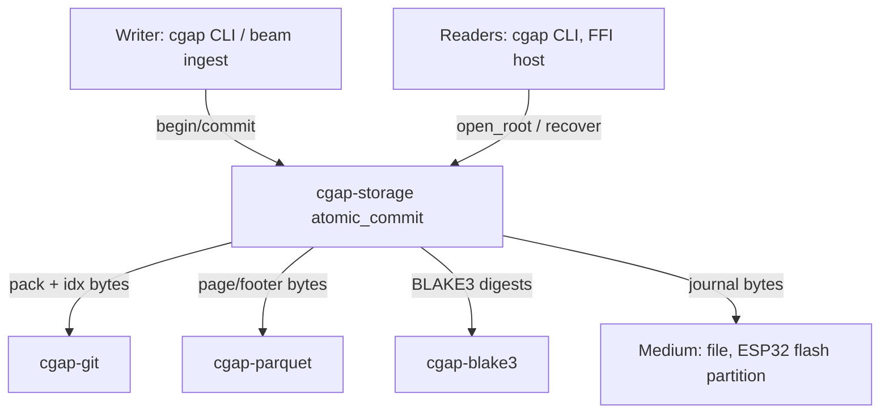
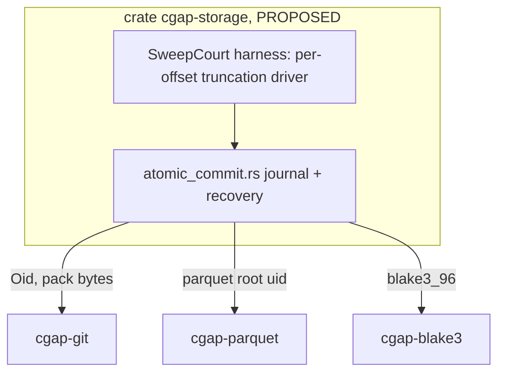
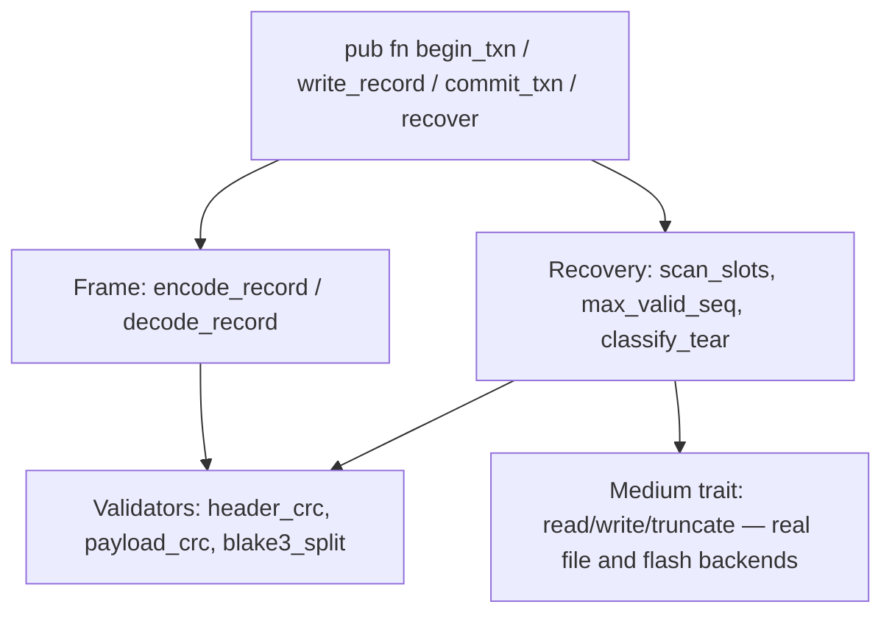

# A05: Power-Cut WAL — `cgap-storage` (PROPOSED), `atomic_commit.rs`

Lane: A05 of 20, v26.11.1 overnight campaign. Repo: `/Users/sac/cgap` (single
canonical checkout; no worktrees, no git commands from this lane). Wave 3
window: 04:30-06:30. File ownership: this document only; the crate
`cgap-storage` it specifies is PROPOSED, not implemented by this lane.

## 1. Status and Standing

- Lane doc: WRITTEN (this file).
- Crate `cgap-storage`: PROPOSED — no code in this lane's deliverable.
- Exit gate (design-level, enforced later by the court): a simulated mid-write
  power cut at ANY byte offset `k in 0..N` of a commit transaction must roll
  back cleanly to the prior Git/Parquet root with ZERO corruption observable
  through the public read path.
- Every claim below is a design claim (UNVERIFIED until the sweep court runs).
  Nothing in this file asserts executed verification.

## 2. Context: Power Loss as the Canonical Adversarial Court

Storage is the layer where the substrate's "conformance outranks throughput"
discipline bites hardest, because the adversary is not a malformed input but
the physical world cutting power mid-`pwrite`. The failure we must survive is
not "the code has a bug" but "the code was correct and the universe stopped
executing it at instruction k of N".

The no-sleep doctrine states the governing law exactly: **time is not a proxy
for state**. A test that "simulates" a power cut by sleeping 50 ms and hoping
the write had finished asserts the world converged BEFORE the check — it buys
flake-or-slowness, and it is flake precisely under the load (slow flash, wear-
leveled erase, brownout-dirty cache) that matters. The cut must therefore be
simulated **per-offset and deterministically**: the transaction log is a byte
string of known length N; the court enumerates every `k in 0..=N`, truncates
the visible log to `k` bytes, and demands the recovery function classify and
resolve the resulting state. Deterministic truncation replaces wall-clock
guessing the same way a bounded poll replaces `Process.sleep`. The sweep IS
the observation; there is no wait anywhere in the design.

Why a WAL at all: cgap's durable artifacts (Git packfiles from `cgap-git`,
Parquet page files from `cgap-parquet`) are large append-heavy blobs whose
in-place rewrite is not atomic on any target medium. An atomic commit of a new
root therefore reduces to: (a) write the new artifact to fresh space,
(b) write a small journal record naming the new root, (c) atomically flip the
root pointer. Steps (a) and (b) are crash-tolerant by construction (garbage is
collectable); step (c) is where the entire correctness burden concentrates,
and a checksummed journal is the classical (and here, dependency-free)
answer.

## 3. ADR: Write-Ahead Journal Design

### 3.1 Decision

`cgap-storage::atomic_commit` implements a **redo-free, checksummed,
seqnumbered journal** over a single fixed-size journal region:

- The journal is an append sequence of framed records into a pre-allocated
  region (double-buffered: two slots A/B, strictly alternating by sequence
  number).
- Each record is self-validating: magic, sequence, CRC-32 over the fixed
  header, BLAKE3 over the variable payload (the new-root descriptor).
- Commit point = a fully-written, checksum-valid record whose sequence equals
  `last_seq + 1`. There is no in-place pointer flip; the "current root" is a
  pure function of `(prior root, valid journal tail)`.
- Recovery scans both slots, validates checksums, picks the highest valid
  sequence; anything else is discarded and the prior root stands.

### 3.3 Journal record layout (byte-exact)

Fixed header, little-endian throughout, 48 bytes:

```
offset  size  field
0       4     MAGIC        = 0x4A414353 ("SCAJ" — bytes 'S','C','A','J' stored as u32 LE)
4       2     VERSION      = 0x0001
6       2     HEADER_SIZE  = 48
8       8     SEQ          u64, monotonically increasing, starts at 1
16      8     PAYLOAD_LEN  u64, bytes of payload that follow the header+trailer
24      4     PAYLOAD_CRC  CRC-32 (IEEE) over payload bytes
28      4     HEADER_CRC   CRC-32 over bytes 0..24 and 32..44 (crc fields excluded, zero-filled)
32      4     RESERVED     0x0000_0000, must be zero
36      12    BLAKE3_OUT   first 12 bytes of BLAKE3(payload) (96-bit digest)
```

Trailer, 16 bytes, immediately after payload:

```
offset  size  field
0       4     TRAILER_MAGIC = 0x524A4353
4       12    BLAKE3_TRAILER second 12 bytes of BLAKE3(payload) (digest split
              across header and trailer so a torn write cannot leave a
              payload whose only digest bytes were the ones destroyed)
```

Total record size = 48 + PAYLOAD_LEN + 16. CRC-32 catches single-burst
corruption cheaply on every read; BLAKE3 (already capital in
`crates/cgap-blake3`) binds payload identity so CRC collision classes cannot
admit a wrong root. Coverage summary:

- HEADER_CRC: bytes 0..24, 32..44 of the header (SEQ, PAYLOAD_LEN, VERSION,
  sizes, BLAKE3 half). Excludes the CRC fields themselves by zero-fill rule.
- PAYLOAD_CRC + BLAKE3(payload) split header/trailer: full payload coverage;
  the split forces both head AND tail of the record to survive for commit.

### 3.4 Payload: the new-root descriptor

```
offset  size  field
0       20    GIT_OID       new Git pack/tree root (cgap-git `Oid`)
20      8     PARQUET_ROOT  offset/uid of new Parquet footer set (A02 contract)
28      8     DAG_SEQ       u64 dag-root sequence (A03 contract)
36      8     TXN_TS        writer timestamp (advisory, never used for ordering)
44      1     FLAGS         bit0 = dual-write (both roots moved together)
45      3     pad
```

Total 48 bytes, so a full record is 112 bytes — small enough to sit inside a
single flash page on every supported target.

### 3.5 Double-buffer vs journaling tradeoffs

Considered:

1. **Double-buffer (two complete root slots, monotonically better one
   wins).** Simple, O(1) recovery. Rejected as the primary mechanism: a slot
   update rewrites the whole descriptor region every commit and gives no
   history for debugging; also on wear-limited media two slots concentrate
   wear on fixed addresses.
2. **Classic redo/undo log with in-place root flip.** More general but needs
   an atomic flip primitive (fsync ordering) we cannot get portably across
   hosted files and ESP32 flash without unsafe/OS assumptions. Rejected.
3. **Chosen: append-only framed records in alternating slots (a
   "ping-pong journal").** Each commit writes exactly one record into the
   slot not holding the last valid record. Sequence numbers, not addresses,
   define order. Recovery = validate both, take max valid seq. Atomicity
   needs no in-place mutation of committed state at all — the prior record
   is never touched, so the prior root is recoverable by construction.

### 3.6 Rejected alternatives (record)

- `fsync`-based file rename atomicity (POSIX-only, no embedded story).
- SQLite-style pager (external dependency; violates E=0 discipline).
- XOR-shadow/undo bytes in-place (weakest torn-write class analysis; a tear
  in the shadow destroys both states).
- Optimistic no-journal with post-crash full re-verify and rebuild from the
  DAG (admissible as a *repair* path; not admissible as the commit path —
  rebuild is O(dataset), the journal is O(1)).

## 4. Architecture (C4)

### 4.1 Context (C1)



### 4.2 Containers (C2)



### 4.3 Component (C3 — atomic_commit.rs)



## 5. Torn-Write Classes and the Crash Matrix

Let `N` = total encoded record length (112 bytes for the standard payload)
and `k` = number of bytes of the new record that reached the medium before
the cut. The court sweeps `k in 0..=N`.

| class | k range | medium state | required outcome |
|---|---|---|---|
| C0 pre-write | k = 0 | slot unchanged / erased 0xFF | prior root; slot free |
| C1 torn header | 1..=47 | partial/garbage header | bad CRC/magic/version → invalid → prior root |
| C2 torn payload | 48..<48+L | header ok, payload torn | CRC/BLAKE3 mismatch → prior root |
| C3 torn trailer | 48+L..<N | trailer bytes missing | BLAKE3 trailer bad → prior root |
| C4 complete record | k = N | record fully valid | NEW root committed (not corruption) |

Additional compound classes the sweep must cover (drive via the Medium
trait's fault injector, not sleeps):

- F1: bit-flip inside a *previously committed* record (aging corruption) →
  that record invalidates, recovery falls back to the prior slot; total
  rollback of at most one transaction, zero corruption.
- F2: both slots torn (cut during commit k, plus earlier damage in the other
  slot) → recovery returns the base root and reports `RecoveryDegraded`.
- F3: identical SEQ in both slots (replayed write) → deterministic
  tie-break on BLAKE3 equality; if payloads differ, refuse with
  `JournalAmbiguous` (fail-closed, never guess).

### 5.1 Recovery algorithm (pseudocode)

```
fn recover(medium) -> Root:
    base  = medium.read_base_root()          # immutable superblock field
    cands = []
    for slot in [A, B]:
        match decode_record(medium.slot_bytes(slot)):
            Ok(rec)       => cands.push(rec)
            Err(Invalid)  => {}            # any tear class C0..C3
    cands.sort_by_key(seq)
    match cands.dedup_by_seq_and_digest():
        Err(Ambiguous)  => return Refuse(JournalAmbiguous)   # F3, fail-closed
        Ok([top, ..])   => root = apply(base, top)
        Ok([])          => root = base                        # clean rollback
    root
```

Invariants asserted by the court for every `k`:

- I1: `recover()` returns either the prior root or the new root — never a
  third value, never a panic, never a partial artifact exposed.
- I2: all returned roots re-verify (Git idx checksum / Parquet footer CRC /
  dag seq monotonic under the A03 contract).
- I3: recovery is deterministic in the post-cut bytes alone (no clock, no
  entropy — time is not a proxy for state).

## 6. Interface Contracts

- **A02 (Parquet footer):** the payload's `PARQUET_ROOT` field is the
  footer-set identifier A02 defines; cgap-storage treats it opaquely but
  re-verifies any root it returns via A02's footer CRC entry point. A02 owns
  the byte meaning; this crate owns atomic visibility of it.
- **A03 (dag root):** `DAG_SEQ` must be strictly monotonic across committed
  records; recovery refuses a valid record whose `DAG_SEQ` <= base dag seq
  (rollback of the counter is treated as corruption, typed
  `SeqRegression`).
- **cgap-git:** `GIT_OID` is the crate's `[u8; 20]` `Oid`; the referenced
  pack must exist and checksum-verify before `commit_txn` acknowledges (the
  journal names only already-durable artifacts).

## 7. Chicago Test Plan — the Sweep Is the Court

Real collaborators throughout: the Medium trait's production file backend
plus a flash-model backend that models page erase (both real in-process
implementations, no mocks). The power cut is not stubbed — it is *executed*:
the transaction is written byte-by-byte through the medium, and the sweep
halts the medium after exactly `k` bytes, then runs the real recovery
function on the resulting bytes.

Tests (`crates/cgap-storage/tests/`, PROPOSED):

1. `sweep_per_offset_rollback`: for k in 0..=N: build txn, cut at k,
   `recover()` → assert I1..I3. 113+ parameter cases, every one enumerated
   (never sampled — sampling is how the one bad offset ships).
2. `sweep_both_slots`: same sweep with a pre-damaged opposite slot (F2).
3. `aging_corruption_flip`: F1 bit-flips at every byte of the committed
   record — recovery must lose at most that transaction.
4. `ambiguous_refuses`: F3 conflicting same-seq records → typed refusal.
5. `commit_ack_means_durable`: after k = N and recovery, new root is live
   (C4 is a commit, not a corruption — the sweep must distinguish).
6. `flash_erase_semantics`: sweep re-run on the flash model (erase sets
   pages to 0xFF, not 0x00) — recovery must not depend on zero-fill.

### 7.1 Anti-vacuity: the court must be able to flip

A green sweep proves nothing unless the harness can fail. Named mutations,
each of which MUST make >= 1 offset in the sweep reproduce visible
corruption or a wrong-root return:

- M1: recovery treats a header-CRC failure as "skip to payload" instead of
  invalid → torn-header offsets return garbage roots.
- M2: recovery picks the *lowest* valid sequence instead of highest →
  double-commit scenarios regress.
- M3: BLAKE3 trailer half dropped from validation → C3 offsets accept
  torn-tail records whose payload digest was destroyed.
- M4: SeqRegression check removed → a stale record rolls the dag root back.

Mutation protocol: apply the mutation in a scratch copy of the recovery
module, re-run the sweep, assert >= 1 offset FAILS; restore byte-exact
(sha256 before/after, fail-closed restore check). **A mutation run in which
the sweep still passes is itself a FAIL — the court is vacuous.** Zero
mutations executed = zero bits; the sweep's green is UNVERIFIED until at
least the M1-M4 flips are witnessed.

## 8. Definition of Done

1. This lane doc lands in `docs/jira/v26.11.1/lanes/` (this file).
2. `cgap-storage` crate skeleton proposed (CrateManifest entry, PROPOSED
   status, E=0 runtime externals, `no_std` + `alloc`, `forbid(unsafe_code)`
   matching house style of `cgap-git`/`cgap-parquet`).
3. Journal record framing spec (Section 3.3/3.4) reviewed against
   cgap-blake3's actual 96-bit digest split capability.
4. Medium trait defined for both hosted-file and ESP32-flash backends.
5. Full crash matrix (C0-C4, F1-F3) documented with per-class required
   outcomes (Section 5).
6. Sweep test plan enumerated per-offset, no sampling (Section 7).
7. Anti-vacuity mutations M1-M4 specified with flip conditions (Section
   7.1).
8. Interface contracts A02/A03/cgap-git confirmed with those lanes or
   registered as a cross-lane dependency in the resolutions doc.
9. Risks (Section 9) reviewed; ESP32 erase-block math checked against the
   journal region size.
10. Receipt: Wave 3 window closed with this file as the sole lane write.

## 9. Risks

- **Flash wear:** alternating two fixed slots doubles per-slot write
  frequency vs round-robin; on ESP32 a 4 KB erase block erasing per commit
  is both slow (~30-100 ms) and wear-limiting. Mitigation: journal region
  sized as an erase-block multiple with a slot-generation counter so the
  active pair rotates across blocks; exact rotation cadence is an open
  parameter for the implementer, bounded by the wear budget.
- **Erase granularity vs record atomicity:** flash erase is per-block,
  write is per-page; a torn erase (power cut mid-erase) leaves 0xFF/old mix.
  The recovery validators must treat any non-conforming byte pattern as
  invalid (they already do — magic+CRC), but the sweep must include
  cut-during-erase offsets, not only cut-during-write.
- **Cached-page reordering on hosted targets:** a POSIX file backend can
  reorder `write` vs later `fsync`; the commit protocol must fsync the
  artifact bytes before the journal record, and the court must model that
  ordering constraint as a hard precondition of `commit_txn`.
- **Digest strength:** 96-bit BLAKE3 prefix is collision-adequate for
  adversarial-accident (not adversarial-attacker) integrity; if the threat
  model upgrades, the frame has room to grow the digest via VERSION bump.
- **Scope risk:** this lane proposes the crate; another wave must implement
  it. Any implementer-visible ambiguity in Section 5's matrix is a defect in
  this doc, not in the implementation.
