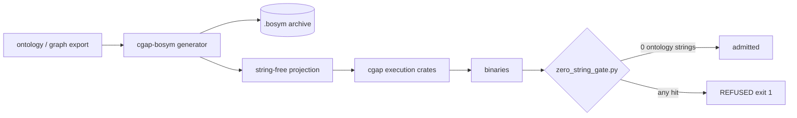

# A07: cgap-bosym — Out-of-Band Symbol Quarantine and the Zero-String Gate

Lane A07 of 20, overnight-campaign doc fan-out, v26.11.1, repo
`/Users/sac/cgap`. Status of everything in this file: **PROPOSED /
UNVERIFIED**. Nothing here has executed; no gate has run; no receipt exists.

## Role in the Wave

Squadron 2, Agent A07. Deliverable slab: one new crate (`cgap-bosym`,
PROPOSED) plus one audit script (`scripts/zero_string_gate.py`), and the
design for proving the gate is not vacuous.

- **Crate**: `cgap-bosym` — build-time sidecar. Owns the generator that
  routes human-readable symbol/ontology strings OUT of the execution path
  and into an out-of-band archive.
- **Script**: `scripts/zero_string_gate.py` — the admission gate. Scans
  compiled execution-crate binaries and refuses any binary carrying ontology
  UTF-8 strings in `.rodata`/`.text`.
- **Exit gate** (milestone-level): objdump/binary scan of every compiled
  execution crate confirms 0 ontology UTF-8 strings in `.rodata`/`.text`.

Every other lane's file is read-only to this lane. No git commands.

## Context: ADR-002 — Out-of-Band .bosym Quarantine

The cgap substrate carries a human-facing ontology: entity names, IRIs,
witness labels, diagnostic vocabularies. Compiled naively, every one of those
strings lands in `.rodata` (or, worse, is reachable from `.text` via
immediate loads) of every execution crate. Consequences:

1. **Footprint tax**: ontology prose rides in every shipped binary, growing
   `.rodata` linearly with vocabulary size (cf. `docs/wasm-footprint.txt`
   for the existing footprint discipline).
2. **Leak surface**: strings in a binary are strings in a binary. Anything
   that can read the artifact can read the ontology.
3. **Two audiences, one artifact**: the execution kernel needs *numbers and
   codes*; humans need *names*. Compiling both into one artifact couples two
   audiences that should never have shared a section.

ADR-002 (this slab is its authored form; it enters the ADR register via the
lane-1 index amendment, not by this file editing the register) resolves this
by splitting the artifact family:

- **Execution path**: contains only numeric codes, interned IDs, and
  opaque handles. Zero ontology UTF-8.
- **Debug/observability sidecar**: a single `.bosym` archive carrying the
  human symbol table, produced at build time, never mapped by the execution
  path, consumable by tooling that *opts in* (debuggers, trace renderers,
  doc generators).

The division of labor is stated once and enforced twice: once at build time
(by the generator inside `cgap-bosym`) and once at admission time (by
`scripts/zero_string_gate.py`). A build-time mechanism without an admission
gate is prose; the gate is the mechanism.

## ADR-002 (authored here, numbered by the register)

- **Status**: PROPOSED
- **Context**: ontology strings compiled into execution artifacts create
  footprint tax, leak surface, and audience coupling (see above).
- **Decision**:
  1. Human-readable ontology symbols live ONLY in a build-time-produced
     `.bosym` archive.
  2. Execution crates are compiled from a string-free projection; the
     source of truth remains the RDF/graph layer per the repo's
     ontology-first discipline; the projection mechanism is the
     `cgap-bosym` generator.
  3. The quarantine is enforced by an admission gate with a proven-able
     failure mode. A gate that cannot fail is not a gate.
  4. `.bosym` is consumable out-of-band; the runtime kernel has no code
     path that opens, reads, or depends on it. Dependency direction:
     tooling → `.bosym` → nothing further. The kernel does not point at
     `.bosym` at all.
- **Consequences**: binary scans become the ontology leak audit; the
  string-free projection becomes a generated artifact (never hand-edited);
  any lane needing a human-readable label at runtime must route through an
  interned-ID lookup served out-of-band, and say so in its receipt.

## C4 — Build-Time Generator (cgap-bosym, container level)

C4-Context (text form; Mermaid C4 syntax support varies by renderer, so the
context diagram is given in plain structure and the container flows as
flowcharts):

- **System boundary**: cgap substrate build.
- **[Person] Operator** — runs `cargo build` / `just` flows.
- **[Software System] cgap-bosym** (PROPOSED crate) — consumes the
  ontology surface (graph export or generated manifest) and emits two
  things: (a) `.bosym` archive, (b) string-free projection consumed by
  execution crates.
- **[Software System] cgap execution crates** (`cgap`, `cgap-ffi`,
  `cgap-arrow`, `cgap-beam`, `cgap-parquet`, `cgap-git`, `cgap-blake3`,
  `cgap-gpu`, `cli`, ...) — consume the string-free projection; never see
  ontology strings.
- **[Software System] zero-string gate** — post-build admission gate over
  every execution-crate binary.

Build-time container flow:



## C4 — Runtime Zero-String Kernel (execution path)

```mermaid
flowchart LR
  subgraph ExecPath[Execution path]
    K[cgap kernel binaries]
  end
  subgraph OOB[Out-of-band, never mapped by ExecPath]
    A[(.bosym archive)]
    T[tooling: debugger, tracer, docgen]
  end
  K -- "interned IDs / numeric codes only" --> W[wire / storage]
  T --> A
  A -- "ID -> human symbol" --> H[human rendering]
  K -.->|"NO dependency edge (must not exist)"| A
  K -.->|"NO dependency edge (must not exist)"| T
  OOB -.->|"forbidden edges, gate-audited at build-script level"|
```

Invariants the diagrams encode:

1. The only edge from the execution path to the ontology is the build-time
   projection edge (generator reads ontology, emits codes).
2. No runtime edge kernel→.bosym exists. If one is ever needed, that is a
   new ADR, not a feature flag.
3. The gate reads binaries, never source. Source-level greps are advisory;
   the binary is the subject.

## .bosym Archive Format (v0, PROPOSED)

A single file, content-addressed by construction, prefix-magic'd so that a
mis-routed copy is identifiable on sight:

- `magic`: 8 bytes, `CGAPBSYM`
- `version`: u16 LE, `0`
- `flags`: u16 LE (bit 0 = compressed, bit 1 = signed — both v0: 0)
  then u32 LE `entry_count`
- `entries`: `entry_count` records, each:
  - `sym_id`: u64 LE — the interned ID the kernel uses
  - `kind`: u8 — 0=entity, 1=relation, 2=IRI, 3=label, 4=annotation
  - `reserved`: u8[3], must be zero
  `name_len`: u16 LE
  - `name`: UTF-8 bytes, `name_len` bytes (no NUL; length-prefixed, so
    ontology strings containing NULs or `.`-like bytes cannot alias the
    framing)
  - `sha16`: first 16 bytes of SHA-256 over `name` — cheap integrity
    check; full hashing is the packer's job, this is the reader's check.
- Trailing section: `sha256` of all preceding bytes (32 bytes, big-endian
  convention) so a truncated/corrupt archive fails closed on read.

Design notes:

- Length-prefixed, not NUL-terminated: the archive must faithfully carry
  strings the *execution* path must never contain; the format cannot assume
  the ontology is NUL-free.
- No NUL-terminated anything in the archive means the gate's own scans of
  `.bosym` are also well-defined.
- v0 has no compression/encryption; flags exist so adding them is a
  version bump, not a format break.

## The Zero-String Gate: `scripts/zero_string_gate.py`

### Scope

Exit gate for the milestone: for every compiled execution crate, 0 ontology
UTF-8 strings in `.rodata`/`.text`. "Compiled execution crates" = the
binary/rlib/artifact outputs of `crates/cgap`, `crates/cgap-ffi`,
`cgap-arrow`, `cgap-beam`, `cgap-parquet`, `cgap-git`, `cgap-blake3`,
`cgap-gpu`, `cli`, `integration`, `wasm-footprint` — the list is enumerated
from `Cargo.toml` workspace members at gate runtime, not hardcoded, so the
gate tracks the workspace mechanically (a hardcode drifts; the manifest
does not, and the gate must not be bypassable by adding a crate).

The gate scans artifacts, not sources: `target/*/` binaries plus `gen/`
artifacts. Source greps are advisory output only.

### How to scan

1. **Enumerate sections.** Use `objdump -h` (macOS: `otool -l` /
   `objdump --macho` also viable; the script shelles out to whichever
   exists) to enumerate allocatable sections. Scan set:
   `.rodata`, `.text`, `.rodata.*`, `.text.*`, `.data.rel.ro`,
   ELF `.data.rel.ro.local`. Rationale: `.rodata` holds string literals;
   `.text` can hold them via immediate/pooled loads (ARM64 literal pools,
   x86 inline immediates). `.data`/`.bss` are excluded from the *fail*
   set but reported as advisory (ontology bytes there are still a defect,
   but the quarantine claim in ADR-002 is scoped to `.rodata`/`.text`).
2. **Extract strings.** Two mechanisms, cross-checked:
   - `strings -a -n 8 <binary>` piped per-section where the toolchain
     supports it (`objdump -s -j .rodata` gives raw bytes per section;
     the script prefers raw-bytes extraction and runs its own printable-run
     finder, so section-to-bytes mapping is exact, not heuristic).
   - Raw-bytes + printable-run scan (len >= 8 printable ASCII/valid UTF-8
     run) over the section bytes; this is the primary mechanism because it
     is deterministic and does not depend on `strings` binary flags.
   Cross-check with `strings` when available; disagreement = loud
   mismatch exit 1 (two extractors disagreeing silently would let a
   heuristic gap become a silent pass).
   8-char minimum keeps noise (jump tables, FP constants) out; the
   ontology vocabulary is long tokens.
3. **UTF-8 heuristic sweep.** For each printable run, decode as UTF-8
   strictly; then classify:
   - **Ontology-string match**: a printable run that matches the
     ontology vocabulary — the vocabulary is materialized by the
     `cgap-bosym` generator as a manifest (`.bosym` archive itself is the
     vocabulary source of truth post-implementation; pre-implementation,
     the gate derives the vocabulary from the same graph export the
     generator consumes).
   - **Allowlist class**: printable runs that are legitimate
     non-ontology strings — panic/asset messages from `core`/`std`
     (`"called `Option::unwrap()` on a `None` value"`,
     `"byte index % in a sequence of % bytes"`), Rust symbol/mangled
     names (`_ZN...`), section names, compiler-ident strings
     (`"rustc version..."`), crate names appearing in panic locations
     ("cgap_blake3.rs"). Allowlist entries are exact-match strings or
     regex-anchored classes, reviewed in-repo, and each carries a
     `# ALLOWLIST-JUSTIFICATION:` comment. Allowlist growth is a reviewed
     diff, never silent (same discipline as the smalt no-sleep allowlist).
   - **Unknown printable run**: a run that is neither vocabulary nor
     allowlist. Policy decision, stated: unknown runs do NOT fail the
     gate by default — the gate fails on *ontology vocabulary hits
     only* (the exit gate is precisely "0 ontology strings"). Unknown
     runs are reported as advisory output. This keeps the gate's failure
     predicate identical to the milestone exit-gate wording, and stops
     the allowlist from ballooning to cover every std string in existence
     (everything is allowlisted ⇒ nothing is scanned ⇒ vacuous gate).
     If the campaign later wants unknown-run failure, that is a gate v2
     predicate change with its own anti-vacuity witness.
4. **Fail-closed behavior.**
   - Missing tool (no `objdump`/`otool`), missing binary, unreadable
     section, extractor disagreement, vocabulary manifest absent,
     `.bosym` present but unparsable as vocabulary source: all REFUSED
     (exit 1) with a typed reason line
     `GATE-REFUSED: <class> <subject>`.
   - The gate never exits 0 on an error path. Any exception unwinds to a
     handler that emits `GATE-REFUSED: internal-error` and exits 1.
     A gate that exits 0 while having scanned nothing is the definition
     of a vacuous pass, and the design refuses it structurally: exit 0
     requires (a) at least one artifact scanned per enumerated crate, (b)
     vocabulary loaded, (c) zero vocabulary hits.
   - Output: machine-readable lines `HIT <binary> <section> <offset>
     <string>` per violation, plus a summary
     `SUMMARY scanned=<n> crates=<k> hits=<m>`; exit 1 if `hits > 0` or
     any REFUSED class fired.

### ANTI-VACUITY Protocol (in full)

The gate's central obligation is not "scan binaries" — it is "be provably
capable of failing." A gate that passes on a poisoned binary is not a gate;
it is a no-op with a logo. Following the smalt shim-court pattern
([[testing-chicago-style]], `scripts/shim_court/lib.sh` method: baseline →
before → shim → after → restore, sha256-verified restores, a court that
cannot flip is FAIL, a skip is loud):

1. **Baseline**: run the gate over the current build of all execution
   crates. Record per-crate scan counts and result. Expected: PASS (hits=0)
   once the quarantine work lands; pre-implementation, expected FAIL with
   real hits (which is itself the proof the gate can fail — but that is
   the *before* state; see step 2).
2. **Before**: poison a scratch crate — this is the load-bearing step.
   Plant a known ontology string in a *scratch* crate (never a real
   execution crate's source): a throwaway crate under a temp dir, built
   once, carrying a planted literal, e.g. a static byte string equal to a
   vocabulary token like a canonical IRI
   `http://example.cgap/ontology#Entity`. Run the gate against the
   poisoned scratch binary. Required result: **FAIL with a HIT line
   naming the planted string**. If the gate passes on the poisoned
   binary, the gate is **VACUOUS** — and the gate must detect its own
   vacuity and exit nonzero *itself*.
3. **Self-check (the gate polices itself)**: the gate supports a
   `--self-check` mode that runs the entire poison/probe sequence
   internally: build (or locate a pre-built) poisoned fixture binary in a
   temp dir, run the scan predicate on it, and require a hit. If the
   scan predicate does not fire on the poisoned fixture, the gate prints
   `VACUOUS GATE: predicate does not fire on poisoned fixture` and exits
   nonzero. Exit 0 in `--self-check` requires: poisoned fixture produced
   a hit AND clean fixture (same toolchain, no planted string) did not.
   This is the smalt rule "a gate that accepts the shim exits 1 as
   VACUOUS GATE" applied to a binary-content gate.
4. **Shim → After → Restore with sha256**: when the self-check builds
   fixtures, it does so in a temp copy; any temporary touch of real
   artifacts follows the shim-court discipline — record `sha256` of every
   artifact before, apply shim, run, restore, verify `sha256` byte-exact,
   fail-closed on restore mismatch. Fixtures in a temp dir are the
   default precisely so the restore path is never exercised against the
   canonical checkout (no worktree discipline preserved; the canonical
   tree is never mutated by the gate).
5. **Non-vacuity is scheduled, not one-shot**: the self-check runs as part
   of the gate's own test suite AND as a CI/lane-level court so the
   property "gate can flip" is witnessed on every wave, not just once.
   A skip in the self-check is loud: `SELF-CHECK [SKIP] <reason>` line and
   nonzero exit, never a faked pass.

Chicago-style note: the poison probe uses a *real* compiled binary as the
collaborator — no mocks, no fakes. The fixture crate is really built by a
real toolchain, really scanned, and the assertion is on real gate output
(exit code + HIT line). This is the Chicago discipline: assert on final
state (exit code, printed HIT), not on interaction counts.

### Chicago Test Plan (beyond the gate)

- **T1 Round-trip**: build the `.bosym` archive from a fixture vocabulary,
  parse it back, assert byte-exact framing and entry-for-entry equality
  including embedded-NUL and non-ASCII names.
- **T2 Truncation**: truncate the archive at every byte offset class
  (magic, header, mid-entry, trailing sha); every truncation must fail
  closed on read with a typed error, never a partial result.
- **T3 Corrupt-tail**: flip one bit in the trailing sha256; read must
  refuse.
- **T4 Poison probe** (described above): poisoned fixture binary FAILs;
  clean twin PASSES; both from the same toolchain in the same run.
  min-of-N not required here (deterministic content), but the test runs
  both arms every time so neither arm is assumed.
- **T5 Cross-extractor agreement**: same binary through raw-bytes scan
  and `strings(1)`-based extraction; assert identical hit sets on a
  fixture with a planted string in `.rodata` AND in `.text` (ARM64
  literal-pool case: plant via `static` array referenced by function —
  verify section placement with `objdump -h` before asserting).
  Skip is loud if `.text` placement fails on a given target —
  `[SKIP] .text placement not achievable on <target>`, and the
  cross-check asserts on `.rodata` at minimum.
- **T6 Allowlist non-absorption**: assert that no allowlist entry
  equals/is a superstring of any vocabulary token (allowlist must never
  swallow ontology strings). This is the false-negative fence.
- **T7 Allowlist review**: every allowlist entry parses and carries an
  `# ALLOWLIST-JUSTIFICATION:` comment; an uncommented entry fails the
  gate's own test, not just review.
- **T8 Allowlist vs ontology precedence**: a vocabulary token that is
  also a plausible panic string (e.g. an ontology label equal to
  `"unreachable"`) must produce a HIT — vocabulary outranks allowlist
  on exact equality.
- **T9 Vocabulary absent**: vocabulary manifest missing →
  `GATE-REFUSED: vocab-missing`, exit 1, never silent pass.
- **T10 Workspace enumeration**: a fixture workspace (temp dir, real
  `cargo`) with an added scratch crate is enumerated automatically; the
  gate cannot be bypassed by adding a crate.
- **T11 Post-quarantine sweep**: `cargo build` the workspace, run the
  gate, assert `hits=0` per crate and `scanned >= crates` (every
  enumerated crate contributed at least one artifact — the structural
  anti-vacuity precondition).
- **T12 Self-check mode**: `--self-check` exits 0 only if the poison
  fixture fires and the clean twin does not.

### DoD (8+)

1. `cgap-bosym` crate exists with generator: ontology export in →
   `.bosym` archive + string-free projection out; the projection is
   generated (never hand-edited), with the generator named in the header
   of every generated file.
2. `.bosym` format v0 implemented with magic/version/flags/entries/
   trailing sha256; T1–T3 pass.
3. `scripts/zero_string_gate.py` implemented: section enumeration, raw
   bytes extraction, strict-UTF-8 printable-run sweep, vocabulary match,
   allowlist with justified entries, fail-closed typed refusals.
4. Gate `--self-check` implemented and green: poison fixture HITs, clean
   twin does not, sha256 restore discipline exercised.
5. Exit gate executed for real: all execution crates scanned, summary
   `hits=0`, receipt with the actual summary line, per-crate scanned
   counts, and the gate's stdout captured. The receipt is the evidence;
   no receipt, no DoD.
6. Execution crates compile from the string-free projection (no direct
   ontology string usage); any exception carries a lane receipt explaining
   why and a follow-up.
7. Chicago test plan T1–T10 green, real `cargo`/real binaries, no mocks;
   skips (only where toolchain-dependent) are loud.
8. Dependency direction proven: `grep`-advisory plus a runtime check that
   no execution-crate code path references `.bosym`-reading symbols.
9. Allowlist discipline: every entry carries
   `# ALLOWLIST-JUSTIFICATION:`; T6/T7/T8 green.
10. Docs: this file updated from PROPOSED to its landed standing with the
    receipt; ADR-002 entered into the ADR register by the register owner
    (lane 1), not by this lane.

### Risks

- **False positives**: legitimate strings resembling ontology tokens.
  Mitigation: exact-match vocabulary + justified allowlist; T8 pins the
  precedence rule (vocabulary outranks allowlist on exact equality);
  every HIT line carries binary/section/offset so a human can adjudicate
  in seconds.
  - **False negatives**: string split across relocation, or beyond the
    8-char printable-run minimum. Mitigation: min length is a reviewed
    constant; T5 plants both `.rodata` and `.text` cases; relocation
    splitting is accepted residual risk, disclosed here rather than
    silently assumed away — a relocated-only string is invisible to a
    post-link scan only if the linker materializes it as non-contiguous
    bytes, which post-link it is not: post-link sections are final
    bytes, so the residual risk narrows to strings materialized only at
    runtime (no static bytes), which ADR-002's build-time projection
    already excludes by construction.
  - **Linker/section variance across targets**: Mach-O uses `__TEXT,
    __cstring`/`__TEXT, __const` (no literal `.rodata`); ELF uses
    `.rodata`/`.rodata.*`; PE uses `.rdata`. The scan set is per-format:
    Mach-O `__TEXT` segments (all `__cstring`, `__const`, `__TEXT`,
    `__text` sections), ELF `.rodata*`/`.text*`/
    `.data.rel.ro*`, PE `.rdata`/`.text`. The script must enumerate
    sections per object format (via `objdump -h` on the actual file)
    and must REFUSE (fail closed) on unknown object formats rather than
    scan a default set — an unknown format scanned with guessed sections
    is a silent false-negative channel.
  - **WASM artifacts**: `wasm-footprint` outputs `.wasm`, not ELF/Mach-O.
    v1 gate scope is ELF/Mach-O/PE native artifacts; `.wasm` string
    scanning is a follow-up (the data section is the analog of
    `.rodata`). Disclosed as a scope boundary, not silently absent.
    - **`strings` flag variance**: mitigated by raw-bytes extraction
      being primary; `strings` is only a cross-check, and extractor
      disagreement is a typed refusal.
  - **Gate runtime cost**: full-workspace scan is O(bytes); acceptable
    post-link; parallelize per-crate if it ever gates a loop hot enough
    to matter.
  - **Allowlist rot**: entries for strings that later become ontology
    tokens. T8 catches exact-collision; near-collision (superstring)
    is caught by T6's superstring assertion.

## Wave 2

This slab is Wave 1 (design + gate + crate skeleton). Wave 2 candidates,
PROPOSED, requiring their own receipts:

1. **Wasm gate coverage**: extend the gate to `.wasm` data sections
   (enables the `wasm-footprint` crate to join the zero-string claim).
2. **Signed .bosym** (flags bit 1): signature over the archive so
   out-of-band consumers can verify provenance; version bump to v1.
3. **Runtime lookup service** (out-of-band): a debug-only sidecar binary
   that serves ID→symbol lookups from `.bosym` for tracers — still zero
   edges from the kernel; the service is a separate artifact.
4. **Compression**: flags bit 0, behind the v1 version bump.
5. **Branchless-manifest integration**: the zero-string gate joins the
   v26.10.31 branchless-manifest gate family (`docs/jira/v26.10.31/`
   gate method), sharing the courts infrastructure (shim-court pattern)
   and receipt format.
6. **Per-crate quarantine receipts**: per-crate gate receipts keyed by
   binary sha256, stored out-of-band (composition C21 method,
   subject-keyed receipts outside the subject tree).

## Standing

- This slab: PROPOSED / UNVERIFIED. Nothing has executed.
- Exit gate wording (milestone): "objdump/binary scan of compiled
  execution crates confirms 0 ontology UTF-8 strings in
  `.rodata`/`.text`." DoD item 5 is that gate, executed with a receipt.

## See Also

- `/Users/sac/cgap/docs/jira/v26.11.1/00-index.md`
- `/Users/sac/cgap/docs/jira/v26.10.31/22-adr-register.md`
- `~/.claude/rules/testing-chicago-style.md` (shim-court pattern,
  Chicago discipline)
- `~/.claude/rules/no-sleep-testing.md` (allowlist-growth discipline)
