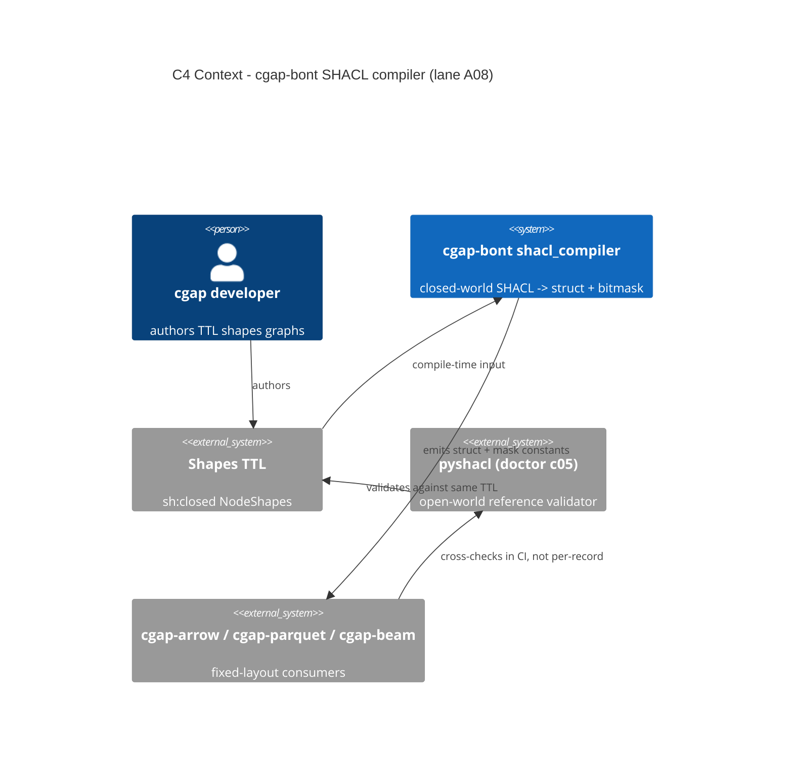

# A08: SHACL NodeShape -> Fixed Struct + Bitmask Compiler (Lane A08)

- **Status**: PARTIAL_ALIVE (design landed; crate `cgap-bont` PROPOSED, not yet built)
- **Lane**: A08 of 20, Squadron 2, overnight-campaign v26.11.1
- **Subject file**: `crates/cgap-bont/src/shacl_compiler.rs` (crate PROPOSED)
- **Exit gate**: mandatory/optional SHACL property constraints evaluate via a
  single mask operation (AND-compare or AND+popcnt+test), register-resident,
  O(1) in property count.

## 1. Context

SHACL (W3C Shapes Constraint Language) validates an RDF graph against shape
declarations. As standardized, SHACL validation is **open-world-ish**: absence
of evidence is not evidence of absence, and even `sh:closed true` permits
properties via `sh:ignoredProperties` and treats undeclared properties as
violations only when the flag is present. Downstream consumers in cgap
(cgap-arrow / cgap-parquet / cgap-beam schema surfaces) need the opposite: a
fixed in-memory layout where the legal property set is closed and known at
compile time, so presence validation of a focus node is a pure integer
operation, not a graph traversal.

This lane compiles a **closed-world subset** of SHACL into a fixed struct plus
a per-instance presence bitmask. The compiler is a projection of the shapes
graph; the emitted struct + mask evaluator is the runtime.

### Closed-world compilation semantics (stated honestly)

Compiling to a fixed struct + presence mask asserts, at compile time, that:

- The property set is **frozen**. A property not declared on the shape cannot
  be encoded. At the struct layer it is unrepresentable; at the mask layer it
  fails `IllegalProperty`.
- Property **presence/absence** is the validation subject. Value constraints
  (patterns, lengths, `sh:in`, counts beyond minCount 0/1) are NOT folded into
  the mask; they remain a stage-2 validation pass over the struct.
- The shapes graph is a **compile-time input**. No runtime shape loading, no
  runtime targeting. `sh:targetClass` targeting stays at the call site.

What this gives up: any instance valid under open-world SHACL but carrying an
undeclared property, or violating a value constraint the mask cannot see, will
be judged by the narrower closed-world verdict. pyshacl (doctor check `c05` in
`crates/cli/src/bin/doctor.rs`) remains the open-world reference validator;
in CI, pyshacl PASS + mask FAIL is a compiler bug, not a data bug.

### Typed refusal registry (no silent drops)

| Refused construct | reason_code | Reason |
|---|---|---|
| missing / `false` `sh:closed` | `NotClosedShape` | open-world shapes not compilable here |
| `sh:pattern`, `sh:in`, length constraints | `ValueConstraintOutOfMaskScope` | value; stage-2 |
| `sh:minCount > 1`, `sh:maxCount` | `CardinalityUnsupported` | mask encodes presence, not counts |
| `sh:qualifiedValueShape` | `CardinalityUnsupported` | subset cardinality inexpressible |
| `sh:node`, `sh:not`, `sh:xone` | `LogicalShapeUnsupported` | logical shapes; XOR presence only |
| `sh:targetClass` / `Node` / `ObjectsOf` | `TargetingOutOfScope` | targeting at call site |
| > 64 declared properties | `MaskOverflow` | mask width; Wave-2 two-level masks |

Note: `sh:closed true` is not a compiled feature — it is the **eligibility
precondition** of the whole compilation. Its absence is a refusal, not a
default.

Every refusal emits a typed row `ShaclRefusal { shape_iri, construct,
reason_code }` into the persisted compile report. Zero silent drops.

## 2. ADR-008: closed-world SHACL -> bitmask compilation

**Status**: PROPOSED (lane A08, v26.11.1). Supersedes nothing. Complements the
existing pyshacl doctor check `c05`, which remains the open-world reference
validator.

**Decision**:

1. **Closed-world precondition**: only shapes with `sh:closed true` are
   eligible; otherwise REFUSED `NotClosedShape`.
2. **Fixed struct**: each eligible NodeShape -> one Rust struct, one field per
   declared property, datatype from `sh:datatype` mapped to a cgap-bont type.
   Undeclared properties are structurally unrepresentable.
3. **Presence mask**: each declared property gets a fixed bit index (§5b). An
   instance's observed presence pattern is a `u64` (width <= 64; overflow is
   `MaskOverflow`). Presence validation = one mask operation.
4. **Evaluation forms**:
   - **AND path (mandatory presence)**: valid ⇔
     `(observed & M_mandatory) == M_mandatory`. Compiled: `and` + `cmp` —
     2 instructions, register-resident.
   - **Closed-world path** (when the payload is mask-encoded rather than
     struct-locked): `observed & !M_legal == 0` guards undeclared bits.
   - **XOR path (exactly-one-of group)**: valid ⇔
     `(observed & M_group).count_ones() == 1`. Compiled: `and` + `popcnt` +
     `test` — 3 instructions.
   The honest claim: **one mask operation** (a single AND-compare or
   AND+popcnt+test expression), O(1), register-resident, no loops, no memory
   traffic — not "one instruction" in the literal sense. The bounded claim is
   what the exit gate asserts and what the T5 asm witness checks.
5. **Excludes value constraints from the mask**; they run stage-2 on the
   struct (Wave 2, §9).

**Consequences**: schema change = compile-time event; runtime shape mutation
refused. Beneficiaries: cgap-arrow schema checks, cgap-parquet write path,
cgap-beam per-record gating. Cost: open-world semantics surrendered; pyshacl
stays as reference.

## 3. C4 context diagram



## 4. C4 container diagram

```mermaid
C4Container
  title C4 Container - shacl_compiler.rs internals
  Container_Boundary(bont, "cgap-bont (PROPOSED)") {
    Container(ttlParser, "ttl parser", "Rust", "shapes graph -> Shape IR")
    Container(shapeIr, "Shape IR", "Rust", "NodeShape { props, datatypes, closed }")
    Container(layout, "BitmaskLayout", "Rust", "property IRI -> bit index")
    Container(emitter, "struct emitter", "Rust", "struct + mask constants")
    Container(evaluator, "mask evaluator", "Rust", "validate_presence -> MaskViolation")
  }
  Container_Boundary(consumers, "existing crates") {
    Container(arrow, "cgap-arrow", "Rust", "schema check")
    Container(parquet, "cgap-parquet", "Rust", "per-record write gate")
  }
  Rel(shapesTtl, ttlParser, "TTL text")
  Rel(ttlParser, shapeIr, "Shape IR")
  Rel(shapeIr, layout, "eligible shapes only")
  Rel(layout, emitter, "BitmaskLayout")
  Rel(emitter, evaluator, "mask constants")
  Rel(arrow, evaluator, "validate_presence")
  Rel(parquet, evaluator, "validate_presence")
```

## 5. Compilation pipeline

```text
shapes.ttl
  |  (only sh:closed true NodeShapes; else REFUSED NotClosedShape)
  v
[1] parse_ttl -> Shape IR
      NodeShape { iri, closed: bool,
                  props: Vec<PropertyShape{ iri, path, min_count, datatype }> }
[2] eligibility court (typed refusals, section 1 registry)
      -> compile report: accepted shapes + refusal rows, both persisted
[3] BitmaskLayout: property IRI -> bit index
      (stable order: sorted by property IRI ascending)
      emits M_mandatory, M_legal, M_group
[4] struct emitter: one field per accepted property, field order = bit order
[5] evaluator emitter: validate_presence(observed: u64, shape) -> Result
      closed-world:  observed & !M_legal == 0   else IllegalProperty
      AND path:      observed & M_mandatory == M_mandatory  else MissingMandatory
      XOR path:      (observed & M_group).count_ones() == 1 else GroupCardinality
```

Stage-2 value validation (patterns, lengths, `sh:in`) runs on the struct after
the mask gate; out of A08 scope (Wave 2).

### Constructs that compile

| Construct | Compiled to |
|---|---|
| `sh:closed true` | eligibility precondition (refuse if absent) |
| `sh:property` + `sh:path` | struct field + bit index |
| `sh:datatype` | struct field type |
| `sh:minCount 1` | bit added to `M_mandatory` (and `M_legal`) |
| `sh:minCount 0` | bit in `M_legal` only (optional) |
| exactly-one-of group (cgap ext `cgap:exactlyOneOf` on `sh:group`) | bits into `M_group` |

## 5b. Bitmask encoding table (worked example)

Shape `ex:PersonShape`, 4 properties, sorted-IRI bit assignment:

| Property IRI | bit | minCount | M_legal bit | M_mandatory bit |
|---|---|---|---|---|
| `ex:email` | 0 | 1 | 1 | 1 |
| `ex:name` | 1 | 1 | 1 | 1 |
| `ex:nick` | 2 | 0 | 1 | 0 |
| `ex:phone` | 3 | 0 | 1 | 0 |

Mask constants:

- `M_legal     = 0b1111` (bits 0..3)
- `M_mandatory = 0b0011` (bits 0,1: email, name)
- `M_group     = 0b0000` (no group in this example)

Worked evaluations:

- Record with email+name+phone: `observed = 0b1011`.
  `0b1011 & 0b0011 == 0b0011` -> valid.
- Record missing `email`: `observed = 0b1001`.
  `0b1001 & 0b0011 == 0b0001 != 0b0011` -> `MissingMandatory`.
- Record with undeclared bit 6 set: `observed & !0b1111 != 0` ->
  `IllegalProperty`.

## 6. Emitted IR and the single-mask-operation argument

Compile-report IR (serde-serializable, persisted artifact):

```rust
pub struct CompiledShape {
    pub shape_iri: String,
    pub mask_width: u8,           // <= 64, else MaskOverflow at compile time
    pub bits: Vec<(String, u8)>,  // (property IRI, bit index), sorted by IRI
    pub m_mandatory: u64,
    pub m_legal: u64,
    pub m_group: u64,
}
```

The entire runtime evaluator (emitted verbatim per shape):

```rust
#[inline]
pub fn validate_presence(
    observed: u64,
    s: &CompiledShape,
) -> Result<(), MaskViolation> {
    if observed & !s.m_legal != 0 {
        return Err(MaskViolation::IllegalProperty);
    }
    if observed & s.m_mandatory != s.m_mandatory {
        return Err(MaskViolation::MissingMandatory);
    }
    if s.m_group != 0 && (observed & s.m_group).count_ones() != 1 {
        return Err(MaskViolation::GroupCardinality);
    }
    Ok(())
}
```

**Argument.** For a shape with no exactly-one-of group, and where the struct
layer already guarantees closedness (a fixed struct cannot hold an undeclared
field, so the `m_legal` guard is only needed for mask-encoded payloads), the
mandatory check reduces to `(observed & M_mandatory) == M_mandatory`. On
x86-64 this compiles to `and` + `cmp` — 2 instructions, register-resident,
constant time regardless of property count. The XOR path is `and` + `popcnt`
+ `test` — 3 instructions. The exit-gate claim is therefore stated and
verified in its bounded form: **a single mask operation (one AND-compare, or
one AND+popcnt+test), register-resident, O(1) in property count, no loops,
no graph traversal.** T5 witnesses this mechanically; if the asm witness is
unavailable in the environment, UNSUPPORTED is recorded with the exact
blocking command + stderr — never a silent skip.

## 7. Chicago test plan + anti-vacuity mutations

Real collaborators throughout: real TTL fixture files, real cargo subprocesses,
real emitted asm on disk. No mocks, no stubs.

- **T1 build gate**: `cargo build -p cgap-bont` exit 0 (requires the PROPOSED
  crate to actually exist).
- **T2 constraint court (anti-vacuity core)**: shape with `ex:name` mandatory
  at bit 0. Assert (a) present -> Ok, (b) missing -> `Err(MissingMandatory)`.
  Mutation M1: clear one mandatory bit in the emitted `M_mandatory` constant
  (simulating a compiler bug that drops a bit) and assert the same input
  flips Ok -> Err. **A constraint court that cannot flip is FAIL.** The flip
  proves the bit is load-bearing, not decorative.
- **T3 XOR court**: group {email, phone}: both set -> Err, exactly one -> Ok,
  none -> Err. Mutation M2: clear `M_group` -> the both-set case must flip
  Err -> Ok, else FAIL.
- **T4 closed-world court**: undeclared bit set -> `Err(IllegalProperty)`.
  Mutation M3: set `m_legal = u64::MAX` (simulating open-world) -> the
  illegal-property case must flip Err -> Ok, else FAIL. This proves the
  closed-world assumption is load-bearing, not prose.
- **T5 asm witness**: `cargo rustc --release -- --emit asm` on a scratch crate
  calling `validate_presence` with a constant `CompiledShape`; grep the
  emitted `.s` for `and`/`cmp` on the AND path and `popcnt`/`test` on the XOR
  path; assert no call/loop instructions on the AND path. If asm emission is
  unavailable: record UNSUPPORTED with the exact command and stderr.
- **T6 round-trip**: real TTL fixture -> compiler -> `CompiledShape` JSON ->
  re-read -> byte-equal masks (`m_mandatory`, `m_legal`, `m_group`
  identical across two runs; deterministic-serializer law).
- **T7 refusal corpus**: each reason_code in the §1 registry has a TTL fixture
  producing that typed refusal, each witnessed by a passing test. A refusal
  code with no passing witness is loudly MISSING in the compile report.

Anti-vacuity summary: three named mutations (M1 bit-clear, M2 group-clear,
M3 open-world m_legal) each must flip a test verdict; T5 gates the
single-mask-operation claim; T7 makes every refusal code witnessed. A skip is
loud (named UNSUPPORTED with blocking fact), never a faked pass.

## 8. Definition of Done (10)

1. `crates/cgap-bont` exists (Cargo.toml, src/lib.rs, src/shacl_compiler.rs);
   `cargo build -p cgap-bont` exit 0.
2. TTL -> Shape IR parser handles `sh:closed`, `sh:property`, `sh:path`,
   `sh:datatype`, `sh:minCount` against real TTL fixtures.
3. Eligibility court emits typed refusals for all reason codes in §1, each
   witnessed by a passing T7 test.
4. BitmaskLayout assigns stable, sorted-IRI bit indices; byte-identical across
   two runs (T6).
5. Emitted evaluator reduces presence validation to a single mask operation,
   witnessed by T5 asm evidence or recorded UNSUPPORTED with blocking fact.
6. Mutations M1, M2, M3 each flip their court's verdict; flip receipts
   (command + exit code) in the lane receipt.
7. T6 round-trip byte-equal masks.
8. `MaskOverflow` (>64 props) witnessed by a test.
9. Compile report artifact (accepted + refused rows) persisted per compile.
10. Wave-2 items filed as follow-on work orders.

## 9. Wave 2

- **W2-1**: stage-2 value validation (patterns, lengths, `sh:in`) over the
  struct; mask stays presence-only.
- **W2-2**: `sh:node` nested shapes -> nested struct + hierarchical mask
  validation (retires `LogicalShapeUnsupported`).
- **W2-3**: >64 properties via two-level masks (u64 lanes); retires
  `MaskOverflow`.
- **W2-4**: ggen pack projecting TTL shapes through the compiler as a
  generated pipeline (ggen_igniter), replacing hand-written per-shape wiring.
- **W2-5**: schema evolution: two `CompiledShape` versions -> generated
  mask-migration function (property rename = bit move + shift).

## 10. Risks

- **Closed-world narrowing**: instances valid under open-world pyshacl may
  fail the mask gate. Mitigation: pyshacl c05 stays as reference; CI rule:
  pyshacl PASS + mask FAIL = compiler bug, not data bug.
- **Bit-order stability**: a re-sorted IRI ordering silently changes masks.
  Mitigation: T6 byte-equal round-trip; deterministic-serializer law.
- **Per-shape bit namespaces**: the same property IRI in two shapes gets
  independent bit indices; documented, tested per-shape.
- **asm emission environment-dependence**: cross-compilation or sandboxing
  may block `--emit asm`; T5 names the UNSUPPORTED path with the blocking
  command + stderr.
- **Crate is PROPOSED**: until DoD 1 lands, this doc is design capital, not
  execution capital; lane stands PARTIAL_ALIVE (design), not ALIVE.

## 11. Standing

- Design/ADR/this doc: PARTIAL_ALIVE (written this session).
- Crate `cgap-bont` + `shacl_compiler.rs`: NOT BUILT (PROPOSED).
- Exit gate: UNVERIFIED (no cargo run, no asm witness this session).
- Standing rises only from receipts: cargo exit codes, asm witness file,
  mutation-court flip receipts.

## See Also

- `/Users/sac/cgap/docs/jira/v26.11.1/00-index.md`
- `/Users/sac/cgap/crates/cli/src/bin/doctor.rs` (pyshacl check c05)
- ADR-008 (section 2) / Chicago test plan (section 7) / Wave 2 (section 9)
