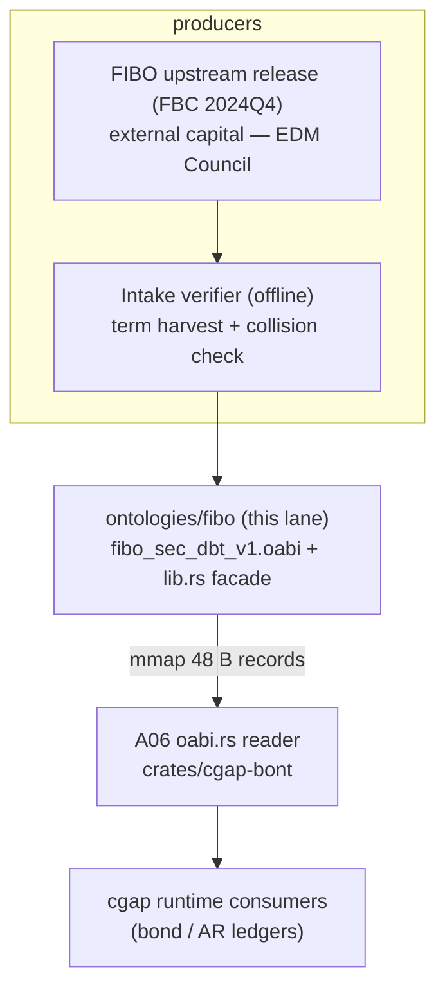
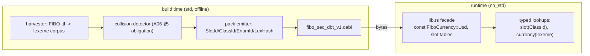
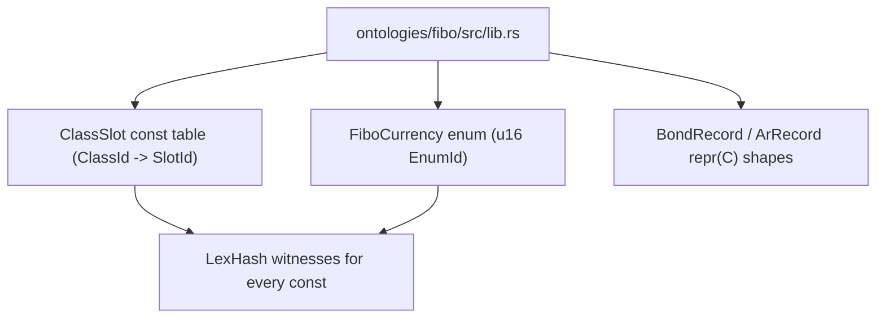

# A09: FIBO Debt / Corporate-Bond / Accounts-Receivable O-ABI Pack (PROPOSED)

- **Lane**: A09 of 20, Squadron 2, overnight-campaign doc fan-out, v26.11.1
- **Status**: PROPOSED (design lane; no `ontologies/fibo` exists yet)
- **Files in scope (PROPOSED)**: `ontologies/fibo/src/lib.rs`,
  `ontologies/fibo/fibo_sec_dbt_v1.oabi`
- **ABI authority**: A06 — `docs/jira/v26.11.1/lanes/A06-bont-scalars.md`.
  `SlotId = truncate64(BLAKE3(lexeme))` over `d[0..8]` LE with namespace tag
  `b"bont\x01"`, `ClassId = u32`, `EnumId = u16`, `LexHash = [u8; 32]`,
  `.oabi` v1 header (64 B) / record (48 B) are all **defined by A06**. This
  lane is a *producer*: it consumes that ABI and emits a pack; it does not
  redefine any width, window, or tag. Where this doc and A06 disagree, A06
  wins and this doc gets corrected.
- **Pack consumer**: A06's `oabi.rs` reader (`OabiRecordV1`, 48-byte records,
  mmap-reinterpretable). The pack in this lane must load through that reader
  with zero per-record transformation.
- **Read-only receipt basis**: `/Users/sac/cgap/crates/cgap-blake3/src/lib.rs`
  (hash substrate, per A06), `/Users/sac/cgap/ontology/cgap.ttl` (existing
  in-repo ontology convention), `Cargo.toml` (workspace, `#![no_std]`
  convention).
- **Coordinator owns**: everything outside the two files above.

## 1. Context

FIBO (the EDM Council's Financial Industry Business Ontology) is the
industry-standard OWL ontology for financial instruments, contracts, and
counterparties. It is enormous — hundreds of modules, tens of thousands of
terms — and it is RDF/OWL: strings all the way down. The cgap runtime wants
the opposite: fixed-width integers, `no_std`, zero runtime strings (the B-ONT
position, A06 Section 1).

This lane manufactures the bridge: a curated **closed-world cut** of FIBO —
debt instruments, corporate bonds, accounts receivable — compiled into a
single `.oabi` pack plus a `no_std` Rust facade (`ontologies/fibo/src/lib.rs`)
exposing the cut as `const` slots and enums. A consumer that needs to know
"USD" or "CorporateBond" or "AccountsReceivable" loads a `u64` slot compare,
not an IRI parse.

What this lane is NOT: a FIBO reasoner, a SPARQL endpoint, or a general FIBO
runtime. It is one frozen vocabulary slice, versioned like any other ABI.

## 2. ADR: scope cut — inclusion and refusal lists (the refusal list matters more)

FIBO is too large to compile whole; the cut IS the design. The refusal list
is load-bearing: anything not explicitly included is *refused*, and a future
addition is a pack version bump, not a patch.

### 2.1 In scope (included modules, FIBO release FBC 2024Q4 baseline)

| FIBO module (abbreviated path) | What we take | Why |
|---|---|---|
| `SEC/Securities/Debt` (`fibo-sec-dbt`) | core debt-instrument classes:
  `DebtInstrument`, `Bond`, `CorporateBond`, `GovernmentBond`,
  `MunicipalBond`, coupon/maturity attributes | the pack's spine |
| `FBC/FinancialInstruments/FinancialInstruments` | `Instrument`,
  issuer/holder relations needed to type the spine | minimal anchoring |
| `FBC/ProductsAndServices/ClientsAndAccounts` | `AccountsReceivable`,
  account/obligor relations | AR ledger half |
| `FND/Utilities/Analytics` (currency individuals only) | ISO-4217 currency
  individuals used by bond denomination (Section 4) | `FiboCurrency` enum |
| `FND/AgentsAndPeople/Agents` (restrictive subset) | `Organization` /
  legal-agent classes referenced by issuer fields | issuer typing |

### 2.2 REFUSED (explicitly out of scope for v1)

- **Equities, derivatives, options, futures, swaps** (`SEC/Equities`,
  `ETD`, derivatives families) — different pack, never this one.
- **Loans/loan servicing detail beyond the debt spine** (`LOAN` modules) —
  A10 territory if anywhere.
- **Regulatory/reporting modules** (`BP`, `BE`, `CAE` regulatory detail) —
  policy, not ABI.
- **Full `FND` foundations graph** (roles, part-whole, temporal extent) —
  only the individuals/classes named above are compiled; the FND closure is
  NOT imported transitively.
- ** owl:Restriction axioms, OWL 2 DL semantics, cardinality constraints** —
  the pack is a vocabulary + schema shape table (Section 5), not a reasoner
  input. Class *hierarchy depth* is flattened to the included-parent edge
  list only.
- **Annotations, labels, rdfs:comment, provenance triples per term** —
  the pack carries lexeme + LexHash; prose stays upstream.

Rule of interpretation: if a consumer asks for a refused term, the answer is
a typed `TermRefused` lookup result naming this section, never a silent
nearest-match.

## 3. C4 diagrams

### 3.1 Level 1 — System context



### 3.2 Level 2 — Container (build and runtime split)



### 3.3 Level 3 — Component (facade internals)



## 4. `FiboCurrency` and `SlotId` assignment (worked examples)

`SlotId` assignment is A06's scheme, restated here only as a *use* of it.
Per A06 Sections 4-6:

```
LexHash  = BLAKE3(b"bont\x01" ++ lexeme_bytes)     // 32-byte root digest
SlotId   = u64::from_le_bytes(LexHash[0..8])       // first 8 bytes, LE
ClassId  = dense u32, assigned by THIS lane's emitter in FIBO-harvest order
EnumId   = dense u16, assigned per enum family
```

Every `SlotId` in the pack and every `const` in `lib.rs` is produced by the
single function of A06 Section 7 (`slot_id(lexeme)`), never hand-minted. The
worked examples below use `S` for a BLAKE3 digest to keep the table readable;
the committed golden table (Section 8, T9) carries the real values.

| Term | Lexeme hashed | ClassId | EnumId | SlotId (illus.) |
|---|---|---|---|---|
| USD currency | `fibo:FndUtlCur:USD` | 0x00000000 | `Usd = 0x0348` | `S1[0..8]` |
| EUR currency | `fibo:FndUtlCur:EUR` | 0x00000000 | `Eur = 0x0349` | `S2[0..8]` |
| JPY currency | `fibo:FndUtlCur:JPY` | 0x00000000 | `Jpy = 0x034A` | `S3[0..8]` |
| CorporateBond | `fibo:SecDbt:CorporateBond` | 0x00000001 | — | `S4[0..8]` |
| Bond (parent) | `fibo:SecDbt:Bond` | 0x00000002 | — | `S5[0..8]` |
| DebtInstrument | `fibo:SecDbt:DebtInstrument` | 0x00000003 | — | `S6[0..8]` |
| AcctReceivable | `fibo:ClAcct:AccountsReceivable` | 0x00000010 | — | `S7[0..8]` |
| maturityDate | `fibo:SecDbt:hasMaturityDate` | 0x00000020 | — | `S8[0..8]` |
| couponRate | `fibo:SecDbt:hasCouponRate` | 0x00000021 | — | `S9[0..8]` |

Design notes:

- **EnumId for currencies is a stable `u16`, not the SlotId**: enum dispatch
  in `match` arms wants a small dense space; the SlotId remains the wire
  identity. `FiboCurrency::Usd = 0x0348` is a *proposed* freeze value; the
  determinism court (T9) is what makes the freeze verifiable, and any renumber
  after freeze is a pack version bump.
- **Dense ClassIds are lane-assigned, order = harvest order**, frozen by the
  pack digest. This mirrors A06's split between sparse identity (SlotId) and
  dense index (ClassId).
- **Every illustrative `S*` above is a placeholder by construction** — the
  real values come from running `slot_id`, which is exactly what T4/T9 in
  A06 and T9 here assert. A hand-typed hex SlotId in a doc is never admitted
  into the pack.

## 5. FIBO provenance and intake discipline (external capital)

The upstream FIBO ontology is **external capital**; this lane does not invent
FIBO contents. Intake discipline:

1. **Pinned release**: exactly one upstream FIBO release is admitted per pack
   version — baseline **FBC 2024Q4** (the EDM Council distribution zip).
   The release URL + SHA-256 of the distribution is recorded in a
   `PACK_PROVENANCE` comment header inside `lib.rs` and in the pack header's
   reserved-free extension area (pack digest covers it).
2. **Verification of terms**: every harvested lexeme is checked against the
   pinned release's TTL sources — the harvester refuses a term whose IRI does
   not resolve in the pinned graph (fail-closed; no hand-typed terms may
   enter the corpus).
3. **No content invention**: class/attribute semantics are not rewritten. If
   FIBO's semantics cannot be represented in the closed-world cut (Section
   2.2 refusals), the term is refused, not approximated.
4. **Version churn rule** (Section 10): a FIBO release bump produces a new
   pack (`fibo_sec_dbt_v2.oabi`) with its own provenance header and its own
   golden court; v1 packs never silently re-resolve against a newer FIBO.

## 6. `.oabi` pack layout (consumer = A06's `oabi.rs` reader)

The pack is byte-for-byte what A06 Section 6 defines:

- Header: magic `b"OABIv1\0\0"`, `header_len = 64`, `version 1.0`, flags
  (bit0 LE, bit1 LexHash-present — both set), `class_count`,
  `enum_count`, `slot_count`, `record_size = 48`, reserved zero.
- Records: `SlotId (8) | ClassId (4) | EnumId (2) | pad (2) | LexHash (32)`,
  48 bytes each, 8-byte aligned, mmap-reinterpretable as
  `&[OabiRecordV1]`.

Producer-side obligations layered on A06's loader checks:

- Every record's `SlotId == truncate64(LexHash)` re-derived at pack load AND
  at pack emit (double check; emit-time failure names the lexeme).
- `class_count` / `enum_count` equal this lane's frozen dense spaces
  (Section 4); a new term that would renumber either triggers a pack version
  bump, never an in-place append, because dense indices are order-frozen.
- Pack digest: the emitter computes and commits a BLAKE3 digest of the full
  pack bytes; `lib.rs` carries it as `const PACK_DIGEST: LexHash` and the
  schema court (Section 8, T7) verifies it at test time. The digest is the
  pack's identity — any byte change flips it.

## 7. `lib.rs` facade (exit-gate shape)

```rust
#![no_std]

/// Pinned FIBO release (PACK_PROVENANCE — see lane A09 Section 5).
pub const FIBO_RELEASE: &str = "FBC-2024Q4";

/// Full-pack BLAKE3 digest (identity of fibo_sec_dbt_v1.oabi).
pub const PACK_DIGEST: [u8; 32] = [/* committed at emit time */; 32];

/// Currency enum family — EnumId = u16 per A06 §2.
#[repr(u16)]
#[derive(Clone, Copy, PartialEq, Eq, Debug)]
pub enum FiboCurrency {
    Usd = 0x0348,
    Eur = 0x0349,
    Jpy = 0x034A,
}

/// Class slots — SlotId per A06 §4 (truncate64(BLAKE3), d[0..8] LE).
#[repr(C, align(8))]
#[derive(Clone, Copy, PartialEq, Eq, Debug)]
pub struct ClassSlot(pub u64);

pub const CORP_BOND:    ClassSlot = ClassSlot(SlotIds::CORP_BOND);
pub const BOND:         ClassSlot = ClassSlot(SlotIds::BOND);
pub const DEBT_INSTR:   ClassSlot = ClassSlot(SlotIds::DEBT_INSTR);
pub const ACCT_RECV:    ClassSlot = ClassSlot(SlotIds::ACCT_RECV);

/// Bond record shape — #[repr(C)] so on-disk == in-memory (A06 §3).
#[repr(C, align(8))]
pub struct BondRecord {
    pub instrument: ClassSlot,   // CORP_BOND | BOND | ...
    pub currency:   FiboCurrency,
    pub slot:       u64,         // instrument SlotId
    pub lex:        [u8; 32],    // LexHash witness
}

/// AR ledger record shape.
#[repr(C, align(8))]
pub struct ArRecord {
    pub class: ClassSlot,        // ACCT_RECV
    pub obligor_slot: u64,
    pub currency: FiboCurrency,
    pub lex: [u8; 32],
}

// ABI freeze asserts — mirrors A06 §7 style, this lane's instances:
const _: () = assert!(core::mem::size_of::<BondRecord>() == 48);
const _: () = assert!(core::mem::align_of::<BondRecord>() == 8);
const _: () = assert!(core::mem::size_of::<ArRecord>() == 48);
const _: () = assert!(core::mem::size_of::<ClassSlot>() == 8);
```

(`SlotIds::*` are the emitted constants from the harvester; exact internal
module layout is implementation detail — the pinned behavior is: all
identities are `const`, the crate is `no_std` with zero runtime
dependencies, and record widths are compile-asserted.)

## 8. Chicago test plan (real collaborators, anti-vacuity mutations)

Chicago discipline: real FIBO lexemes from the pinned release, real pack
bytes, real digests. No mocks — every collaborator is an in-process pure
function or an in-memory byte slice. Anti-vacuity pattern follows A06
Section 8: every court must be witnessed FAILING under a named mutation
before it is accepted as passing.

**T7 — Schema digest court (anti-vacuity: fails on ANY `.oabi` byte
change).** Load `fibo_sec_dbt_v1.oabi` from disk, compute BLAKE3 over the
full byte range, assert equality with `PACK_DIGEST` in `lib.rs`.
*Vacuity checks (all must be witnessed failing)*: (a) flip one byte in a
LexHash field -> court fails; (b) append one zero byte -> fails; (c) swap
two records' order -> fails. A court that survives any of these is a
VACUOUS GATE and the lane is not done.

**T8 — Currency enum court (anti-vacuity: fails if a constant changes).**
Assert `FiboCurrency::Usd as u16 == 0x0348` (and Eur/Jpy) against a
committed golden table; also assert the *reverse* mapping: the pack record
whose EnumId is `0x0348` carries the USD lexeme's LexHash. *Vacuity checks*:
mutation "change Usd to 0x0349" must fail T8 (collision with Eur's golden
row makes the reverse check fail even if the forward assert is also
shimmed); mutation "swap Usd/Eur discriminants" must fail the reverse
LexHash join.

**T9 — Determinism court (A06 T1 applied to the FIBO corpus).** The full
harvest corpus (Section 2.1) re-hashed via `slot_id` equals the committed
golden SlotId table, record-for-record, in harvest order. Mutations
witnessed failing: truncation-window shift, namespace-tag drop (inherited
from A06 T1 semantics, re-run against this corpus).

**T10 — Loader round-trip through A06's reader (real collaborator, not a
stub).** mmap/`from_raw_parts` the real pack through `OabiRecordV1` and
assert: record count matches header `slot_count`; every record re-derives
`SlotId` from `LexHash`; the set of ClassIds is exactly Section 4's dense
space. Mutation "one record's SlotId byte corrupted" must be refused by the
reader with a typed error (inherited A06 T3 behavior, witnessed on this
pack).

**T11 — Refusal-list court.** For a sample of refused terms (Section 2.2:
`fibo:Equity`, an option class, a regulatory module term), assert the
harvester refuses the term AND no pack record carries its lexeme. Mutation
"add `fibo:Equity` to the corpus" must fail the emit with a typed
`TermRefused` naming Section 2.2.

**T12 — Record-shape court.** `BondRecord`/`ArRecord` byte round-trip
against committed golden blobs (A06 T2 pattern); widening mutation
(`currency: u16 -> u32`) must fail both the const-assert compile gate and
T12.

## 9. Definition of Done (8+)

1. `ontologies/fibo/src/lib.rs` exists, `#![no_std]`, zero runtime
   dependencies; all `const` identities, no lazy statics, no alloc.
2. `FiboCurrency` (>= Usd/Eur/Jpy), `ClassSlot` constants for the Section
   2.1 class set, `BondRecord`/`ArRecord` — all compile with Section 7
   const-asserts.
3. `fibo_sec_dbt_v1.oabi` emitted through the pinned-release harvester with
   PACK_PROVENANCE (release id + distribution SHA-256) recorded.
4. Every pack record passes emit-time and load-time
   `SlotId == truncate64(LexHash)` re-derivation (A06 §5 obligation).
5. T7 digest court passes with all three vacuity mutations witnessed
   failing.
6. T8 currency court passes both directions (forward constants, reverse
   EnumId->LexHash join); both mutations witnessed failing.
7. T9 determinism court passes against the committed golden table for the
   full corpus.
8. T10 loader round-trip through A06's `OabiRecordV1` passes on the real
   pack bytes; corrupted-record mutation refused with a typed error.
9. T11 refusal-list court passes; a `TermRefused` emit failure is witnessed
   on an injected refused term.
10. T12 record-shape courts pass against golden blobs; widening mutation
    witnessed failing the compile gate.
11. Build-time collision detector (A06 §5 obligation, producer side) runs
    over the full corpus with zero collisions at emit.
12. `cargo build`/`cargo test` clean for the lane's test targets in the
    shared checkout; lane leaves no build-root artifacts.

## 10. Risks

- **FIBO version churn (primary risk).** Upstream FIBO releases regularly
  move/rename classes; a release bump can invalidate lexemes, remap
  ClassIds, and break the golden courts. Mitigation: the pack is versioned
  (`_v1`) and pinned to one release (Section 5); a bump is a new pack + new
  golden court, never an in-place re-resolution. The pack digest makes any
  drift loud (T7) rather than silent.
- **FIBO size / harvest blowup.** The closed-world cut (Section 2) bounds
  the corpus; the refusal list is enforced mechanically (T11), so scope
  creep in the harvester is a failing test, not a review-time judgment.
- **SlotId collision** at FIBO scale: bounded by A06's Section 5 math
  (negligible at 1e6 lexemes) plus the mandatory emit-time collision check
  (DoD 11).
- **Dense-index freeze pressure.** Appending a class mid-stream would
  renumber ClassIds and break consumers holding stale indices. Rule:
  append-only at the END of the dense space until the space is exhausted,
  then a new pack version.
- **EnumId freeze coupling with A06's EnumId width (u16)**: the currency
  family is small; if a future cut needs >65k variants in one family that
  is an A06 ABI break, escalated to the coordinator, not patched here.
- **Placeholder-constant hazard**: hand-typed illustrative hex values (this
  doc's `S*`, even `0x0348`) are documentation, never admitted into the
  pack; T8/T9 make actual hand-minting fail loudly.

## 11. Wave 2 (02:00-04:00) — producer implementation window

- Wave 1 dependency: A06's ABI freeze (SlotId/ClassId/EnumId/LexHash widths
  and `.oabi` v1 layout) must be in `RESOLUTIONS.md` before this lane emits
  anything — this lane inherits, never forks, that ABI.
- Wave 2 deliverables: harvester + collision check + emitter against the
  pinned FIBO release; `fibo_sec_dbt_v1.oabi` + committed pack digest;
  `lib.rs` facade with emitted constants; all Section 8 courts green with
  witnessed vacuity mutations; DoD 1-12 checked with command receipts.
- If A06's freeze slips, this lane holds at BLOCKED (cite
  `RESOLUTIONS.md` gap) rather than locally widening anything.

## See Also

- `docs/jira/v26.11.1/lanes/A06-bont-scalars.md` — ABI authority (SlotId
  scheme, `.oabi` v1 container, reader)
- `crates/cgap-blake3/src/lib.rs` — hash substrate (read-only basis)
- `ontology/cgap.ttl` — in-repo ontology convention
- Sibling lanes: A10 (second producer), A01/A11/A17 (ABI consumers)
