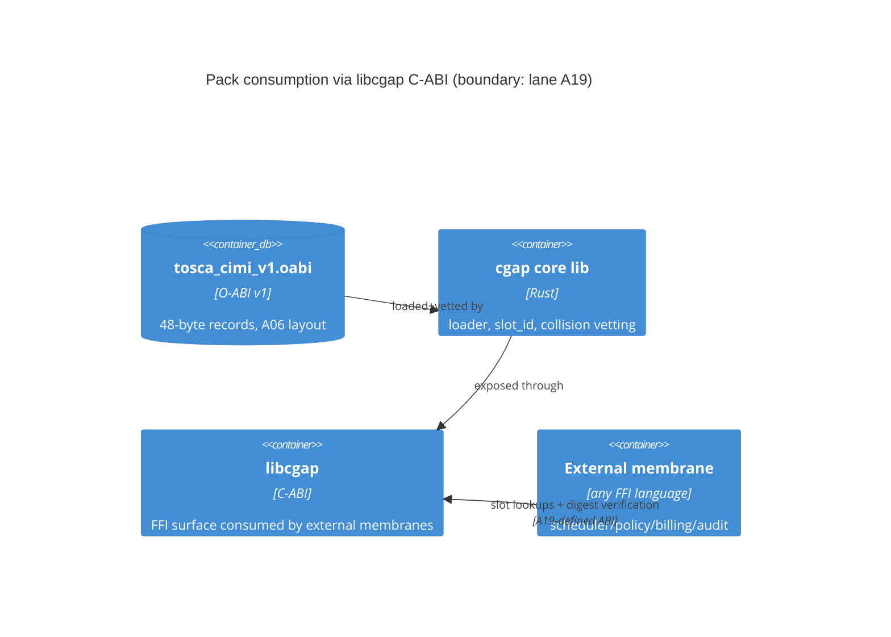

# A10: vendor-neutral cloud resource O-ABI pack (TOSCA/CIMI)

Lane: A10 of 20, Squadron 2, cgap overnight campaign v26.11.1.
Status: PROPOSED (all artifacts in this lane are PROPOSED until courts pass).
Files owned by this lane (disjoint ownership, everything else read-only):

- `docs/jira/v26.11.1/lanes/A10-cloud-oabi.md` (this document)
- `ontologies/cloud/src/lib.rs`
- `tosca_cimi_v1.oabi`

## 1. Context

cgap compiles ontology lexemes to canonical 64-bit `SlotId`s (authority:
A06, `docs/jira/v26.11.1/lanes/A06-bont-scalars.md`). Downstream membranes
— scheduler, policy, billing, audit — need a shared, vendor-neutral
vocabulary of *cloud resources* so that a "virtual machine" means the same
slot in every consumer, regardless of which provider's SDK produced the
event. Without a pinned pack, each membrane invents its own string->slot
mapping and the O(N^2) drift law applies: N membranes, N^2 pairwise
reconciliations.

This lane ships the vendor-neutral cloud O-ABI pack: an ontology crate
(`ontologies/cloud`) plus a serialized pack (`tosca_cimi_v1.oabi`) that
external membranes consume through `libcgap`'s C-ABI (boundary lane: A19).

### 1.1 Sources read

- `docs/jira/v26.11.1/lanes/A06-bont-scalars.md` — SlotId derivation
  (`SlotId = u64::from_le_bytes(BLAKE3(b"bont\x01" ++ lexeme)[0..8])`),
  ClassId u32 / EnumId u16 / LexHash 32 B widths, `.oabi` v1 header
  (magic `OABIv1\0\0`, header_len 64, record_size 48) and record layout
  `SlotId(8) | ClassId(4) | EnumId(2) | pad(2) | LexHash(32)`, loader
  refusals, static-assertion gate, and the Chicago court pattern this
  lane mirrors.
- Existing repo structure: `ontologies/` (ontology crates),
  `crates/cgap` (umbrella facade), `crates/cgap-blake3` (hash
  dependency cited by A06 Section 7).

## 2. ADR: why TOSCA + CIMI as the vendor-neutral spine

**Decision.** The pack's class/enum vocabulary is drawn from two
vendor-neutral standards, not from any cloud provider's SDK shape:

- **OASIS TOSCA** (Topology and Orchestration Specification for Cloud
  Applications) — node types give the *compute/topology* vocabulary:
  `tosca.nodes.Compute`, `tosca.nodes.BlockStorage`,
  `tosca.nodes.Network`, `tosca.nodes.software.Component`, etc.
- **DMTF CIMI** (Cloud Infrastructure Management Interface) — resource
  models give the *management-plane* vocabulary: `Machine`,
  `MachineImage`, `Volume`, `VolumeImage`, `Network`, `Meter`,
  `Event`, `Job`.

**Why (in order of force):**

1. **Vendor neutrality is the requirement, not a preference.** AWS /
   Azure / GCP SDK shapes each bake in provider-isms (ARNs, resource IDs,
   region enums, SKU taxonomies). Anchoring to any one of them silently
   makes cgap an AWS-shaped ontology. TOSCA and CIMI are the two
   standards bodies (OASIS, DMTF) that already did the neutral-naming
   work; reusing it is prior-art-first, not reinvention.
2. **Two complementary planes, one pack.** TOSCA is deployment/topology
   (what the application looks like); CIMI is runtime management (what
   the provider API operates on). The four cgap primitives split
   cleanly across them (Section 5), and the pair covers both
   provisioning-time and steady-state vocabularies without inventing
   new classes.
3. **Stable published lexemes.** Both specs pin canonical type/resource
   names in prose, so pack lexemes are citable spec strings, not
   local conventions. That makes the SlotId table auditable against a
   third-party document.
4. **Versioned vocabularies exist.** TOSCA profiles and CIMI resource
   models have version identifiers, giving the pack a natural
   `tosca_cimi_v1` generation label that maps onto the `.oabi`
   `version_major/minor` fields.

**Refused alternatives:**

- **Cloud-provider SDK shapes as the spine** (AWS SDK model files, Azure
  ARM types, GCP discovery docs). Refused: vendor lock-in at the
  ontology layer; every non-provider membrane pays translation tax;
  provider renames silently remap slots.
- **A from-scratch cgap cloud taxonomy.** Refused: reinvents naming the
  standards already settled; no external audit referent; maximizes the
  Unknown-residue surface the doctrine routes to known forms.
- **Full-fidelity import of both specs.** Refused for v1: TOSCA has
  hundreds of node types and CIMI dozens of resources; the pack pins
  only the four primitives' field lists plus their immediate
  superclasses (Section 5). Broadening is Wave 2.
- **A unifying new meta-model over TOSCA+CIMI.** Refused: an
  interpretation layer is exactly the O(N^2) drift this lane exists to
  kill. v1 maps primitives onto the standards' own names; where the two
  specs overlap (e.g. TOSCA `BlockStorage` vs CIMI `Volume`), the pack
  pins BOTH lexemes to the same slot contract via an explicit
  equivalence record rather than choosing a winner (see Section 6,
  mapping-ambiguity risk).

## 3. Architecture (C4)

### 3.1 Context (C1)

```mermaid
C4Context
    title Cloud O-ABI pack — system context
    Person(operator, "Membrane operator")
    System(cgap, "cgap", "SlotId authority; BLAKE3 slot compiler")
    System(cloudPack, "cloud O-ABI pack", "vendor-neutral cloud resource slots (this lane)")
    System(externalMembrane, "External membranes", "scheduler / policy / billing / audit")
    System_Ext(tosca, "OASIS TOSCA spec", "lexeme source (deployment plane)")
    System_Ext(cimi, "DMTF CIMI spec", "lexeme source (management plane)")
    Rel(operator, externalMembrane, "operates")
    Rel(cloudPack, cgap, "compiles lexemes via", "cgap-blake3 slot_id")
    Rel(externalMembrane, cgap, "resolves slots via", "libcgap C-ABI")
    Rel_Ext(tosca, cloudPack, "vocabulary")
    Rel_Ext(cimi, cloudPack, "vocabulary")
```

### 3.2 Container (C2) — consumption boundary



The C-ABI boundary — function names, handle types, error codes — is
**lane A19's contract, cited, not redefined here**. This lane guarantees
that whatever A19 exposes resolves the SlotIds in `tosca_cimi_v1.oabi`
byte-identically.

### 3.3 Component (C3) — pack crate

```mermaid
C4Component
    title ontologies/cloud components
    Component(lexemes, "lexeme table", "const (class, enum, lexeme) triples from TOSCA/CIMI names")
    Component(slot, "slot compiler", "slot_id(lexeme) per A06 Section 7 namespace b\"bont\\x01\"")
    Component(equiv, "equivalence records", "TOSCA<->CIMI cross-spec aliases pinned to one SlotId")
    Component(emit, "pack emitter", "writes tosca_cimi_v1.oabi (A06 Section 6 layout)")
    Component(courts, "courts", "Chicago anti-vacuity tests (Section 7)")
    Rel(lexemes, slot, "feeds")
    Rel(slot, emit, "SlotIds")
    Rel(equiv, emit, "duplicate-slot records")
    Rel(emit, courts, "pack bytes")
```

## 4. SlotId scheme (authority: A06)

This lane does NOT redefine the scheme. Per A06 (cited as the sole
authority):

| Item | Value | A06 reference |
|---|---|---|
| `SlotId` | `u64`, little-endian first 8 bytes of BLAKE3 | Section 4, 7 |
| Namespace tag | `b"bont\x01"` | Section 7 |
| Derivation | `SlotId = u64::from_le_bytes(BLAKE3(ns ++ lexeme)[0..8])` | Section 4 |
| `ClassId` | `u32` | Section 7 |
| `EnumId` | `u16` | Section 7 |
| `LexHash` | `[u8; 32]` (full BLAKE3) = truncation preimage witness | Sections 2, 4 |
| Collision law | two lexemes -> same SlotId is a hard producer error | Section 5 |

Concrete SlotIds for the pack are minted at build time by the pack
compiler; this doc pins the *lexemes* and the *derivation*, not
hand-computed hashes. Committed golden values live in the test corpus
(Section 7, T1) once the court runs — none are claimed as-of-now
(UNVERIFIED by default, per status discipline).

## 5. The four primitive mappings (all PROPOSED)

Every primitive below compiles to canonical 64-bit SlotIds consumable by
external membranes through libcgap (A19 boundary). Field lists are the
pack's pinned lexeme fields; types are the A06 widths.

### 5.1 Compute

TOSCA spine: `tosca.nodes.Compute` (host, OS, endpoints capabilities).
CIMI spine: `Machine` (+ `MachineImage`).

| Field lexeme | Source | Class | Type |
|---|---|---|---|
| `tosca.nodes.Compute` | TOSCA node type | Compute | class root |
| `compute.host` | TOSCA capability | Compute | sub-lexeme |
| `compute.endpoint` | TOSCA capability | Compute | sub-lexeme |
| `compute.os` | TOSCA capability | Compute | sub-lexeme |
| `cimi.Machine` | CIMI resource | Compute | equivalence |
| `cimi.Machine.state` | CIMI attr (STARTED/STOPPED/etc.) | Compute | enum-carrying |
| `cimi.Machine.cpu` | CIMI attr | Compute | sub-lexeme |
| `cimi.Machine.memory` | CIMI attr | Compute | sub-lexeme |
| `cimi.Machine.disks` | CIMI attr | Compute | sub-lexeme |

### 5.2 Blob

TOSCA spine: `tosca.nodes.BlockStorage` (+ `tosca.capabilities.Attachment`).
CIMI spine: `Volume`, `VolumeImage`.

| Field lexeme | Source | Class | Type |
|---|---|---|---|
| `tosca.nodes.BlockStorage` | TOSCA node type | Blob | class root |
| `blob.size` | TOSCA property `size` | Blob | sub-lexeme |
| `blob.volume_id` | TOSCA property `volume_id` | Blob | sub-lexeme |
| `blob.snapshot_id` | TOSCA property `snapshot_id` | Blob | sub-lexeme |
| `blob.attachment` | TOSCA capability Attachment | Blob | sub-lexeme |
| `cimi.Volume` | CIMI resource | Blob | equivalence |
| `cimi.Volume.state` | CIMI attr | Blob | enum-carrying |
| `cimi.Volume.capacity` | CIMI attr | Blob | sub-lexeme |
| `cimi.VolumeImage` | CIMI resource | Blob | equivalence |

### 5.3 EventStream

TOSCA has no native event model; the CIMI spine carries this primitive.

| Field lexeme | Source | Class | Type |
|---|---|---|---|
| `cimi.Event` | CIMI resource | EventStream | class root |
| `cimi.Event.content` | CIMI attr (resource+state) | EventStream | sub-lexeme |
| `cimi.Event.severity` | CIMI attr | EventStream | enum-carrying |
| `cimi.Event.timestamp` | CIMI attr | EventStream | sub-lexeme |
| `cimi.Job` | CIMI resource (async op record) | EventStream | equivalence |
| `cimi.Job.status` | CIMI attr | EventStream | enum-carrying |
| `cimi.Job.progress` | CIMI attr | EventStream | sub-lexeme |
| `eventstream.channel` | cgap-local (A10) | EventStream | sub-lexeme |

`eventstream.channel` is the one cgap-local lexeme (flagged as such in
the lexeme table so audits can distinguish spec-derived from local);
everything else is spec-derived.

### 5.4 Vault

Neither TOSCA nor CIMI models secrets natively. The pack defines Vault as
a **cgap-local class** whose lexemes cite the neutral referents that do
exist (CIMI `Credential` resource) rather than any provider's KMS shape.

| Field lexeme | Source | Class | Type |
|---|---|---|---|
| `cimi.Credential` | CIMI resource | Vault | class root |
| `cimi.Credential.type` | CIMI attr | Vault | enum-carrying |
| `vault.secret` | cgap-local (A10) | Vault | sub-lexeme |
| `vault.lease` | cgap-local (A10) | Vault | sub-lexeme |
| `vault.mount` | cgap-local (A10) | Vault | sub-lexeme |

Vault is declared cgap-local in the pack metadata (Section 6) — an
explicit registered-divergence cell, not a silent extension.

## 6. `.oabi` layout (per A06 Section 6, unchanged)

`tosca_cimi_v1.oabi` uses the A06 v1 layout verbatim — no pack-local
header extensions in v1:

```
offset  size  field
0       8     magic          = b"OABIv1\0\0"
8       4     header_len     (u32 LE) = 64
12      2     version_major  = 1
14      2     version_minor  = 0
16      4     flags          (bit0 LE; bit1 LexHash present)
20      4     class_count    = 4  (Compute, Blob, EventStream, Vault)
24      4     enum_count     (per committed enum-carrying lexemes)
28      4     slot_count     (records follow)
32      4     record_size    = 48
36      28    reserved       (zero)
-- slot_count x 48 B records: SlotId(8)|ClassId(4)|EnumId(2)|pad(2)|LexHash(32)
```

Pack-local metadata that does not fit the v1 header (spec versions,
cgap-local flags, equivalence semantics) lives in the crate as a const
table compiled into `ontologies/cloud/src/lib.rs`, NOT as header
mutations — mutating the header would fork cgap's pack format and is
refused. Loader refusals are exactly A06 T3's five cases; this lane adds
no new refusal paths.

Equivalence records (TOSCA/CIMI aliases) are ordinary 48-byte records:
the alias lexeme gets its own LexHash and its own SlotId, and the
equivalence is a crate-level mapping `alias_slot -> canonical_slot`
so the pack stays a flat A06 record list while cross-spec resolution
remains a pure in-crate lookup.

## 7. Chicago test plan with anti-vacuity courts

Real collaborators only: in-process pure functions and in-memory byte
buffers; nothing here is infeasible in-process, so zero doubles.

**T1 — Golden digest court (anti-vacuity: flips on any byte change).**
Compile the full pack from the committed lexeme table and assert the
pack's BLAKE3 digest equals a committed golden digest. *Mutations that
must flip it*: (a) any lexeme string edited; (b) any record reordered;
(c) a ClassId reassigned; (d) the namespace tag dropped from `slot_id`.
Digest court that still passes under (a)-(d) is VACUOUS and FAIL.
Verified by running the shimmed build before accepting the court.

**T2 — Primitive-slot court (anti-vacuity: flips if a SlotId constant
changes).** For the four primitives' root lexemes (`tosca.nodes.Compute`,
`tosca.nodes.BlockStorage`, `cimi.Event`, `cimi.Credential`) and the
equivalence lexemes (`cimi.Machine`, `cimi.Volume`, `cimi.VolumeImage`,
`cimi.Job`), assert the compiled `SlotId` equals the committed golden
`u64` AND that the crate's `pub const` re-derivation (recompute via
BLAKE3 in the test, spec by hand per A06 Section 4, not by calling
`slot_id`) matches. *Mutation that must flip it*: changing any SlotId
constant in `lib.rs` fails both the const-assert and T2.

**T3 — Loader refusal court (A06 T3, inherited verbatim).** Mutated
pack buffers: bad magic, header_len != 64, record_size != 48, one
record SlotId != truncate64(LexHash), nonzero reserved. Typed error per
case; an accepting loader is FAIL.

**T4 — Equivalence court.** For each TOSCA/CIMI alias pair, assert
`equiv(alias_slot) == canonical_slot` and that the canonical direction
is total (every alias resolves, none self-loop). Mutation "drop one
equivalence row" must flip T4.

**T5 — Exit gate: external membrane consumption.** Compile the pack,
load it through the libcgap boundary stub defined for lane A19's
in-repo tests (real function call through the actual C-ABI symbol, not
a re-import of the Rust API), and assert the four primitive root slots
come back byte-identical to T2's goldens. If A19's surface is not yet
landed, T5 is marked PARTIAL in the receipt and the lane stays
PROPOSED — it does not fake the boundary.

## 8. Definition of Done (8+)

1. `ontologies/cloud/src/lib.rs` compiles with A06 widths
   (`SlotId` u64 / `ClassId` u32 / `EnumId` u16 / `LexHash` 32 B) under
   `assert_eq_size!`/`assert_eq_align!` gates.
2. Lexeme table committed: every TOSCA/CIMI lexeme citable to a spec
   section; cgap-local lexemes (`eventstream.channel`, `vault.*`)
   flagged `LOCAL(A10)`.
3. `tosca_cimi_v1.oabi` emitted with A06 v1 header
   (magic/header_len/record_size exact) and 48-byte records.
4. Loader re-derives every `SlotId` from its `LexHash` and refuses all
   five A06 T3 mutation classes with typed errors.
5. T1 digest court passes AND is demonstrated non-vacuous (each listed
   mutation flips it).
6. T2 primitive-slot court passes for all 12 root+equivalence lexemes
   with committed goldens, non-vacuous under SlotId-constant mutation.
7. T4 equivalence court passes for all TOSCA/CIMI alias pairs, total
   and self-loop-free.
8. T5 consumption gate run through the real C-ABI symbol (or receipt
   marks PARTIAL with the A19 blocker named).
9. Collision-vetting build step run over the full lexeme set: zero
   collisions (A06 Section 5 hard rule).
10. All four primitives' SlotIds resolvable by a consumer that sees
    ONLY the `.oabi` bytes — demonstrated by a test that loads the
    raw file in a fresh process with no crate types.
11. Receipt written with commands, exits, and verification ladder;
    standing remains PROPOSED until T1/T2/T4 pass and T5 is not-BLOCKED.

## 9. Risks

- **Spec drift.** TOSCA and CIMI revisions rename/add node types; a
  rename in an upstream spec does NOT remap committed slots (SlotIds
  are content-addressed to the lexeme bytes pinned at pack time), but
  it does strand the pack as a historical generation — mitigation:
  `version_major/minor` + a new generation file (`tosca_cimi_v2.oabi`),
  never an in-place edit of v1 bytes.
- **Mapping ambiguity between TOSCA node types and CIMI resources.**
  `BlockStorage` vs `Volume` is the witnessed case: same real-world
  thing, different spec identities. v1 refuses to pick a winner and
  pins both with an explicit equivalence record; the risk is that a
  future spec revision breaks an equivalence (attributes drift apart).
  Mitigation: T4 totality court + equivalence rows carry their spec
  citations so a break is diagnosable to a section.
- **Collision risk (A06 Section 5).** 2^64 space, birthday-bounded;
  producer-side vetting is a hard build step (DoD 9). A collision is a
  lexeme-set change, i.e. a new pack generation, not a patch.
- **A19 boundary not landed.** T5 depends on lane A19's C-ABI. If A19
  slips, this lane cannot exit PROPOSED; the dependency is declared
  here rather than faked (law 7: end with a receipt, never a claimed
  execution).
- **Local-lexeme creep.** `vault.*` and `eventstream.channel` are the
  only sanctioned cgap-local lexemes; anything more erodes the
  vendor-neutral claim. Growth of the local set requires a pack
  generation bump and an ADR addendum, not a quiet table edit.

## 10. Wave 2

- Broaden coverage beyond the four primitives' immediate field lists:
  TOSCA `Network`, `software.Component`, `LoadBalancer`; CIMI `Meter`,
  `Network`, `NetworkPort`, `Address`.
- Bidirectional equivalence resolution API in the crate (currently
  alias->canonical only).
- Pack-generation linter: CI court that any new lexeme row must carry
  a spec citation or a `LOCAL(A10)`-class flag.
- Digest-court automation: publish golden digests keyed by pack
  generation so downstream membranes can verify `.oabi` bytes
  out-of-band without loading them.
- If A19 lands late: post-hoc T5 execution and standing flip
  PROPOSED -> verdict in the same receipt format.
