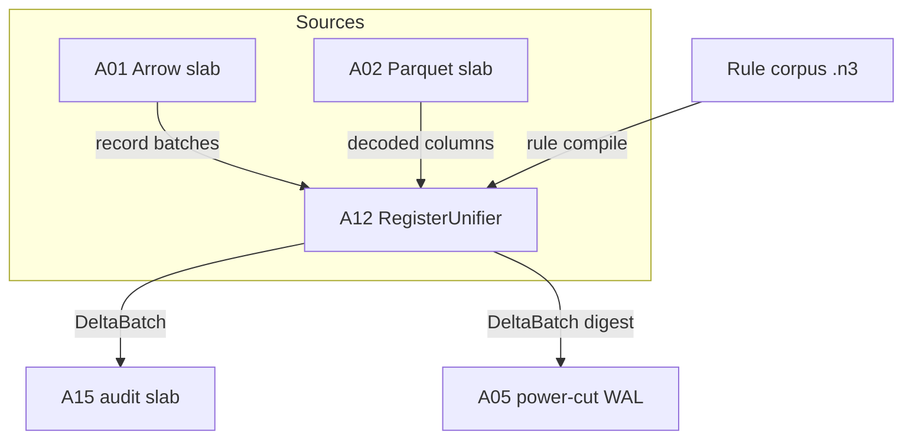
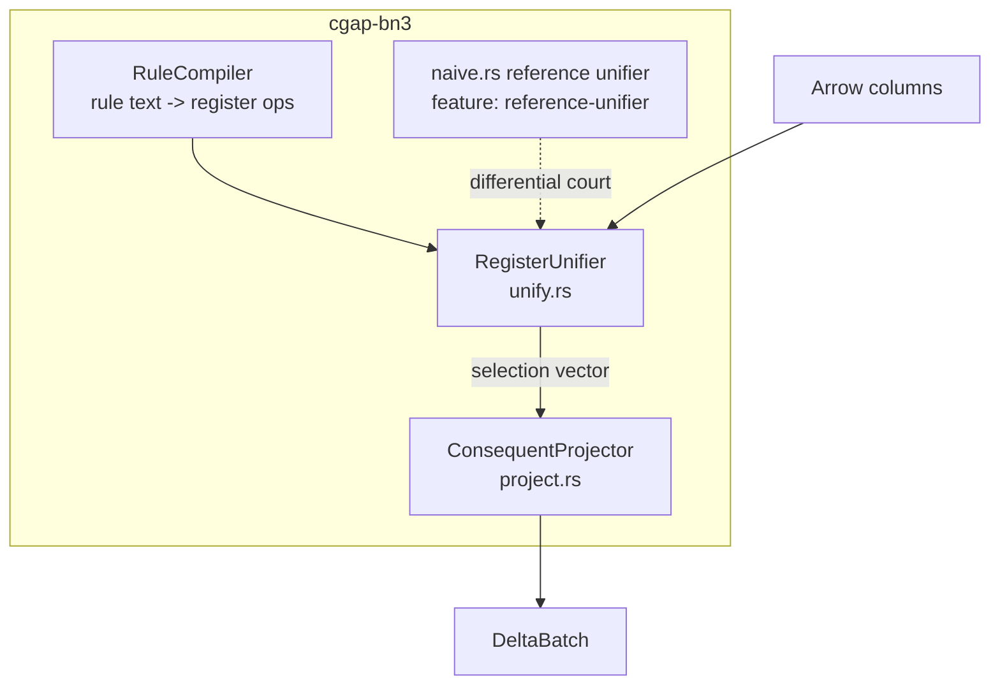
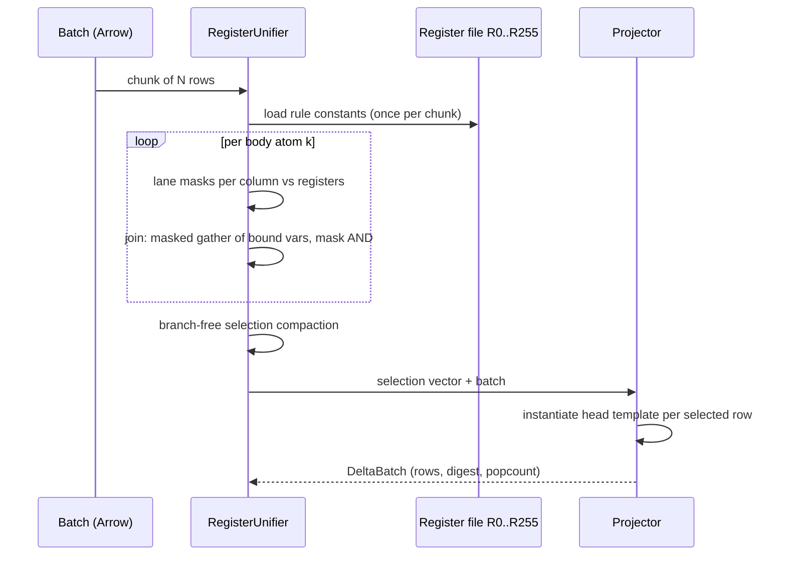

# A12: Branchless SIMD Register Unifier (R0..R255) + Consequent Projector

Lane: A12 of 20, Squadron 3, overnight campaign v26.11.1.
Target files: `crates/cgap-bn3/src/unify.rs` (new),
`crates/cgap-bn3/src/project.rs` (new).
Crate: `cgap-bn3` is PROPOSED in this lane — it does not exist yet; this lane
document is its charter, not a description of an existing crate.
Companions: A15 (audit slab — consumes the delta batches this lane emits),
A05 (power-cut WAL — persistence seam for the unifier's working set),
A02 (Parquet slab — an alternative column source the unifier must tolerate).

## 1. Context

CGAP's engine is statement-oriented. A statement is a 24-byte record
(Section 4.1) — the atom that rules match, unify against, and derive. The
next capability layer is forward-chaining implication: rules of the form
`body => head`, evaluated over columnar (Arrow) statement stores, emitting
derived statements as delta batches that downstream lanes (A15 audit slab)
can consume, hash, and persist.

The design constraint comes from ADR-003 (adopted at the campaign level):
**implication is compiled to a branchless relational scan**, not an
interpreter walking a rule tree. The reasoning: the rule corpus is expected
to be small (tens of rules) but the statement corpus large (millions of
rows); column-at-a-time evaluation amortizes rule overhead across the
column; and the measurable claim is at the CPU frontend — branch
mispredicts — not at wall clock, which the no-sleep doctrine already
deems an unobservable proxy.

The exit gate (TARGET, not measured): N3-style implication rules (`=>`)
execute over Arrow columns with **0 branch mispredicts** in the hot scan
kernel and emit well-formed delta batches. Section 6 defines exactly what
"0 branch mispredicts" means and how it is measured. Until that court runs,
every performance claim in this document is a target, not a result.

## 2. Deliverables

1. `unify.rs` — `RegisterUnifier<R>`: a branchless selection kernel over a
   256-slot virtual register file (`R0..R255`) holding bound term values;
   evaluates rule body conjunctions as mask computations over Arrow
   `UInt8`/`UInt32`/dictionary columns.
2. `project.rs` — `ConsequentProjector`: given the selected row mask and a
   rule head template, emits a `DeltaBatch` — a typed Arrow record batch
   of derived statements, with a deterministic row order and a per-batch
   digest (feeds A15).
3. `naive.rs` (test-support, feature-gated `reference-unifier`) — the
   naive recursive reference unifier used by the differential court
   (Section 7.2). Shipped in the same crate under an explicit feature so
   the court binary and the court only depends on it.
4. `benches/branchy_baseline.rs` — the deliberately branchy baseline
   implementation (Section 6) used as the ratio-fence denominator.
5. Mermaid C4 diagrams (Section 5), statement layout (Section 4), delta
   batch format (Section 4.4), Chicago test plan with named anti-vacuity
   mutations (Section 7), DoD (Section 9), risks (Section 10).

## 3. ADR

### 3.1 Decision: column-at-a-time, not row-at-a-time

Row-at-a-time (Volcano-style) iteration makes one virtual call and one
predicate branch per row per operator; at millions of rows the branch
predictor state is dominated by data-dependent predicate outcomes.
Column-at-a-time (MonetDB/X100 lineage, since deployed in DuckDB and
Velox) evaluates each predicate as a tight vectorized pass producing a
selection vector. This lane adopts column-at-a-time because:

1. The measurable exit gate is branch mispredicts in the hot loop. Only a
   kernel whose hot loop is data-oblivious can plausibly hit it.
2. The input is already Arrow columns (A01/A02 lanes); no row materialize
   is needed on the input side, and the output (delta batch) is Arrow
   again — the format boundary is the same type system end to end.
3. Rule count is small; predicate count per rule is small; vectorization
   overhead (mask temporaries) is amortized across the column length.

### 3.2 Join strategy

Rules may join two statements (e.g. `?x knows ?y` AND `?y knows ?z`).
Strategies considered:

- **Nested-loop with mask AND (chosen for v1)**: evaluate predicate k per
  body atom to a bit/selection mask; joining atom k+1 to k is a mask-AND
  where the join variable's bound value is scattered (Section 4.3). No
  hash table, no reordering; quadratic in atom count, linear in rows.
- **Hash join on bound variables (deferred)**: needed only when a rule's
  body contains a high-selectivity atom followed by a low-selectivity
  one, or when corpora exceed L2. Registered as a risk (Section 10),
  not built in this lane.
- **Sideways information passing / atom reordering**: a planner concern;
  out of scope. The rule corpus is hand-ordered for v1 and the court
  corpus (Section 7.2) is generated so atom order does not change
  correctness — asserted by the differential court against the naive
  unifier, which does its own order.

### 3.3 Why branchless, honestly scoped

"Branchless" is an implementation discipline for the hot kernel:
predicates compile to mask arithmetic (e.g. `a == b` over SIMD lanes
produces a lane mask; conjunction is mask AND; the selection-vector
compaction is a stream-compaction step whose *internal* branches are
popcount/ SIMD-gather driven). The claim is NOT that the compiled binary
contains zero `jcc` instructions — that is false and will not be claimed.
The claim is measurable and narrower, defined in Section 6.

### 3.4 Rejected: recursive interpreter (kept only as reference)

A recursive structural-unification interpreter (naive.rs) is correct,
obvious, and the court's ground truth. It is retained under a test
feature, never linked into the release kernel. Its presence is the
anti-vacuity anchor: any unifier change must keep the differential court
green.

## 4. Data Layout and Algorithm

### 4.1 The 24-byte statement

```
offset  size  field
0       8     subject   : u64 (interned term id)
8       8     predicate : u64 (interned term id)
16      4     object    : u32 (interned term id, small-object pool)
20      2     flags     : u16 (bit 0: object is literal, bit 1: deleted)
22      2     _pad      : zeroed, reserved (court asserts pad is zero)
```

Total 24 bytes — three columns fit a 256-bit register lane group with the
padding column; the layout is asserted by a `const`-evaluated size/align
check and by the pad-zero court mutation (Section 7.3, M12-4).

### 4.2 Register file R0..R255

256 virtual registers, each 8 bytes, partitioned by role:

- `R0..R63`: constant pool — interned values loaded from the rule's
  constant bindings at rule-compile time.
- `R64..R191`: variables — one register per distinct rule variable
  (max 128 variables per rule; the corpus generator never exceeds 8, and
  exceeding 128 is a typed `UnifyError::RegisterOverflow`).
- `R192..R255`: scratch — mask temporaries, join scatter targets, and the
  consequent template's output staging.

The register file is the *binding map*: the rule compiler lowers each
body atom's term triple into a small program of register ops
(`LoadConst`, `BindVar`, `CmpEq reg, col`, `AndMask`, `Scatter reg`),
each of which compiles to a branch-free sequence over an Arrow chunk.
The op list is emitted once per rule per batch-size class, not per row.

### 4.3 Stream path

1. Arrow record batch in (columns: subject u64, predicate u64, object
   u32, flags u16 — dictionary-encoded columns are decoded or
   dictionary-compared per the rule compiler's choice; both paths are
   courted).
2. For each body atom: compute lane masks `subject==R[s]`,
   `predicate==R[p]`, `object==R[o]` over the chunk; combine into the
   atom mask.
3. Join: for atom k+1 referencing a variable already bound by atom k,
   the bound lane values are scattered from atom k's matching rows into
   `R` scratch via a masked gather; the k+1 mask is ANDed against the
   gathered comparison. (This is the one place a data-dependent gather
   appears; it is index-driven, not branch-driven.)
4. After the final atom: compact the surviving row indices into a
   selection vector (branch-free compaction via prefix-sum of the
   inverted mask).
5. Hand the selection vector + batch to the projector.

### 4.4 Delta batch emission format (feeds A15)

```rust
pub struct DeltaBatch {
    pub rule_id: u32,          // emitting rule
    pub epoch: u64,            // monotonically increasing input epoch
    pub rows: ArrowBatch,      // columns: subject u64, predicate u64,
                               // object u32, flags u16 — same layout
                               // as 4.1, column-major, no padding
    pub digest: [u8; 32],      // SHA-256 over canonical row order
    pub source_mask_popcount: u32, // audit: rows selected pre-dedup
}
```

Determinism contract: for a fixed (input batch, rule set), `DeltaBatch`
bytes are byte-identical across runs — asserted by the delta court
(Section 7.3, M12-6). A15 consumes `digest` as its slab anchor; row order
is the input batch's row order filtered by the selection vector, so the
digest is stable without sorting. Dedup (same head derived twice) is
A15's concern, not the projector's — the projector emits derivations,
the audit layer collapses them. This division is asserted by M12-7.

## 5. C4 Diagrams

### 5.1 System context (C1)



### 5.2 Container (C2)



### 5.3 Component (C3: one rule evaluation)



## 6. The Branch-Mispredict Claim: Measurement Definition

The claim "0 branch mispredicts" is a measurable property of a specific
binary on a specific corpus, defined as:

**Definition (BM0 gate).** On the court binary `benches/branchy_baseline`
counterpart `benches/unifier_court`, over the generated corpus of
Section 7.2, `perf stat -e branch-misses,branches,cycles` (Linux;
on macOS fall back to Instruments `br_misp_retired` equivalent or
`dtrace`-sampled counters — the lane documents which counter actually
ran; a court that could not read a hardware counter is FAIL, not
assumed-pass) over the hot scan region only (excluded: allocator, IO,
rule compilation, batch setup):

- ratio `branch_misses / branches` in the unifier hot region is at most
  **0.001** (the ratio fence), AND
- the same ratio for the branchy baseline on the identical corpus is at
  least **10x** the unifier's ratio.

Two-sided fence, per the no-sleep doctrine: the fence is a *measured
ratio against a real baseline on the same machine, same corpus, same
region*, never a hoped wall-clock number. If the machine cannot expose
hardware counters, the gate degrades to `PARTIAL` with the counter
failure receipted — it never silently passes.

**Anti-vacuity of the BM0 gate**: substituting the branchy baseline into
the unifier slot MUST fail the gate (Section 7.3, M12-2). A gate that
passes for both implementations is measuring nothing.

## 7. Chicago Test Plan

Real collaborators throughout: real Arrow batches built in-process, real
corpora generated to temp files, real `perf`/hardware counters where the
OS exposes them. No mocks. The reference unifier is a real (slow)
implementation, not a stub — it is the court's ground truth.

### 7.1 Corpus generation

`tests/common/gen_corpus.rs`: deterministic (seeded) generator producing
(a) statement batches with controlled selectivity per predicate and (b)
rule corpora of 1..=64 rules, bodies of 1..=4 atoms, up to 8 variables,
including: no-match rules, single-match rules, join rules (`?x p ?y . ?y
q ?z`), self-join rules (`?x p ?x`), constant-bound rules, and rules
whose heads re-bind body variables in swapped order. The same seed
always yields the same corpus (asserted).

### 7.2 Differential court (correctness)

For every generated (corpus, batch) pair: run the register unifier to
fixpoint and the naive recursive unifier to fixpoint; assert the derived
statement sets are equal as sets AND the delta batch digests match after
canonical set-ordering (the naive unifier has its own order; the court
compares sets plus per-statement multiplicity). This is the court that
kills silently-wrong mask arithmetic, gather errors, and join-var
scrambles.

### 7.3 Anti-vacuity mutations (each must FAIL the relevant court)

- **M12-1** (mask identity): replace the atom mask AND with OR in a
  copy of the kernel -> differential court must fail.
- **M12-2** (BM0 vacuity): substitute the branchy baseline binary into
  the unifier slot of the perf court -> BM0 gate must FAIL (ratio fence
  not met). A court passing both binaries is VACUOUS.
- **M12-3** (join swap): swap the gather source/dest registers in the
  join step -> differential court must fail on at least one generated
  join rule.
- **M12-4** (pad corruption): write nonzero into the 2-byte pad of a
  corpus statement -> pad-zero assertion must fail loudly.
- **M12-5** (rule drop): silently skip one rule in the fixpoint loop ->
  delta court must fail: a corpus where every rule derives >= 1
  statement guarantees the drop is observable; the generator asserts
  this property of each corpus ("every rule fires" witness), otherwise
  the drop-mutation court is vacuous for that corpus.
- **M12-6** (nondeterminism): reorder chunk processing order ->
  DeltaBatch bytes must be identical (determinism court); failure here
  breaks A15's digest anchoring.
- **M12-7** (dedup smuggling): dedupe derivations inside the projector
  -> the `source_mask_popcount` vs emitted-row-count invariant must
  fail, confirming the projector emits derivations, not collapsed sets.
- **M12-8** (reference divergence): mutate the naive unifier's
  occurs-check -> differential court must fail, proving the court
  actually distinguishes the two implementations (the court's own
  positive control).

A mutation court that cannot fail is recorded as `VACUOUS GATE` and the
lane is not done.

### 7.4 Zero-allocation hot path

Counting-global-allocator test (pattern: `crates/cgap-parquet/tests/
page_zero_alloc.rs`): the scan+project path over a pre-built batch
performs zero allocations after warmup; rule compilation may allocate
(once, outside the timed/court region).

## 8. Wave

Wave 3: depends on A01/A02 slab shapes (consumed as Arrow columns) and
feeds A15 (delta batches) and A05 (digests for WAL). Interfaces with
those lanes are the `DeltaBatch` struct (Section 4.4) and the Arrow
column schema (Section 4.1); if A15's slab charter changes the digest
anchoring, this lane's M12-6 court is the compatibility tripwire.

## 9. Definition of Done

1. `crates/cgap-bn3` exists with `unify.rs`, `project.rs`,
   feature-gated `naive.rs`, `benches/`, `tests/`; `cargo build` and
   `cargo test` clean; `#![no_std]`-compatibility decision made
   explicitly (this lane tolerates `std` for v1 — the perf court needs
   hosted counters — with the `no_std` seam registered, not hand-waved).
2. Differential court green over >= 100 generated (corpus, batch) pairs,
   including every rule class in Section 7.1.
3. All 8 mutations M12-1..M12-8 executed with recorded FAIL receipts;
   any PASS recorded as VACUOUS GATE and fixed before done.
4. BM0 gate executed with real hardware counters (or receipted PARTIAL);
   ratio fence and 10x baseline separation met or the shortfall
   receipted as a measured number with analysis.
5. DeltaBatch byte-determinism court green across reordered chunk
   processing.
6. Zero-allocation hot-path test green with the counting allocator.
7. `every rule fires` witness implemented in the corpus generator and
   asserted (otherwise M12-5 is vacuous).
8. This document's status section updated from TARGET/PROPOSED to the
   actual measured standing with command receipts — no claim in this
   file is treated as measured until Section 6's court has run.

## 10. Risks

- **Register pressure**: 256 virtual registers must lower to real
  registers/SIMD lanes without spills in the hot loop; if the compiler
  spills, the BM0 gate will show it as mispredict/latency noise. Fallback:
  shrink the hot set to R0..R63 with spilled variables held in a mask-
  indexed stack slot (measured, receipted trade).
- **Rule corpora size**: beyond ~64 rules the per-rule mask pass cost
  dominates; the design answer is rule selection/indexing (a predicate
  -> rules inverted index) which is a FOLLOW-UP lane, explicitly out of
  scope here; the court corpus stays within the v1 envelope and the
  envelope is documented, not hidden.
- **Join gather cost**: masked gathers on wide rows may dominate; if
  the BM0 profile shows this, the hash-join strategy (Section 3.2)
  graduates from deferred to planned with its own lane.
- **Counter availability**: CI runners may lack `perf` access; the gate
  then runs on a designated local host with the environment receipted.

## Status

PROPOSED / TARGET — nothing in this file is measured. Receipts land
here as courts run.
