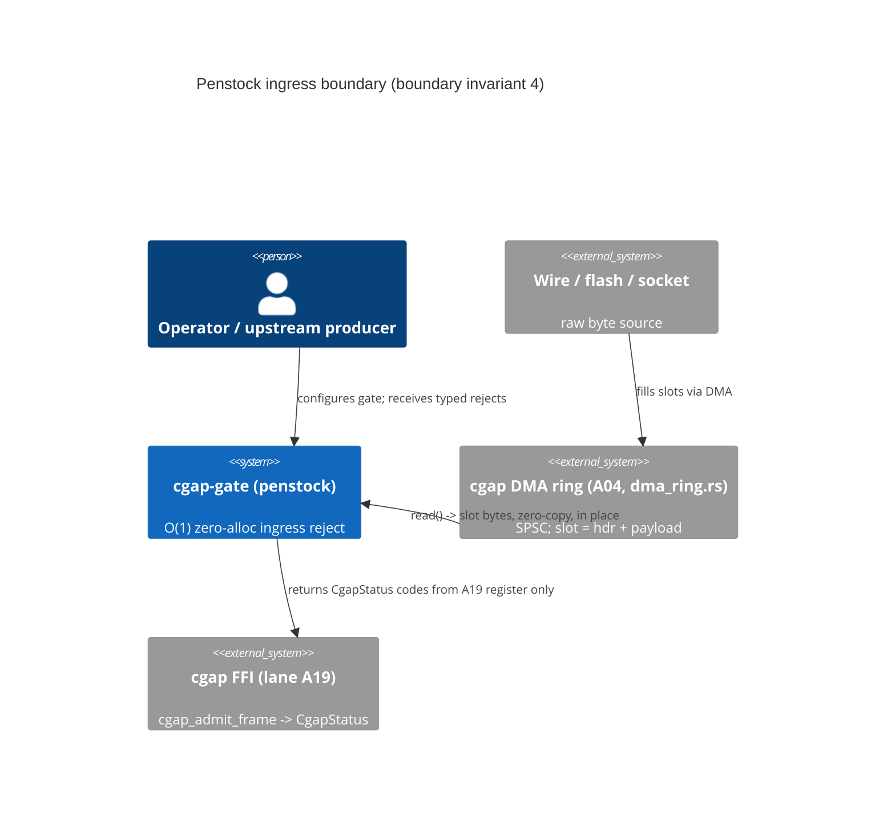
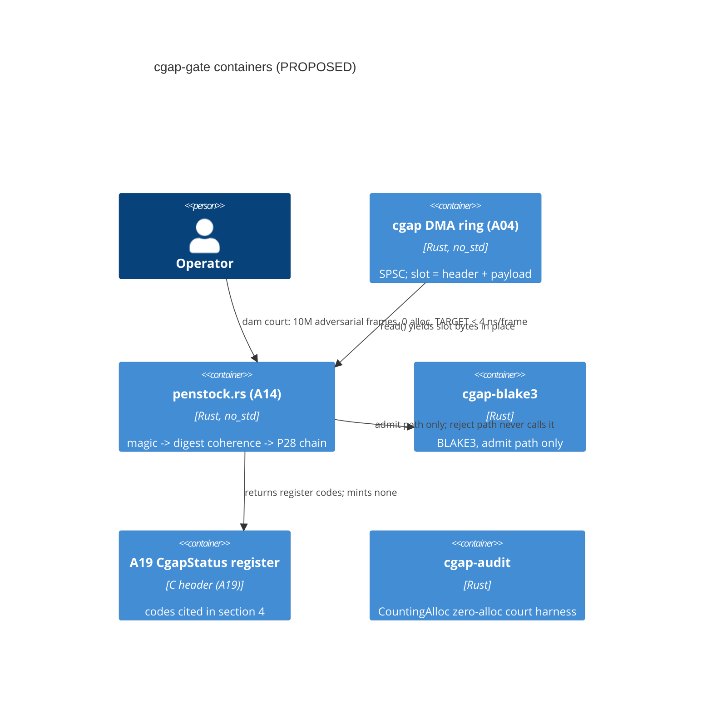

# A14: Dam & Penstock — `cgap-gate` (PROPOSED), `penstock.rs`

Lane: A14 of 20, cgap v26.11.1 overnight campaign. Repo: `/Users/sac/cgap`
(single canonical checkout; no worktrees, no git commands from this lane).
File ownership: this document only; the crate `cgap-gate` it specifies is
PROPOSED, not implemented by this lane. Sibling lanes cited: A04 (canonical
`CgapFrameHeader`, DMA ring), A19 (FFI surface, `CgapStatus` register),
cgap-audit (`CountingAlloc`).

## 1. Status and Standing

- Lane doc: WRITTEN (this file).
- Crate `cgap-gate`: PROPOSED — no code in this lane's deliverable.
- Exit gate (design-level, enforced later by the dam court): **10,000,000
  adversarial/malformed frames rejected with 0 bytes allocated, at a
  per-frame reject cost of < 4 ns/frame — stated as a TARGET, not a
  receipted fact.** The throughput figure is labeled TARGET everywhere it
  appears and is measured per the method in section 8.4.
- Every claim below is a design claim (UNVERIFIED until the dam court
  runs against a real `penstock.rs`). Nothing in this file asserts
  executed verification.

## 2. Context: The Ingress Is a Dam, the Admission Path Is a Penstock

A hydroelectric dam's entire value proposition is refusal: nearly all of
the water that arrives is stopped, and the small controlled fraction that
passes does so through a penstock — a single fixed-geometry conduit whose
behavior is known to the centimeter. The ingress limiter for cgap frames
has exactly the same job. Frames arrive from the wire (socket,
flash-mapped I/O, DMA ring) at line rate; the gate must classify each
frame OK/reject in constant time and constant space, before any
downstream parser, decoder, or allocator ever sees a byte. A frame that
fails the gate is not "parsed and then found invalid" — it never becomes
a frame at all.

This is the wire/ingress instance of the campaign's ADR boundary
invariants. A19's lane doc fixes boundary invariant 1 (all FFI consumers
live outside the repo and see only exported C symbols; A19 §"C4 context",
subgraph "ALL OUTSIDE THE REPO — boundary invariant 1"). The dispatch
contract for this lane names **boundary invariant 4 — the ingress
boundary: nothing that fails the gate crosses it, and the gate is the
first code the bytes meet.** Operationally, three consequences.

1. **First code, not first parse.** `penstock::ingress` is the entry
   point the transport hands raw bytes to. If the bytes are malformed,
   the only observable consequences are a `CgapStatus` code (from A19's
   register, cited below) and the caller's own buffer, untouched.
2. **Nothing malformed is parsed.** No lenient mode, no partial
   admission, no recover-and-repair. Fail-closed decode (M-05 in
   `docs/DFLSS_CHARTER.md` §3, the defining document of the M-register)
   extends from decode to ingress: no panic on bad input, and no
   allocation on any path — reject or admit.
3. **The gate is side-effect free.** `ingress()` reads the caller's
   bytes and writes at most to a caller-provided out-view (A19's
   `cgap_frame_view` pattern: non-owning, zero-copy, MAY be NULL to
   probe). It mints no heap state, so a flood of malformed frames cannot
   exhaust the process through the gate itself — the gate cannot be the
   OOM.

Why a new crate rather than extending A04's `frame.rs` validation: A04
owns the canonical header — layout, digest semantics, static asserts
("any drift between this table and `frame.rs` is a defect in
`frame.rs`", A04 §6). Ingress limiting is a different responsibility —
rate-irrelevant, allocation-irrelevant classification at the transport
boundary — and mixing it into the canonical-definition crate would let
transport concerns mutate the normative layout table. `cgap-gate` is a
consumer of A04's spec, never a co-owner of it. This follows the
campaign's lane-partition law: canonical definitions have exactly one
owner; every other surface cites.

## 3. Spec Honored (Cited, Never Redefined)

The normative definition of the 128-byte `CgapFrameHeader` is owned by
lane A04, `docs/jira/v26.11.1/lanes/A04-triumvirate-isomorphism.md` §6.
A14 does not redefine it. For readability only, the three field groups
the penstock reads are summarized here; the A04 table is normative on
any conflict.

| offset | size | field | A14 relevance |
|---:|---:|---|---|
| 0 | 4 | `magic` = `43 47 41 50` ("CGAP") | first gate check |
| 8 | 8 | `payload_byte_len` (u64 LE) | coherence check vs caller `len` |
| 16 | 32 | `oabi_digest` | BLAKE3 over payload (A04 §6) |
| 48 | 80 | `attestation` (`P28LicenseAttestation`, A04 §6.2) | P28 chain presence |

## 4. ADR: Check Ordering for Early Exit, and Why Magic First

**Decision.** The penstock evaluates its checks in one fixed order and
returns on the first failure:

1. header length >= 128, then `magic == "CGAP"`
   → else `CGAP_ERR_INVALID_MAGIC`
2. O-ABI digest coherence → else `CGAP_ERR_OABI_MISMATCH`
3. P28 chain presence → else `CGAP_ERR_P28_SPOLIATION`

**Why magic first.**

- **Cheapest discriminator.** A single 4-byte load-and-compare against
  a known constant rejects the overwhelming majority of garbage in
  O(1). Every later check costs more: the digest coherence check
  touches 32 bytes plus the length coherence compare; the attestation
  check touches 80 bytes. Ordering by ascending per-check cost under a
  reject-dominated workload means the expensive checks run only on
  frames that deserve them.
- **Highest early-exit yield.** Adversarial corpora (fuzzers, port
  scans, flipped-transport garbage) corrupt the magic with far higher
  frequency than any other field, because magic is the most famous
  field. Putting it first maximizes the fraction of rejects that cost
  exactly one load-and-compare.
- **Alias safety.** A frame with wrong magic has undefined field
  semantics: A04's offset table only means something for genuine CGAP
  frames. Checking magic first means the digest and attestation paths
  never interpret a struct whose fields are not yet known to be in the
  CGAP field grammar — the checks never read meaning into garbage.
- **Precedent.** A04's own validator orders the same way (A04 §5 C4
  component: `validate()` — "magic/version/flags/digest checks"). A14
  is consistent with, and downstream of, that ordering.

**Why digest second, P28 third.** The digest coherence check reads the
32-byte digest field plus the 8-byte length field and compares against
caller-supplied bounds — fixed 40 bytes of header. The P28
chain-presence check is a fixed 80-byte field inspection (attestation
magic `"P28\0"`, per A04 §6.2) plus bounded field compares. Both are
O(1); the ordering is by ascending cost and by semantic dependency
(length coherence must hold before digest coherence is meaningful).

**Status codes.** Every failure mode maps to a code from the
`CgapStatus` enum defined normatively in lane A19,
`docs/jira/v26.11.1/lanes/A19-libcgap-ffi-xip.md` §"C signatures
(normative)". The penstock returns only: `CGAP_OK` (`0x00000000u`),
`CGAP_ERR_INVALID_MAGIC` (`0x43470001u`), `CGAP_ERR_OABI_MISMATCH`
(`0x43470002u`), and `CGAP_ERR_P28_SPOLIATION` (`0x503238FFu`). The
penstock never invents status values; that would fork A19's register.

The fixed order is normative and is pinned mechanically by the
order-pinning court case in section 4.5.

## 4.5 Order-Pinning Court Case

The order is load-bearing, so a court pins it. Construction: frames
that fail check k+1 but pass check k (e.g. valid magic + zeroed digest
field; valid magic + coherent digest + broken attestation magic), run
through the gate, and assert the returned status equals the FIRST
failing check's code, not a later one. Then the shim: reorder the
check bodies in `penstock.rs` (SHIM-COURT marked) — the court must
FAIL (some frames now return a later check's code first). Restore
byte-exact. A court that still passes under the reordered shim is a
VACUOUS GATE, exit 1. This converts section 4's prose ordering into an
executable constraint.

## 5. Rejection Taxonomy (Every Failure Mode -> A19 Status Code)

| # | failure mode | detected by | A19 `CgapStatus` returned |
|---:|---|---|---|
| 1 | len < 128 (truncated header) | length pre-check | `CGAP_ERR_INVALID_MAGIC` |
| 2 | magic != "CGAP" | 4-byte compare | `CGAP_ERR_INVALID_MAGIC` |
| 3 | digest all-zero, or len field > `len - 128` | coherence compares | `CGAP_ERR_OABI_MISMATCH` |
| 4 | attestation magic != "P28\0" (offset 48) | 4-byte compare | `CGAP_ERR_P28_SPOLIATION` |
| 5 | attestation fields out of range (A04 §6.2) | field compares | `CGAP_ERR_P28_SPOLIATION` |
| 6 | reserved flag bits set (bits 4-7) | bitmask compare | amendment candidate, 5.2 |

Row "delegated" (not a gate row): full payload digest mismatch on the
ADMIT path is detected by `cgap-blake3` re-derivation (A04 §6) and
mapped to `CGAP_ERR_OABI_MISMATCH` downstream. A pure-O(1) gate cannot
hash the payload; the penstock's reject path does constant work only,
and full digest verification belongs to the admit path (A04's
`validate()`), which is downstream of the gate. The gate's O-ABI check
is deliberately a *coherence* check: the digest field well-formed and
the declared payload length inside the caller's buffer. This keeps the
reject path O(1) and the 4 ns TARGET checkable in isolation.

### 5.1 Testability of Each Row

Each row above is individually injectable and individually assertable
(section 8), so A19's status reachability law ("every value MUST be
reachable through a real code path on some supported target; an enum
value no injected fault can produce is untested decoration") holds for
the penstock's subset of the register.

### 5.2 Precision Note on the Len<128 Class (Amendment Candidates)

A truncated frame has no magic to compare, and reserved-bits-set is not
currently a named fault in A19's register. Both are documented overloads
or gaps rather than silent choices: row 1 returns
`CGAP_ERR_INVALID_MAGIC` on the reading "not a CGAP frame is exactly
what INVALID_MAGIC means", and row 6 has no register code at all. Both
are routed to lane A19 as amendment candidates (a
`CGAP_ERR_TRUNCATED`-class code and a reserved-bits code), NOT minted
unilaterally by A14. Falsifier: if A19 refuses the amendments,
`cgap-gate` ships A19's ruling, never a private constant.

## 6. The O(1) Argument, Stated Precisely

**Claim.** `penstock::ingress(bytes, len, out)` performs work bounded
by constants independent of the payload length, the caller's buffer
length, and the frame content beyond the fixed 128-byte header.

- **Constant memory.** The gate borrows the caller's bytes as
  `&[u8]` and reinterprets the first 128 bytes as a `&CgapFrameHeader`
  view (A04's type; unaligned-read-free — A04 pins align 64, and the
  gate asserts alignment before the reference is formed, else row-1
  reject). Stack usage is a fixed bound of a few dozen bytes of
  locals; the out-view, when requested, is written into
  caller-provided storage (A19's `cgap_frame_view` pattern). Heap
  allocations on any path: zero. Formal statement:
  `allocs(ingress) = 0 and bytes(ingress) = 0`, enforced by the
  allocation court (section 8.2) over the real `CountingAlloc` surface
  in `crates/audit/src/alloc_counter.rs`.

- **Constant time.** On the reject path the penstock performs at most
  six fixed-size compares: magic (4 B), version (1 B), length
  coherence (8 B), digest-field coherence (32 B), attestation magic
  (4 B), attestation fields (bounded bytes within the 80 B block).
  Every compare reads a fixed number of bytes at a fixed offset from
  the first 128 bytes. Total bytes read <= 128, compare count <= 6,
  no loop over payload, no loop over content. The reject decision is
  therefore a compile-time-known instruction sequence — per-frame
  reject cost is O(1) as a structural property of the code shape,
  not an asymptotic hope. The dam court measures the constant
  (section 8.4, TARGET < 4 ns/frame).

- **Content-independence corollary.** Because the reject decision
  reads only the first 128 bytes, two frames with identical headers
  and different payloads are classified identically. Court case:
  same header, payloads {empty, 1 KiB, 1 MiB} -> same status and
  same measured reject latency within noise. This is the lane's
  contribution to the M-05 fail-closed register row and aligns with
  `docs/DATA_INDEPENDENCE_AUDIT.md`'s content-independence
  discipline.

## 7. Architecture (Mermaid C4)

DMA boundary position: the DMA ring is where the wire meets memory.
Lane A04 owns the ring (`dma_ring.rs`, A04 §7 — fixed capacity in
slots, each slot = one frame: 128 B header + payload; SPSC, no_std,
`read()/release()` invariants). The penstock sits between the ring's
read side and every consumer: the ring's `read()` output is the
penstock's input. Because a slot is exactly one frame, the penstock
classifies slot contents IN PLACE — no copy out of the ring slot, no
copy at all, which is what keeps the zero-alloc claim honest at the
transport boundary and not just at the function boundary.

### 7.1 C4 Context Diagram

### 7.2 C4 Container Diagram

## 8. Chicago Test Plan (Real Collaborators, Assert Final State)

All tests assert on real bytes, real return codes, real allocator
counters. No mocks: nothing in this design has an infeasible real
collaborator, so the Chicago exception never triggers. The real
collaborators are the caller-supplied byte buffer, the real
`CgapFrameHeader` layout per A04 §6, the real `CountingAlloc` from
`crates/audit/src/alloc_counter.rs`, and (admit path only) the real
`cgap-blake3` kernel.

### 8.1 The 10,000,000-Frame Adversarial Corpus (Deterministic, Seeded)

Corpus generation is a deterministic function of one u64 seed: any court
run anywhere replays byte-identical 10M frames — the corpus is
reproducible capital, not a random sample. Mix: 50% pure garbage
(uniform random bytes over full frame length), 25% seeded per-field
mutation classes over the A04 §6.1 offset table, 25% valid frames (must
be ADMITTED — otherwise the court is trivially green and proves
nothing).

Mutation classes (seeded per header field, offsets per A04 §6.1):

| class | target (A04 §6.1) | mutation | expected code (section 5 row) |
|---:|---|---|---|
| MC-1 | 0..4 magic | byte flip; "XGAP"; lowercase "cgap"; all-zero | row 2 |
| MC-1b | frame length | valid header prefix, total len 0..127 | row 1 |
| MC-2 | 8..16 payload_byte_len | len > caller buffer; len overflow | row 3 |
| MC-2b | 16..48 oabi_digest | all-zero digest; digest/payload contradiction | row 3 |
| MC-3 | 48..52 attestation magic | "P29\0"; zeroed; lowercase "p28\0" | row 4 |
| MC-4 | 53..56 sil_level/reserved | sil_level != 2; reserved != 0 | row 5 |
| MC-5 | 5 flags | valid FLAG bits 0x01/0x02/0x04/0x08 (admit); bits 4-7 set (row 6) | row 6 |
| MC-V | all fields | valid frames, all flag combos | `CGAP_OK` |

Seeding: one u64 seed -> SplitMix64; per frame i, derive class id then
per-field payloads. The court first asserts generator determinism
(Chicago final-state assertion: two generations from the same seed are
byte-equal), then consumes a 10M-entry manifest of
(seed, class, expected_code) rows, so a generator mutation that changes
the expected-code map flips the court.

### 8.2 Allocation Court (Zero Alloc, Real CountingAlloc)

The court binary installs `CountingAlloc` as its `#[global_allocator]`
(same pattern as the audit crate's own test binary —
`crates/audit/src/alloc_counter.rs` lines 39-40). Each `ingress` call
runs under the scoped `with_alloc_tracking` guard (same file: per-thread
const-init TLS `Tracking { active, allocs, bytes }`; guard reports
per-thread alloc/byte counts). Assertions, all final-state:

- per call: `allocs == 0 && bytes == 0` for all 10M frames;
- whole run: process counters `TOTAL_ALLOCS` / `TOTAL_ALLOC_BYTES`
  unchanged across the corpus pass (delta == 0).

`CountingAlloc` is not a mock: it forwards every call to `System` with
identical semantics and is a hand-written real interface implementation,
which is exactly the Chicago rule's "not a mock" clause. Scoping note
(risk R3): the tracking guard scopes to ingress calls only; corpus
construction is data preparation and is outside the measured region —
but the guard scope is itself proven real by the anti-vacuity shim
below.

### 8.3 Anti-Vacuity Mutations (the Court Must Be Able to Fail)

A court that cannot flip is decoration. Pinned mutations, each with the
expected failure, executed shim-court style (BASELINE sha256 of
`penstock.rs` -> BEFORE full-corpus PASS -> SHIM marked SHIM-COURT ->
AFTER court must FAIL -> RESTORE sha256 byte-exact, fail-closed):

- **Magic-check removal.** Shim: comment out the magic compare. The
  MC-1 frames (wrong magic) must then be misclassified — some get
  `CGAP_ERR_OABI_MISMATCH` instead of `CGAP_ERR_INVALID_MAGIC`, and a
  wrong-magic frame with coherent digest field and "P28\0"
  attestation magic is ADMITTED outright. The per-class expected-code
  match rate drops below the court's 100% requirement -> court FAILS.
  Positive control (always run, no shim): inject MC-1 frames and
  assert reject with `CGAP_ERR_INVALID_MAGIC` — this assertion is the
  one that cannot survive the shim.
- **Allocation injection.** Shim: one `Vec::with_capacity(8)` inserted
  anywhere in the ingress path. The per-call `allocs == 0` assertion
  must flip the court to FAIL. This also proves the `CountingAlloc`
  install in the gate court binary is live, not silent-zero (risk
  R3b).
- **Check-order shuffle.** Shim per section 4.5; order-pinning court
  must FAIL.

A court run under any shim that still passes exits 1 as VACUOUS GATE.
A skip is loud (`[SKIP] <reason>`), never a faked pass.

### 8.4 Throughput TARGET (labeled TARGET; method; null-baseline ratio)

**TARGET: < 4 ns/frame** reject cost across the 10M-frame corpus. This
is a target, not a receipted fact; nothing was measured this session.

Measurement method (when implemented):

- `criterion` bench at `crates/gate/benches/penstock_bench.rs`
  (PROPOSED), iterating the corpus from a contiguous buffer behind
  `black_box`; per-frame cost = batch total / N, reported as min-of-N
  over paired rounds (ratio-fence law: min-of-N against an independent
  baseline, never a single mean, never a fixed sleep — harness
  readiness is a bounded poll on a completion flag, not
  `thread::sleep`).
- **Null-check baseline.** A baseline fn implementing only the single
  4-byte magic compare (the cheapest lawful check that still rejects
  garbage), measured with identical harness, corpus, build flags, and
  paired rounds on the same host. TARGET: full penstock < 4 ns/frame
  AND <= 3x the null-check baseline. The ratio fence exists so "4 ns"
  cannot be satisfied by accidentally fast hardware: the gate must
  stay within a constant factor of its own cheapest equivalent on the
  same silicon.
- Receipt discloses host, toolchain, `RUSTFLAGS`. Advisory only:
  conformance outranks throughput — the exit gate is the 10M reject +
  zero-alloc court; throughput is a TARGET row in the receipt, never
  the gate.

## 9. Definition of Done (11 items)

1. `crates/gate/` exists with `penstock.rs` implementing
   `ingress(bytes, len, out)` per section 4's normative order;
   no_std-compatible; zero external deps (M-01 register row).
2. Static asserts in `cgap-gate` pin the A04-cited layout against
   A04's `frame.rs` type (`size_of == 128`, `align_of == 64`),
   re-imported, never re-declared.
3. Taxonomy rows 1-6 each injectable via the seeded corpus generator;
   each row's expected A19 status code asserted in the dam court.
4. Dam court: 10,000,000 adversarial frames (50% garbage / 25% seeded
   mutations / 25% valid) — 0 misclassified, exit 0.
5. Allocation court: per-call and whole-run `with_alloc_tracking`
   counts exactly 0 allocs / 0 bytes (real `CountingAlloc`,
   `crates/audit/src/alloc_counter.rs`).
6. Anti-vacuity shims executed: magic-removal -> court FAIL;
   allocation-injection -> court FAIL; order-shuffle -> court FAIL;
   restore sha256 byte-exact; any still-passing shim exits 1 as
   VACUOUS GATE.
7. Throughput TARGET row in the receipt: < 4 ns/frame AND <= 3x
   null-check baseline, min-of-N paired rounds, host disclosed.
   Labeled TARGET until a real bench receipt exists.
8. Content-independence court: identical header, payloads
   {empty, 1 KiB, 1 MiB} -> same status, same latency within noise.
9. Order-pinning court (section 4.5) passes on the real gate and its
   reorder shim flips it.
10. Status-code purity: grep court shows no status constant in
    `cgap-gate` that is not a use/re-export of A19's named constants
    — the penstock mints no codes; amendment candidates live in
    section 5.2, routed to A19.
11. Lane receipt in the campaign ledger citing subject, diff, court
    commands + exits, verification ladder, branch/SHA.

## 9.1 Wave 3 Window

Wave 3 (04:30-06:30, per the campaign wave schedule used by sibling
lane A05): this lane's implementation window. `cgap-gate` moves
PROPOSED -> implemented only inside Wave 3, on this one canonical
checkout, with the dam court as the exit gate. Anything not finished by
06:30 lands as PARTIAL with the unfinished DoD rows named — never
rounded up to done.

## 10. Risks

| id | risk | impact |
|---:|---|---|
| R1 | Digest coherence is weaker than full BLAKE3; crafted headers may pass. | medium |
| R1b | len<128 -> INVALID_MAGIC is an overload A19 may refuse. | low |
| R2 | The < 4 ns/frame TARGET may be unreachable with the full compare chain. | medium |
| R3 | Corpus generation allocates; conflating it with gate allocation vacuates zero-alloc. | low |
| R3b | `CountingAlloc` is per-test-binary; a court binary without it counts silent-zero. | medium |
| R4 | A04's header spec drifts post-draft. | medium |
| R5 | Status register drifts from A19. | medium |
| R6 | This lane doc contains defects the lane-doc court must catch. | low |

Mitigations and falsifiers, per risk id:

- **R1** — Deliberate: the gate is a limiter, not a verifier; full
  verification is the admit path (A04/A19). Falsifier: a gate-admitted
  frame failing downstream digest verification is EXPECTED for
  coherence-class frames; only gate misclassification is a defect.
- **R1b** — Amendment candidate routed to A19 (section 5.2), never
  minted unilaterally. Falsifier: A19 refuses -> gate ships A19's
  ruling, never a private constant.
- **R2** — TARGET is advisory; the exit gate is the court, not the
  nanoseconds. Falsifier: a bench receipt showing > 4 ns names the
  gap; no rounding up.
- **R3** — The tracking guard scopes to ingress calls only (section
  8.2). Falsifier: widening the guard to include corpus construction
  correctly fails — proving the scope is real, not assumed.
- **R3b** — Gate court binary installs `CountingAlloc` (same pattern
  as the audit crate's test binary); the allocation-injection shim
  proves the install is live, not silent-zero.
- **R4** — DoD 2 static asserts fail loudly on drift; A04 §6 declares
  drift a defect in `frame.rs`, so the asserts localize the defect.
- **R5** — DoD 10 grep court: `cgap-gate` uses only A19's named
  constants; a retired code breaks the build loudly.
- **R6** — Intended: the doc court has real positives to find
  (amendment candidates, PROPOSED status, TARGET labels). Its
  falsifier is alive, not vacuous.

## 11. Sources Read (receipt)

All verified on disk this session with real tool output:

- `/Users/sac/cgap/docs/jira/v26.11.1/00-index.md` — charter,
  governing disciplines, UNVERIFIED-standing law for the milestone.
- `/Users/sac/cgap/docs/jira/v26.11.1/lanes/A04-triumvirate-isomorphism.md`
  — §6 canonical `CgapFrameHeader`, §6.1 offset table, §6.2
  `P28LicenseAttestation`, §6.3 flags, §6.4 static asserts, §7 DMA
  ring, validator ordering (§5 C4).
- `/Users/sac/cgap/docs/jira/v26.11.1/lanes/A19-libcgap-ffi-xip.md`
  — `CgapStatus` enum values (§"C signatures (normative)"),
  reachability law, caller/callee ownership table,
  boundary-invariant-1 context.
- `/Users/sac/cgap/crates/audit/src/alloc_counter.rs` (lines 1-80) —
  real `CountingAlloc` surface: `GlobalAlloc` wrapper over `System`,
  `TOTAL_ALLOCS` / `TOTAL_ALLOC_BYTES` atomics, per-thread const-init
  TLS tracking, `#[global_allocator]` install.
- `/Users/sac/cgap/docs/DFLSS_CHARTER.md` §3 — M-register (M-01, M-05)
  and FMEA table.
- `/Users/sac/cgap/docs/jira/v26.11.1/lanes/A05-powercut-wal.md` —
  sibling lane style, standing vocabulary, Wave 3 window framing.

Boundary-invariant-4 note: the dispatch contract for this lane names
the ingress boundary invariant; the repo's lane docs on disk define
boundary invariant 1 explicitly (A19). Invariant 4 is cited here per
the dispatch contract and given an operational definition in section 2;
if the campaign ADR register numbers it differently, A04/A19's register
is authoritative and this doc amends.
