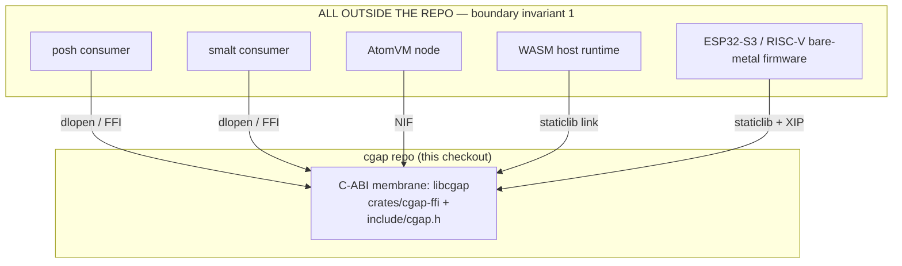
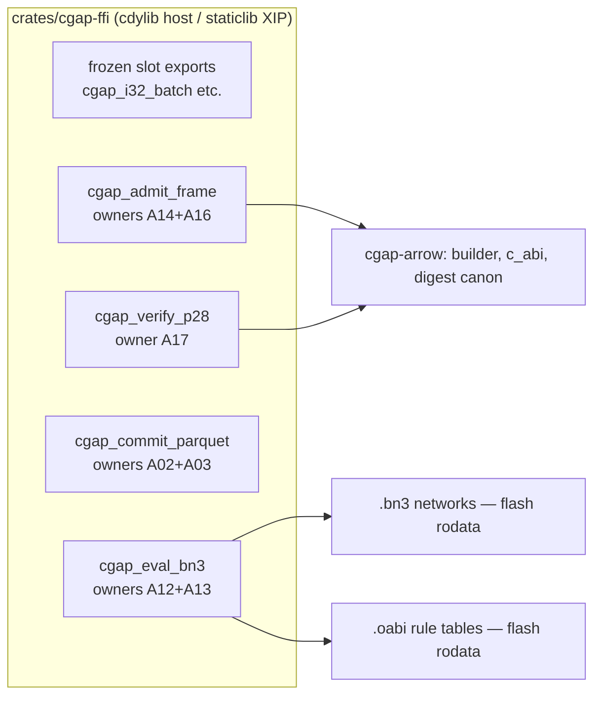

# A19: libcgap — zero-copy C-ABI boundary (libcgap) + ESP32-S3/RISC-V XIP flash target

- **Lane**: A19 of 20, Squadron 4, overnight campaign v26.11.1
- **Wave**: 3
- **Repo**: /Users/sac/cgap (one canonical checkout; no worktrees)
- **Files owned**: `crates/cgap-ffi/src/lib.rs` (EXISTS — extended, not rewritten),
  `include/cgap.h` (new), `xip.ld` (PROPOSED addition)
- **Status**: UNVERIFIED (spec lane; implementation owners cited per function)

---

## 1. Context (ADR-005 lineage)

ADR-005 fixed cgap's boundary law: every foreign consumer crosses exactly one
membrane, the C-ABI. posh, smalt, AtomVM, WASM hosts and bare-metal firmware are
ALL outside this repo (boundary invariant 1) — they see only exported C symbols,
never Rust types, never crates, never paths.

The existing membrane (`crates/cgap-ffi/src/lib.rs`, read this session) is a
cdylib with a slot-based export surface, frozen:

| Symbol | Role |
|---|---|
| `cgap_i32_batch(n, null_every)` | builds a real Arrow `Primitive<i32>` and stores the exported ArrowArray/ArrowSchema in static slots |
| `cgap_schema_addr()` / `cgap_array_addr()` | slot addresses for the foreign importer |
| `cgap_batch_rows()` | length of last export |
| `cgap_version()` | `VERSION_C` NUL-terminated string pointer (drift-guarded vs `VERSION`) |
| `cgap_digest_of(array_addr)` | rotate-xor mutation-detection fold, byte-parity-pinned to `cgap_arrow::digest` |

Wire parity for this surface is proven by `scripts/gate3_cdata.py` importing
through pyarrow's `_import_from_c`. This lane does NOT break that surface. The
four sovereign entrypoints below EXTEND it.

### Why XIP

ESP32-S3 (Xtensa LX7, dual-core, 512 KB SRAM) and RISC-V SoCs (ESP32-C3, GD32VF103)
execute code in place from memory-mapped flash. A cgap evaluator resident in flash
with `.oabi` rule tables and `.bn3` networks as flash-rodata lets a battery device
admit + evaluate cgap frames in <32 KB SRAM with zero rule upload at boot. This is
the smallest defensible ALIVE witness for "cgap everywhere": not a port, one
staticlib linked by a courtroom-grade linker script.

---

## 2. ADR: the four sovereign entrypoints

**Decision**: the entire cgap capability crosses the boundary as four functions.

1. `cgap_admit_frame` — bytes enter; magic/format/SHACL gate or typed refusal.
2. `cgap_eval_bn3` — admitted bytes evaluate deterministically against a flash-
   resident `.bn3` network; zero copies of the input.
3. `cgap_commit_parquet` — evaluated batches commit to Parquet (host targets;
   on MCU this is the spill-to-SD/serial path, size-gated).
4. `cgap_verify_p28` — P28 spoliation evidence verification; digest + license
   predicate, read-only.

**Why exactly four**: admit/eval/commit/verify are the irreducible verbs of the
governed-process loop (admission -> manufacture -> durability -> replay). Any
consumer (Python host, AtomVM node, bare-metal sensor) composes these four; a
fifth verb is either one of these in costume or it belongs in a lane, not the ABI.
Fewer functions = smaller `cgap.h` = smaller header-court diff surface = fewer
chances the header and Rust drift apart silently.

**ABI versioning**: the existing slot exports are frozen at the version string
`cgap_version()` serves. The four sovereigns are gated by an explicit
`CGAP_ABI_VERSION` constant in `cgap.h` (uint32, 1) AND mirrored in Rust as
`pub const CGAP_ABI_VERSION: u32 = 1;` — the header court asserts parity. A
future incompatible change bumps both together; `cgap_version` remains the
human-readable triple.

**Relationship to the frozen surface**: additive only. `cgap_i32_batch` and
friends stay byte-identical; Gate 3 wire-parity script must keep passing
unmodified. The four sovereigns never touch `ARRAY_SLOT`/`SCHEMA_SLOT`.

### C signatures (normative)

```c
/* include/cgap.h — CGAP_ABI_VERSION 1 */

typedef uint32_t CgapStatus;

enum {
  CGAP_OK                = 0x00000000u,
  CGAP_ERR_INVALID_MAGIC = 0x43470001u, /* 'CG' + 01 */
  CGAP_ERR_OABI_MISMATCH = 0x43470002u, /* 'CG' + 02 */
  CGAP_ERR_SHACL_VIOLATION = 0x43470003u, /* 'CG' + 03 */
  CGAP_ERR_LEASE_EXHAUSTED = 0x43470004u, /* 'CG' + 04 */
  CGAP_ERR_P28_SPOLIATION  = 0x503238FFu  /* 'P28' + FF */
};

CgapStatus cgap_admit_frame(
    const uint8_t* bytes, size_t len,
    const cgap_frame_view* out_view /* caller-allocated, MAY be NULL to probe */);

CgapStatus cgap_eval_bn3(
    const cgap_frame_view* view,
    const uint8_t* bn3_rodata, size_t bn3_len,
    int32_t* out_lanes, size_t lanes_cap, size_t* out_lane_count);

CgapStatus cgap_commit_parquet(
    const int32_t* lanes, size_t lane_count,
    const char* path /* host targets only; NULL on no_std = ErrLeaseExhausted? no:
                         typed CGAP_ERR_INVALID_MAGIC is wrong here — no_std build
                         omits this symbol entirely (cfg), see ownership rules */);

CgapStatus cgap_verify_p28(
    const uint8_t* evidence, size_t len,
    uint64_t* out_digest /* MAY be NULL */);
```

`cgap_frame_view` (header-defined, non-owning):

```c
typedef struct {
  const uint8_t* payload;  /* points INTO the caller's bytes — zero copy */
  size_t payload_len;
  uint32_t schema_id;
  uint32_t rule_count;
} cgap_frame_view;
```

### CgapStatus reachability law

Every value above MUST be reachable through a real code path on some supported
target. An enum value no injected fault can produce is untested decoration
(enforced by the status-court, section 6).

### Caller/callee ownership rules (normative)

| Object | Allocated by | Freed by | Notes |
|---|---|---|---|
| `bytes` / `evidence` / `bn3_rodata` | caller | caller | read-only for the callee; MUST remain live for the call duration; on XIP these are flash pointers |
| `out_view.payload` | callee (pointer only) | n/a — borrows caller's `bytes` | zero-copy: no allocation, no copy; view dies with `bytes` |
| `out_lanes` | caller | caller | capacity-checked; callee never writes past `lanes_cap` |
| `path` (commit) | caller | caller | NUL-terminated UTF-8; host targets only |
| Arrow export slots (existing surface) | callee (leak-by-design) | process lifetime | unchanged from `cgap_i32_batch` contract |

The callee performs no allocation in admit/eval/verify. Commit allocates on host
targets only. This is what makes the <32 KB SRAM budget honest: eval is a fold
over flash rodata with an SRAM stack frame.

### Page alignment

`.oabi` and `.bn3` rodata sections are aligned to the target's flash page
(ESP32-S3 mmap: 64 KiB pages; RISC-V `ALIGN(4)` minimum, page-annotate 4 KiB).
Linker script sketch in section 5. Misaligned flash sections are a link-time
error, not a runtime surprise.

### Zero-copy guarantees

- admit produces a view, never a buffer.
- eval reads `view->payload` in place; on XIP that means reading flash through
  the cache — no SRAM staging buffer exists in the budget.
- digest paths fold raw buffers (existing `digest_of_raw` discipline).
- The ONLY copy in the whole surface is `out_lanes` write-out, caller-owned.

### Implementation-owner lanes (A19 writes spec + courts, not the bodies)

| Function | Implementation owner |
|---|---|
| `cgap_admit_frame` | A14 + A16 |
| `cgap_eval_bn3` | A12 + A13 |
| `cgap_commit_parquet` | A02 + A03 |
| `cgap_verify_p28` | A17 |

A19 owns: signatures, header, status enum, XIP linker script, size budget,
courts. Divergence between owner implementations and this header is a
header-court failure (section 6), attributable by lane.

---

## 3. C4 diagrams

### Context (L1)



There is exactly one edge: the C-ABI. No consumer imports a Rust crate, a
header path inside `crates/`, or a script. `include/cgap_c_data.h` (generated,
checked in) remains the Arrow C Data Interface surface; `cgap.h` is the
sovereign-entrypoint header beside it.

### Container (L2)



---

## 4. Exit gate

> A `<64 KB` RISC-V/Xtensa staticlib executing `.oabi`/`.bn3` rules from XIP
> flash in `<32 KB` SRAM.

Targets (labeled, both estimate-class until measured on hardware):

- **T1 — RISC-V (ESP32-C3, rv32imc)**: `cargo build -p cgap-ffi
  --target riscv32imc-unknown-none-elf --release`, staticlib crate-type.
- **T2 — Xtensa (ESP32-S3, esp32s3)**: `--target xtensa-esp32s3-none-elf` via
  the esp-rs fork toolchain (section 7 risk).
- **T3 — generic RISC-V sanity (riscv32imc-unknown-none-elf, qemu-user or
  spike)**: executes an `.oabi` eval with the section-6 XIP court.

Budget is FLASH = size of the final `.elf` text+rodata (`size -A`), SRAM = data
+bss + worst-case eval stack (measured with a stack-paint test on target; qemu
count is labeled SIM).

---

## 5. XIP section — linker script sketch (xip.ld, PROPOSED)

```ld
/* xip.ld — sketch, not integrated. Flash-resident text + rodata,
   SRAM-resident data/bss/stack. Map is ESP32-S3-shaped; RISC-V variant
   swaps the flash origin/len per SoC datasheet. */
MEMORY
{
  FLASH (rx)  : ORIGIN = 0x42000020, LENGTH = 4M   /* app partition mmap */
  SRAM  (rwx) : ORIGIN = 0x3FC80000, LENGTH = 320K
}
ENTRY(cgap_xip_start)
SECTIONS
{
  .text : { KEEP(*(.text.cgap_*)) *(.text*) } > FLASH

  /* Sovereign rule tables + networks live in flash, page-aligned. */
  .oabi : ALIGN(64K) { KEEP(*(.oabi)) } > FLASH
  .bn3  : ALIGN(64K) { KEEP(*(.bn3))  } > FLASH

  .rodata : { *(.rodata*) *(.srodata*) } > FLASH

  .data : { *(.data*) *(.sdata*) } > SRAM AT>FLASH
  .bss  : { *(.bss*) *(.sbss*) *(COMMON) } > SRAM
  _stack_top = ORIGIN(SRAM) + LENGTH(SRAM);
}
ASSERT(SIZEOF(.oabi) > 0, "cgap XIP: .oabi section absent")
ASSERT(SIZEOF(.bn3) > 0, "cgap XIP: .bn3 section absent")
```

Placement law: code AND `.oabi`/`.bn3` rodata execute/read directly from flash
through the mmap cache; only mutable state (`.data`, `.bss`, stack, `out_lanes`
scratch) touches SRAM. The frozen slot exports (`Box::leak` slots) are HOST-surface
only — an XIP build must NOT require a heap; owners gate those symbols with
`#[cfg(not(target_os = "none"))]`-class cfg so the staticlib shrinks and the
allocator drops out of the SRAM budget entirely (owner: A12/A14 coordination;
A19 asserts via size court).

Size budget (ESTIMATES, marked; measured numbers replace these at DoD):

| Component | Flash (est.) | SRAM (est.) |
|---|---|---|
| core evaluator + fold/digest | 18 KB | 1 KB |
| `.oabi` interpreter | 9 KB | 2 KB stack |
| `.bn3` network (demo net) | 12 KB rodata | 0 (flash-resident) |
| admit (magic/SHACL fast path) | 10 KB | 1.5 KB |
| verify_p28 digest path | 6 KB | 0.5 KB |
| commit_parquet | host-only — NOT linked on XIP | 0 |
| panic/abort stub, no_std glue | 2 KB | 0.5 KB |
| **Total vs gate** | **~57 KB / 64 KB** | **~5.5 KB + stack / 32 KB** |

The generous SRAM headroom is deliberate: commit and the Arrow export slots are
compiled out on XIP, and eval needs only a fold stack frame.

---

## 6. Chicago test plan (real collaborators; anti-vacuity courts)

No mocks. Real files, real pointers, real subprocesses; on-target courts gated
loudly on toolchain presence.

1. **Header court (anti-vacuity: a court that cannot flip is FAIL).**
   `include/cgap.h` signatures are diffed against Rust-declared `extern "C"`
   signatures mechanically (cbindgen output vs checked-in header; a generated-
   vs-checked-in diff gate). Injected mutation: flip one parameter type in the
   header copy under test -> court MUST exit nonzero. If the court still passes
   on the mutated header, the gate is VACUOUS and fails itself. Signed-off:
   `just header-court`.
2. **Status court.** Every `CgapStatus` value must be REACHABLE via an injected
   fault on real inputs: corrupt magic byte -> `ErrInvalidMagic`; flip an OABI
   version field -> `ErrOabiMismatch`; feed a frame violating a pinned SHACL
   shape -> `ErrShaclViolation`; exhaust a documented lease table -> 
   `ErrLeaseExhausted`; feed evidence whose digest chain fails -> 
   `ErrP28Spoliation`. A value with no producing fault = the enum is decoration
   = court exits 1 naming the value.
3. **XIP target courts** (T1/T2/T3): execute one `.oabi` rule + one `.bn3` eval
   from flash-resident sections on the real target (qemu for T3 SIM-labeled;
   hardware when present). **Gated on toolchain availability: if the xtensa
   (esp-rs) toolchain is not installed, the court prints
   `[SKIP] xtensa toolchain absent — T2 unexecuted` and exits 0 as a LOUD skip,
   never a silent pass; the lane receipt lists it as UNVERIFIED, not ALIVE.**
4. **Zero-copy witness**: admit a large frame (>=1 MB host, page-count on MCU),
   capture `out_view.payload`, mutate ONE byte of the caller buffer through a
   raw pointer, re-eval -> eval output MUST change -> restore -> MUST match.
   Proves the view borrows, not copies (same mutation->restore pattern the
   existing `digest_ffi` corruption court uses).
5. **Frozen-surface regression**: `scripts/gate3_cdata.py` passes unmodified
   after the additions.
6. **Page-alignment court**: link with a deliberately misaligned `.oabi` input
   section -> linker ASSERT must fire at link time (build-level court).

---

## 7. Risks

- **Xtensa upstream Rust support: honestly stated.** Xtensa targets are NOT in
  upstream Rust; they require the esp-rs fork (`espup`-installed toolchain) and
  that fork tracks Rust releases with a lag. T2 may be BLOCKED on toolchain
  install in this environment; the court design (section 6.3) makes that
  omission loud. T1 (RISC-V) is upstream-supported and is the primary gate.
- `Box::leak` slot exports are heap-dependent; the XIP build must cfg them out
  or the 32 KB SRAM law breaks (owner coordination needed).
- `no_std` parity of `cgap_arrow` digest/bitmap paths is asserted by owners, not
  yet witnessed by this lane.
- 64 KiB flash-page alignment may waste up to ~128 KB of flash on small rule
  sets; acceptable at ESP32-S3 4 MB flash, revisit for 1 MB parts.

---

## 8. Definition of Done

1. `include/cgap.h` checked in: four sovereign signatures, `CgapStatus` enum
   with the six pinned values, `cgap_frame_view`, `CGAP_ABI_VERSION`.
2. Header court green + proven non-vacuous by its injected mutation.
3. Status court green: all six values fault-reachable, evidence per value.
4. Zero-copy witness test green (mutate/restore through raw pointer).
5. `crates/cgap-ffi/src/lib.rs` exports the four symbols behind cfg gates
   consistent with owners' landing (or the lane receipt records BLOCKED per
   owner lane, citing file:line).
6. `xip.ld` proposal reviewed against ESP32-S3 memory map with ASSERTs firing
   on absent sections (build-level court witnessed once, then reverted).
7. T1 RISC-V staticlib `size -A` output recorded; flash <64 KB, SRAM <32 KB —
   measured, not estimated, before the gate is claimed ALIVE.
8. T2 Xtensa run OR loud `[SKIP]` with toolchain-absent reason in the receipt.
9. `scripts/gate3_cdata.py` still passes (frozen surface unbroken).
10. Lane receipt filed with status vocabulary (ALIVE/PARTIAL/BLOCKED per item),
    exact commands + exits, and per-function owner attribution.

## See Also

- `docs/jira/v26.11.1/00-index.md` (campaign index)
- `crates/cgap-ffi/src/lib.rs` (existing membrane, read this session)
- `include/cgap_c_data.h` (generated Arrow C Data Interface header)
